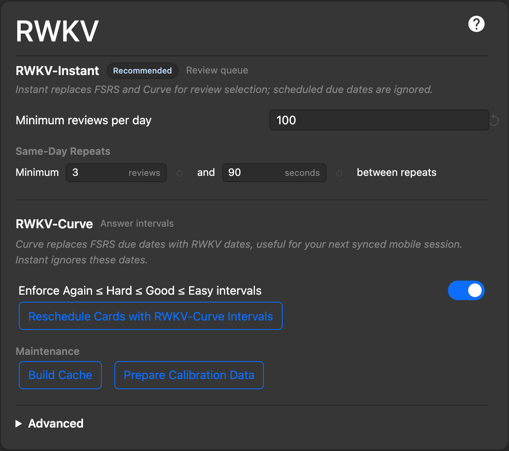
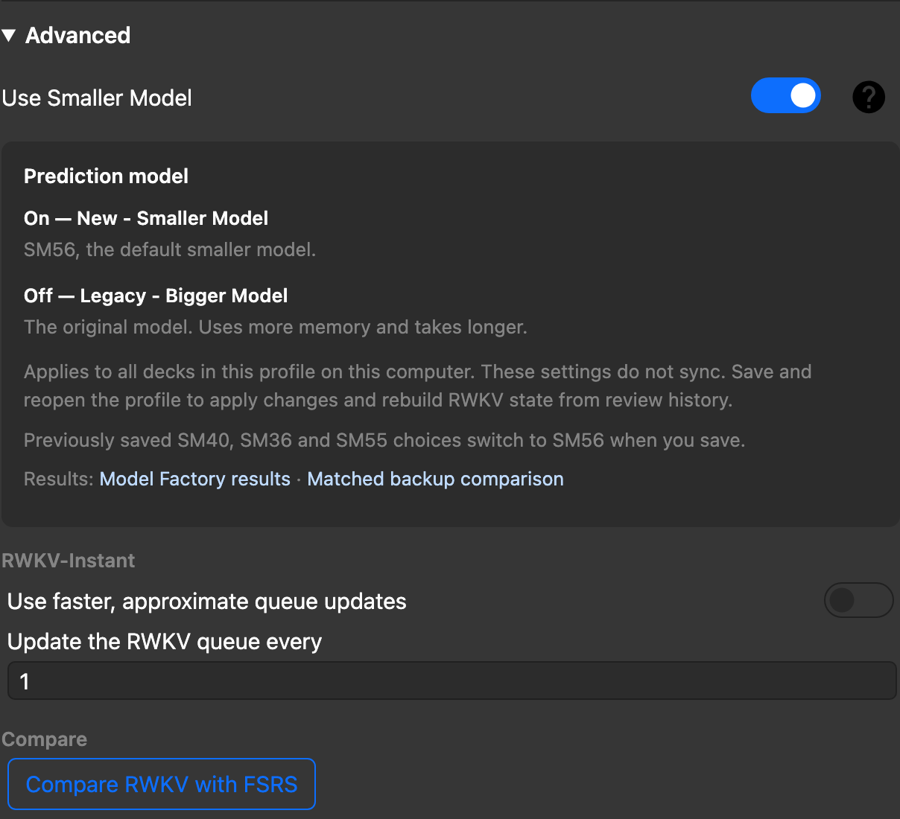
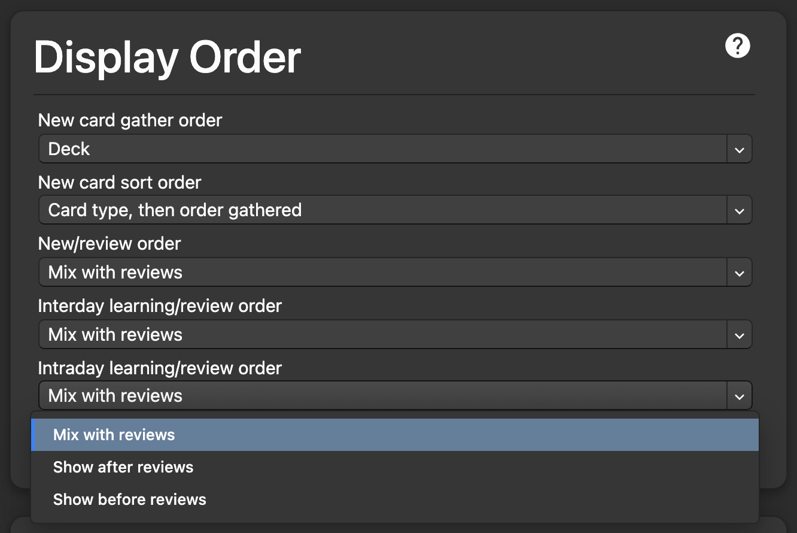

# Fork Release Notes

This file tracks changes specific to the Anki FSRS7 fork.
The machine-readable application version remains [`.version`](./.version).
Upstream Anki changes are inherited when the fork is synchronized, but are not
repeated here unless they materially affect a fork feature.

## Maintenance

- Add user-visible fork changes to **Unreleased** in the same commit as the
  change.
- Split each release into **User facing changes** and **Technical details**.
  Group **User facing changes** under **New Features** and **Fixes**; keep storage optimizations, historical model benchmarks and implementation details in **Technical details**.
  Describe practical outcomes in the first section. Put implementation context,
  upstream references, compatibility notes, measurements, and verification in
  the second section.
- Include concise, verified before/after measurements where available and useful. Prefer these figures to illustrative scenarios; do not force an example onto every change or invent measurements.
- For cumulative release notes, use the latest normal (non-prerelease) release as the baseline, include all intervening prerelease and draft changes, and verify coverage against the exact release commit.
- Keep release-note paragraphs on one source line and let GitHub wrap them.
  Use line breaks for Markdown structure, not a fixed prose width.
- Include fixes, new behavior, compatibility changes, migrations, and notable
  performance or security changes. Omit routine formatting, CI-only changes,
  and upstream synchronization without a notable impact.
- Before publishing, rename **Unreleased** to the intended application version
  and date, then add a new empty **Unreleased** section above it. Release build
  numbers may be recorded separately when useful.
- Treat [`.version`](./.version) as authoritative if this file and the build
  version ever disagree.
- The release workflow includes the matching version section (or **Unreleased**
  for an unsigned draft build) before GitHub's generated commit list. Keep that
  section complete for the exact release commit; an empty section blocks release
  creation.

## Unreleased

Changes since [build 115](https://github.com/JSchoreels/anki/releases/tag/26.09.4%2Bfsrs7.build.115). The application version is now `26.11b1+fsrs7`.

**Based on [Anki 26.11b1](https://github.com/ankitects/anki/releases/tag/26.11b1)**, plus its later security fixes: editor fields can no longer contain `<base>` tags, and ammonia 4.1.9, url 2.5.9 ([RUSTSEC-2026-0592](https://rustsec.org/advisories/RUSTSEC-2026-0592)) and urllib3 2.8.0 are used. Notable upstream changes:

- Numerical field searches and ranges, such as `frequency>500`.
- `{{type:ci:Field}}` checks typed answers without regard to case.
- The Browser no longer freezes after selecting or restoring a large selection.
- A full sync downloads to disk instead of holding the collection in memory.

### User facing changes

#### New Features

- **Choose what to share with the scheduling research campaign.** Open **Sharing preferences** from the invitation or the Support menu to select note fields and card template layouts separately for each note type. All fields start selected. Manual and monthly uploads reuse your profile’s saved choices, and newly added fields and templates stay unchecked until selected. Uncheck a note type to share none of its fields or layouts. **Include all** and **Exclude all** apply to every note type, or to the note fields currently listed by the field search. Expand **How uploads work** in the invitation to see how Anki sends the collection. The invitation summarizes what is currently selected. Tags, deck and preset names, deck descriptions, filtered-deck searches, and add-on card data are always left out.
- **See collection upload progress.** One dialog follows a manual upload from preparing the collection to Dropbox's receipt, with the percentage sent and a Cancel button. Interrupted chunks of large uploads are resent automatically. Monthly uploads run in the background, skip a month with no new reviews, and report a failure only after three attempts in a row fail.
- **Contribute to the Anki-RWKV data campaign.** An online startup invitation shows campaign progress and prepares a media-free collection on request. Choose **Upload my collection** to send it once, follow its progress in Anki, and receive a thank-you when Dropbox confirms receipt. Collections over 150 MB upload in chunks through the campaign’s Cloudflare service. Each snapshot has a UTC timestamp and a random collection ID that syncs across your devices. Choose **Later** for a one-day reminder or **Don’t remind me** to opt out for this profile. After a confirmed donation, Anki waits a month before asking again. Select **Automatically upload every month** to send future media-free copies at the first eligible profile startup. Open **Support** to donate on demand, view the campaign, or turn off monthly uploads. You can also turn them off in Preferences → Syncing.
- **Export execution logs from Help.** Anki keeps recent desktop Python console output across restarts. Choose **Export Execution Log…** to save the retained history, or **Post Logs on GitHub Issues…** to review the full log and open a GitHub issue draft. Anki masks recognizable passwords, tokens and email addresses before writing its Python logs. It also applies redaction to older execution logs when you export them or prepare a GitHub attachment. Anki opens a folder containing the reviewed log file, ready to drag into the issue description.

- **Preview a study session while editing Deck Options.** See cards from the selected deck, their positions, and why they were chosen or postponed. Try the same settings on a 120-card example or a learning-steps example. Learning and Reviews group related controls together. The Classic view switch applies to all decks in the profile.
- **Study suspended cards under your daily new-card limit.** In Learning, choose Suspended before New, New before Suspended, or Mix new and suspended cards. In Classic view, use **Include suspended cards in the learnable pool** under Daily Limits. Answering a suspended card unsuspends it and resumes its existing schedule.
- **Gather new cards by a note field.** In Learning, or Display Order in Classic view, choose a field and ascending or descending order. Numbers sort by value. Mixed ranks ordinary new and suspended cards together. Either “before” option ranks by field within each group.
- **Set Easy Days in 25% increments.** Seven weekday sliders let you target 0%, 25%, 50%, 75%, or 100% of a normal review load.
- **`is:due` follows RWKV-Instant.** In the Browser, filtered decks and the custom study option for due cards, `is:due` now matches review cards by RWKV-Instant eligibility when their deck's preset uses RWKV-Instant, as the deck list does. Other cards still use their due dates. The daily minimum of RWKV reviews is not added. The new `is:fsrs:due` always uses due dates. If no RWKV-Instant preset exists, `is:due` is unchanged and runs without RWKV.

- **More RWKV-Instant workload scenarios.** Compatible add-ons such as Search Stats Extended can request five or seven answer-outcome scenarios instead of three. The lowest and highest stay one standard deviation from the central scenario, and the others are evenly spaced in between. Three scenarios give the same results as before. Lapses follow the answer outcome closely, but reviews due can cross between neighbouring scenarios, especially with five or seven, because each simulated session moves the model differently. Read them as a range, not a ranking.
- **Keep learning new cards when only minimum reviews remain.** With RWKV-Instant, the new **New cards ignore minimum reviews** option in Daily Limits introduces new cards before reviews that are pulled forward only to reach **Minimum reviews per day**. New cards take their share of the daily limits first, are shown before those reviews, and do not count toward the minimum. Without it, a minimum equal to **Maximum reviews/day** can leave no new cards while the review limit also applies to new cards. The deck list counts and the RWKV-Instant workload forecasts follow the same order. With **Show new cards before reviews**, the order is new cards, due reviews, then minimum reviews. The option is greyed out while the minimum is 0. In both views, **Minimum reviews per day**, the new option and **Also honor subdeck minimums** now sit in Daily Limits, and their help entries are listed there only while RWKV-Instant is on.
- **See how many RWKV-Instant reviews are still possible today.** When fewer reviews are due under RWKV-Instant than the daily limit allows, the reviewer, the deck overview and the deck list show the remaining allowance next to the review count, for example `50 (≤100)`. Its tooltip explains that more cards can become due as recall drops and, in the reviewer and overview, how many due cards are waiting for spacing between reviews. The allowance is hidden when the daily review limit is 9999 (no limit).
- **Explore recall by answer time.** Card Info estimates the chance of answering within 2, 4, 6, 8, 10, 15, 20 and 30 seconds if you press Good. Its graph shows the chance of recalling within each time limit (Hard, Good or Easy), alongside the chances of Good or better and Easy. The answer time is the whole time on the card, front and back: from the question appearing to your grade press, capped at the preset's maximum answer seconds, so "recalled within 8 s" means recalled and answered within 8 s, reading the back included.

- **Answer-time estimates in every model size.** Big, Small and Tiny all show the estimated answer time and the recall-by-answer-time chart in Card Info, also for cards last reviewed today (only a card's first review has none). Big shows them with RWKV-Instant alone too; Small and Tiny show them with RWKV-Curve and with RWKV-Instant alone, since their longer Instant-Only models have their own answer-time heads. On held-out reviews, each size's answer-time LogLoss is 17% to 18% lower than a per-button running-median baseline.

- **More reliable recall-by-answer-time chart.** Card Info's chance of a recalled, Good or Easy, or Easy answer within each time (reading the back included) is now recalibrated on your own history: the rolling per-user recalibration of the timed answer-time probabilities (SM175) refits, every 7 days, one Platt scaling per answer set and threshold on your latest 30,000 reviews with a recorded time from earlier days, and keeps the raw values until 1,000 of them exist. On 732 held-out users all 21 timed cells from 2 to 10 seconds become reliable for every model size (13 to 16 of 21 before), and LogLoss of Good or Easy within 4 seconds is 0.7% to 1.2% lower than raw (the rolling recalibration on the 732 set (SM125), for the Big models (SM128) and for the six-layer Tiny (SM140)); about 96% of reviews had enough history. Recall, button probabilities, intervals and scheduling are unchanged. The fit runs in the background when Card Info opens, once per 7-day block; until it is ready the chart shows the raw values. The Rust replay reproduces the reference recalibration on synthetic users within 4.5e-9 ([details](docs/rwkv-answer-time-recal-2026-11-26.MD)).

- **New Small and Tiny models.** Small's two-head model is now the show-time two-head cool-down for Small (SM118): Curve LogLoss 0.113% lower and Instant LogLoss 0.100% lower than the show-time retrain (SM92) on 722 held-out users. Tiny now runs the six-layer Tiny (SM130), two models with 185,057 parameters each instead of 311,786 (six layer steps instead of twelve; state replay about 39% faster than the earlier Tiny pair on 32,000 synthetic answers); its state per card and note is unchanged (1,315 B each). Its LogLoss stays within 0.6% of Small's (Curve +0.47%, Instant +0.52% to +0.56%). Profiles using Small or Tiny rebuild their RWKV state once after updating.

- **More accurate Small and Tiny Instant predictions.** Small and Tiny use new Instant-Only models trained longer with the Big Instant model as a teacher. Held-out Instant LogLoss improves by 0.094% for Small (0.276191 to 0.275933) and 0.099% for Tiny (0.27672 to 0.276446), with the same memory and disk use. Profiles that use RWKV-Instant rebuild their RWKV state once after updating.

- **More accurate Tiny Instant predictions with both Tiny models.** When Tiny runs its two models (the default), the Instant prediction now combines both: the Tiny instant ensemble (SM170) averages the logits of the six-layer Tiny Instant-Only model (SM130), weight 0.69, and the six-layer Tiny two-head model (SM130)'s Instant head, weight 0.31. Instant LogLoss is 0.067% lower than the Instant-Only model alone on 732 held-out users (deploy-time ensemble test (SM160)) and 0.062% lower [0.057%, 0.066%] on 1,385 users (decisive check (SM169)), at no extra cost since both models already run on every review. The review screen, Card Info, the statistics graphs and the button probabilities all show the combined value. Big, Small, Tiny with the one-model option, Tiny with RWKV-Instant alone, the Curve predictions and the intervals are unchanged; no state is rebuilt.

#### Fixes

- **Keep macOS dialogs responsive during update checks.** When Anki finds an update while another dialog is open, you can finish using that dialog and respond to the update prompt afterward.

- **Start RWKV campaign uploads sooner.** If the first server address is slow to connect, Anki tries the next address after 250 ms. On an affected connection, establishing HTTPS took 0.33 seconds, down from 30.4 seconds.

- **See the campaign invitation sooner.** When a reminder is due, Anki fetches the campaign details while opening your profile so the invitation can appear as soon as startup sync and the lookup finish.

- **Use the latest RWKV-Instant scores when choosing the next card.** With **Precompute next card** off, Anki now updates the full queue after each answer for every sort order. Descending retrievability uses the updated ranking, and orders such as random or due date pick from the updated set of eligible reviews. The workload forecast follows the same rule.
- **Find the next low-retrievability review more reliably.** With ascending R and faster approximate RWKV-Instant updates, Anki now also rechecks cards just outside the previous leaders. In a 351-decision backtest, the default 512-card update matched the full rescore 351 times, up from 348. At 64 cards it matched 263 times, up from 211.
- **See which daily limit postponed a card.** Session Preview shows how many reviews, learning steps and new-card slots are queued. It identifies the limit that held a card back and keeps three-digit positions on one line.
- **Keep RWKV due totals consistent when returning to the deck list.** The list waits for the reviewer’s background queue refresh before calculating how many reviews are due before daily limits.
- **`is:rwkv:due` uses scores for its own search.** Browser searches with `is:rwkv:due`, `is:rwkv-curve:due` or `is:due` now prepare RWKV scores for that search, instead of reusing scores prepared for another search, filtered deck or Stats page. If no scores are ready, `is:due` uses due dates and `is:rwkv:due` matches nothing. Filtered decks and due-card custom study sessions whose search uses `is:due` need the RWKV state, as `is:rwkv:due` decks do.
- **Stop showing the due-date count in place of an RWKV count.** When RWKV-Instant counts cannot be computed for a deck, the deck list now shows `?` with a tooltip giving the due-date count, instead of presenting that count as the RWKV one. While RWKV is busy, the deck list shows `…` and retries automatically, so you can leave it open to see the due counts. A failure in one deck no longer stops the others, and stale results are retried twice first.
- **Keep Anki usable while an add-on forecast runs.** The "Recovering RWKV state..." dialog no longer pops up and blocks Anki while an add-on forecast or simulation (such as Search Stats Extended) is running. Anki waits until it finishes and recovers only if the RWKV state was lost meanwhile.
- **Show a readable message when an add-on forecast is interrupted.** If the RWKV state changes while an add-on workload forecast (such as Search Stats Extended's) is finishing, the add-on now reports that the forecast was invalidated by a state change, instead of showing only an internal error name.
- **Keep RWKV counts available when scoring overlaps.** A busy scorer preserves installed queue scores. The deck overview shows an ellipsis while it waits for fresh counts, and its callbacks respect navigation into study.
- **RWKV state stays valid on cards with thousands of reviews.** Card and note state is now stored as int8 rows with float16 scales for every model size. The earlier int4 card state could drift on very long card histories, stop predicting for that card, or crash the state build. The state is rebuilt once after updating. Per card and note with both models, Big stores 46.4 KB (was 39.1 KB), Small 7.8 KB (was 7.1 KB) and Tiny 5.3 KB (unchanged).
- **Faster RWKV state builds.** On a collection with 226,546 reviews, the Small model pair rebuilt in 7.1 seconds, down from 8.7 seconds.
- **Faster single-thread RWKV replay on Apple Silicon.** On an M1 Max, replaying cards with 24 reviews went from 14,630 to 15,047 reviews/s on Small (+2.9%) and from 27,090 to 28,170 on Tiny (+4.0%).
- **Faster RWKV state rebuilds on Apple Silicon.** On a 10-core M1 Max, native cache rebuild time for 205,785 synthetic reviews fell from 17.67 to 13.87 s on Big, from 5.24 to 4.50 s on Small, and from 3.06 to 2.73 s on Tiny.
- **Faster full-queue retrievability refreshes.** Refreshing all 7,533 cards in a deck with RWKV-Instant took 153 ms on repeated runs, down from 163 ms.
- Optimize All preserves saved parameters when a preset’s search fails. Check Database identifies presets with an invalid review-history cutoff so the date can be corrected in Deck Options.
- Scheduled imports recalculate memory state when the destination uses different parameters. Answer-button states and add-on edits now use the same displayed Stability as the saved card.
- Recall searches score the cards selected by the rest of the query, and the no-review workload estimate uses both FSRS7 memory components and each card’s last review time.
- Recall searches, graphs and ordering use the Default preset when a card's home deck or preset is missing. The Browser keeps the other columns readable when it cannot calculate retrievability.
- When reviews are sorted by retrievability, learning-only queue requests include intraday cards that are due now as well as cards available through learn-ahead.
- **Keep short delays in the Review queue.** With **Skip learning and relearning queues with FSRS/RWKV** enabled, presets still follow their configured steps. FSRS and RWKV-Curve can also schedule model intervals under one day when same-day reviews are enabled. Both become due in Review at the scheduled time.
- When a damaged card has no usable stability or review history, FSRS7 repair clears only its memory estimate. The card keeps its schedule and review history. Repairs skip unrelated legacy decks and include cards routed to FSRS7 by add-on rules.
- Anki can still open the collection if it cannot migrate the FSRS7 memory state. Review answer buttons keep their expected interval order when delay calculations would otherwise put them out of order.
- Card Info and batch memory metrics use the latest rated scheduling review when the saved review time is missing. With no such review, they estimate recall from the card's schedule and leave the review time empty.
- Workload simulations now start existing FSRS7 cards at their full memory state's 90% recall interval, within the range the simulator can represent. Later simulated reviews still use a single stability value.
- **RWKV state refreshes after an AnkiConnect sync.** RWKV-Curve intervals and the RWKV state now update after an AnkiConnect sync that brings reviews from another device. Before, they stayed on the pre-sync state until you restarted Anki.
- **No more crash on negative answer times.** The RWKV state build no longer crashes when old reviews have a negative answer time, for example from a past clock change. Such times are treated as 0 s.
- **Faster RWKV startup with large add-on config values.** When an add-on stores a large value in the collection config, the per-card reset-boundary lookup no longer reads that value for every card. In a 66,000-card test collection with a 200 KB value, the lookup took 0.03 s instead of 1.8 s.

### Technical details

- Apple Silicon groups two Small or Tiny card and note writes when the replay pool has one worker. Big and multicore Apple Silicon rebuilds use one card per solve. [M1 Max measurements](https://github.com/JSchoreels/anki/blob/main/docs/rwkv-mac-speed-todo-2026-11-25.MD)
- ARM64 projections accumulate four rows in registers and use a dense loop when all input scales are nonzero. The recurrent kernel computes each output alongside its state row, and the low-rank solver handles small groups and fully active rotations more efficiently. On macOS ARM64, long multicore Big rebuilds process up to 16,384 reviews per internal chunk, trading additional scratch memory for faster replay. The M1 Max benchmark compares the serialized states and all prediction fields bit for bit. [Rebuild measurements and bitwise checks](https://github.com/JSchoreels/anki/blob/main/docs/rwkv-mac-speed-todo-2026-11-25.MD#multicore-rebuilds-with-the-arm64-kernels)
- Updated the Rust `url` dependency to 2.5.9 to address [RUSTSEC-2026-0592](https://rustsec.org/advisories/RUSTSEC-2026-0592), a crash in URL origin handling.
- **New cards ignore minimum reviews** is a new preset field, `rwkv_review_new_cards_ignore_minimum_reviews` (deck config field 90, default off). Like the other RWKV fields it is stored in the preset's `other` data under `jschoreels.rwkv`, syncs with the preset, and is ignored by upstream Anki. When it is on, the queue builder runs the daily-minimum pass after gathering new cards and appends the minimum reviews after the new/review merge; deck-list counts cap minimum reviews against the review capacity left after new cards. Instant workload forecasts apply the same order (due reviews, new cards, then the minimum pass) and queue the minimum reviews after the new/review mix, before the intraday-learning mix. With the option off, forecasts are unchanged.
- **RWKV 6-bit low-rank factors (SM162):** the default profile precision is now `compact_lowrank`, whose factor width follows the model's size: Big and Small store int6 factor codes (new precision byte `0x26`, the training repository's `w8+lr2.16.4q6x8`: the same rank-2 / rank-4 schedule and int8 shift vectors, each factor vector a float16 scale of max/31 and codes in [-31, 31] bit-packed four in three bytes), Tiny keeps int8 factors (`0x28`, `w8+lr2.16.4q8x8`). Each size runs only its own models, so a pair never mixes widths. About 85% (Big) and 71% (Small) fewer state bytes than the int8 rows (was 82% and 66%); Tiny unchanged at 65%. The width is resolved when a model loads, from its card layers (one card layer: Tiny). `compact_lowrank_int8` (int8 factors on every size) and `compact_lowrank_int6` (int6 on every size) stay valid native values; saved `compact_lowrank_int8` profiles move to the new default. State-cache version 16 rebuilds the cache once; a stored state of either width still decodes, and a write onto a block of the other width reads its factors as the next solve's basis. Downgrade: an older build ignores the version-16 cache and the unknown profile value and rebuilds with its own default (int8 factors); a `0x26` state it cannot decode falls back to a full rebuild. Parity: the int6 rounding and packing match the scorer bit for bit on synthetic vectors (`rwkv_state_lowrank_int6_rounding_matches_the_scorer`), the codec matches the scorer's `LowRankCodec` on every synthetic head write, and the show-time big model (SM91s2) matches the scorer's `w8+lr2.16.4q6x8` outputs on two synthetic users within the low-rank end-to-end rule (per-user LogLoss within 3e-4, mean within 1e-4; `rwkv_legacy_lowrank_state_matches_the_scorer`).
- **RWKV low-rank state:** the default profile precision is now `compact_lowrank_int8` (precision byte `0x28`): each card and note head is stored as a rank-2 product below 16 answers and a rank-4 product from the 16th answer, with int8 factor vectors (one float16 scale each) and int8 shift vectors; about 82% (Big), 66% (Small) and 65% (Tiny) fewer state bytes than the int8 rows. Saved `compact_cards_int8` profiles move to the new default; state-cache version 15 rebuilds the cache once. Report: `docs/rwkv-lowrank-state-2026-11-23.MD`.
- **RWKV state format (earlier in this release candidate):** the default profile precision was `compact_cards_int8` (precision byte `0x18`: int8 rows with float16 row scales, int8 shift vectors with one float16 scale each); `compact_cards_int4` (`0x14` cards) is a non-default option. Saved `cards_int4_notes_int8` profiles move to the default, and the changed replay key and state-cache version 14 rebuild the cache once. A state that cannot be decoded now fails a replay with an error, which falls back to a full rebuild, instead of panicking. Long-card regression, scorer parity and sizes: [state format report](https://github.com/JSchoreels/anki/blob/main/docs/rwkv-rc-state-format-2026-11-21.MD). The bundled weights ship with `WEIGHTS-NOTICE.md`: they are not under the code's license.
- Legacy SQL recall functions use the displayed Stability (S90) as the interval at which predicted recall reaches 90%.
- [JSchoreels/anki#30](https://github.com/JSchoreels/anki/issues/30): `Collection.sync_collection` sets a sticky `_rwkv_sync_changes_pending` flag when a sync brings remote changes. `_rwkv_sync_will_start` no longer hides it, and only `refresh_rwkv_state_after_sync` clears it, so a following no-change sync (AnkiConnect calls `sync_collection` directly, then `mw.onSync()`) still triggers the refresh.
- [JSchoreels/anki#32](https://github.com/JSchoreels/anki/issues/32): the feature scalers clamp their inputs (duration to at least 0 ms, `log_elapsed` to `x <= -1` giving 0, `scale_day_offset_diff` to at least -1) so a negative revlog `time` can no longer produce a NaN that fails the compact-state load with "non-finite shift". Valid inputs are bit-identical.
- [JSchoreels/anki#31](https://github.com/JSchoreels/anki/issues/31): the history-reset SQL reads the `rwkvHistoryReset_` key range once in a `limit -1` subquery (materialized with an automatic index) instead of a per-card point lookup in `config`, which read the overflow pages of large unrelated values. The same expression exists in `rslib/src/storage/revlog/mod.rs` and `qt/aqt/rwkv_scheduler.py`.
- RWKV search scores carry an `instant_due` flag (new `RwkvStatsGraphScoresRequest.instant_due` field). Browser and `find_cards` searches use only scores whose normalized search key matches. Filtered deck builds use scores published under a reserved key, once, for all their filters. For each scored review card whose home preset (original deck for cards in a filtered deck) uses RWKV-Instant, `is:due` uses the same eligibility as `is:rwkv:due`. Known differences from the deck list: the deck list applies the selected deck's preset to its subdecks and leaves out cards in filtered decks, and its intervening-review counts cover the selected deck's tree rather than each card's home deck.
- The FSRS engine includes the training and simulation fixes and the updated FSRS-6 optimizer from [7.0.0](https://github.com/open-spaced-repetition/fsrs-rs/releases/tag/v7.0.0). Anki now uses the engine to reconstruct memory states from legacy add-on writes and truncated review histories. [fsrs-rs #485](https://github.com/open-spaced-repetition/fsrs-rs/pull/485)
- The [RWKV FAQ](https://github.com/JSchoreels/anki/blob/main/RWKV_FAQ.md) explains how recent reviews affect scheduling, how to interpret due counts and forecasts, and how to compare schedulers.
- Full replay resolves each card’s history-reset boundary once and packs canonical review rows directly into the existing replay format. The macOS desktop benchmarks produced byte-identical saved states and retrievability scores for the Small, Tiny and Big model pairs.
- Exact queue refreshes reuse converted inputs for unchanged cards. They fetch current queue membership and retention targets and recalculate elapsed time before scoring.
- **Answer-time thresholds:** The time head's bin probabilities are interpolated in log time. The graph combines them with the active RWKV answer-button probabilities to estimate the joint chances of each outcome and answering within each threshold; it does not measure the effect of answering faster. See [answer-time evaluation](https://github.com/JSchoreels/anki/blob/main/docs/rwkv-answer-time-2026-11-01.MD).

- **Answer-time heads for the family (SM117):** Separate head files beside the show-time big model (SM91s2), the show-time retrain (SM92, replacing its earlier head), the Tiny two-head model (SM106) and the show-time instant-only big model (SM99); every two-head weights file is unchanged byte for byte, so their cached state stays valid. The native runtime reads heads on the big engine (1,306 inputs: the residual after the encoder and after each of the five streams, the 512-wide instant hidden layer and 26 history features). The heads were trained on show-time inputs with same-day reviews included (head format 2). A head always runs on the model it was trained on: one model alone uses its own head; a pair uses its Instant-Only model's head when it has one (every Instant-Only model of the family but the Small Instant-Only model (SM98) and the Tiny Instant-Only model (SM101), which stay bundled, unused), else its two-head model's. Parity with the PyTorch heads on synthetic histories, f32 and int8 head files, within 1e-5 per bin probability. See [answer-time heads for every size](https://github.com/JSchoreels/anki/blob/main/docs/rwkv-time-heads-2026-11-16.MD).

- **Release-candidate models (2026-11):** Small = the show-time two-head cool-down for Small (SM118, `sm118`) + the longer Small Instant-Only model (SM113); Tiny = the six-layer Tiny two-head and Instant-Only models (SM130, `sm130th` / `sm130io`, arch `w64-c1-d2p1u1`); Big unchanged. The small engine picks one of three compiled layer plans from the weights (engine, tiny, six-layer) and each model key checks its layer counts; the answer-time head width follows the plan (346 inputs for the six-layer Tiny's two layer rounds, heads from SM138; SM118's head from SM119). Synthetic-user parity fixtures for all three new models. See [release candidate](https://github.com/JSchoreels/anki/blob/main/docs/rwkv-rc-2026-11.MD).

- **New Instant-Only models:** the longer Small Instant-Only model (SM113) replaces the Small Instant-Only model (SM98), and the longer cool-down for Tiny (SM115) replaces the Tiny Instant-Only model (SM101), on the 732-user held-out set with show-time inputs (-0.094% [-0.103, -0.085] and -0.099% [-0.108, -0.091] instant LogLoss). Same architectures and state sizes; the Small Instant-Only model (SM98) and the Tiny Instant-Only model (SM101) stay bundled, unused. Both new models carry their own answer-time head, trained in the time heads for the new candidates (SM119) run (format 2, show-time inputs).

The existing model selector and released RWKV family are shown below for context.

## 26.09.4+fsrs7.build.115 — 2026-11-14

Changes since the last normal release, [build 110](https://github.com/JSchoreels/anki/releases/tag/26.09.3%2Bfsrs7.build.110). The application version is `26.09.4+fsrs7`, incorporating [Anki 26.09.4](https://github.com/ankitects/anki/releases/tag/26.09.4).

### User facing changes

#### New Features

- **Choose an RWKV model size.** Deck Options offers Big, Small and Tiny cards with estimated memory and disk use, accuracy and relative replay time. Small is the default. At the default storage precision, Tiny's combined Curve and Instant state uses about 5.3 KB per card and note instead of Small's 7.1 KB, or 26% less, with a small accuracy tradeoff. Each size uses its own Curve and Instant models; **Use one model for RWKV** reduces state use when both schedulers are enabled.

- **Switch models without reopening the profile.** Saving a choice now offers to rebuild RWKV state immediately when the underlying models change. If the model layout stays the same, the existing state is kept.

- **More accurate Big and Small Instant predictions.** Each size has a model trained for the instant recall query. For Big, held-out Instant LogLoss fell from 0.276183 to 0.275894. With both RWKV schedulers enabled, the dedicated Big model adds a second state; **Use one model for RWKV** retains single-model state use.

- **See estimated answer time.** When the Small Curve model is active, Card Info can show typical answer time by button and the expected answer time for cards last reviewed on an earlier day. On held-out reviews, its time LogLoss was 17.3% lower than a per-button running-median baseline.

- **Compare FSRS-6 models in statistics add-ons.** Current predictions use each home deck's saved FSRS-6 parameters; historical comparisons use held-out predictions trained on earlier review folds. Preparing the comparison does not change card state or overwrite the active model's prediction cache.

- **Forecast RWKV-Instant workloads.** Compatible add-ons can simulate Instant reviews using recent answer timing and outcomes, daily limits, learning steps and selected review order. The graph can show simulated days as they finish; larger forecasts may still take time.

- **Support smoother RWKV recall forecasts.** Compatible add-ons can project recall at several future times without holding the collection worker throughout scoring. In an offscreen test with an updated forecast add-on and 8,747 cards, the longest sampled collection-task wait during repeated refreshes fell from 19.2 seconds to 1.1 milliseconds. Overlapping identical requests share work, and predictions wait for the RWKV backend between batches.

#### Fixes

- **Correct FSRS training and simulations.** FSRS-7 optimization with same-day reviews disabled now preserves valid model parameters. FSRS-6 simulations keep stability from falling on a Hard answer, and initial stabilities stay ordered by answer button. Re-optimize an affected preset to obtain corrected parameters.

- **Balance Instant minimum reviews across the selected deck.** The minimum chooses the lowest-recall cards across its subdecks. The deck-specific **Also honor subdeck minimums** option retains separate minimums where desired.

- **Avoid unnecessary RWKV state reloads.** When a change such as selecting a deck leaves the review history untouched, Anki can confirm that the resident state still matches instead of loading it again. One collection avoided about 1.4 seconds of CPU work.

- **Keep RWKV state reliable after template changes and sync.** Fix a crash caused by applying an answer twice after editing a card template, and refresh state after a sync add-on receives remote changes.

- **Improve Instant forecasts.** Respect daily limits, use the model's actual queue scores, estimate answer duration from recent review history and recall, and calibrate the range of answer outcomes. In one 28,925-card measurement, a two-day single-path forecast fell from 66.5 to 45.7 seconds; in a separate backtest, the estimated review time improved from 12.3 to 9.6 seconds against 9.6 seconds observed.

- **Optimize FSRS faster with less memory.** On a copied deck with 188,183 rated reviews, optimization without the optional health check or Dynamic DR fell from 1.57 to 0.36 seconds and peak process memory from 259 to 165 MiB. A subsequent improvement reduced a comparable run from 365 to 316 ms and 167 to 114 MiB. Results matched the earlier implementation.

- **Reduce FSRS calibration memory.** On the same deck, generating final-fit predictions and five validation folds used 125 MiB instead of 236 MiB, with matching prediction rows.

- **Honor answer-button retention rules with RWKV-Curve.** Dynamic Desired Retention grade rules now select the RWKV target without replacing its button intervals with FSRS estimates.

- **Speed up normal sync uploads.** Pending small changes are combined into fewer requests; the improvement depends on the number of changes and network latency.

- **Include Anki 26.09.4 security fixes.** Address shared-deck code-execution vulnerabilities involving embedded editor content and macOS **Show in Folder**, and update bundled certificate and installer dependencies.

### Technical details

- **RWKV model family:** Big uses SM91s2 for Curve and SM99 for Instant, Small uses SM92 and SM98, and Tiny uses SM106 and SM101. A paired runtime replays both models; Instant-only configurations use only the Instant model and fall back to FSRS for intervals. Model identities determine whether cached state must be rebuilt. Small's SM92 has the answer-time head; Big and Tiny do not. Details and accuracy methodology: [family wiring](https://github.com/JSchoreels/anki/blob/main/docs/rwkv-sm114-2026-11-13.MD) and [answer-time evaluation](https://github.com/JSchoreels/anki/blob/main/docs/rwkv-answer-time-2026-11-01.MD).

- **Model-size timing:** On one Windows collection copy with 13,980 reviewed cards and 225,132 reviews, estimated cold state builds with both schedulers were 23.3 seconds for Big, 7.8 seconds for Small and 7.2 seconds for Tiny. These estimates add a separately measured Python cost to native replay; actual time depends on hardware and collection. See the [benchmark and methodology](https://github.com/JSchoreels/anki/blob/main/docs/rwkv-speed-test-2026-11-14.MD).

- **FSRS-6 comparison API:** Current scores use the home-deck config's saved parameters; an independent calculation returns saved-model and chronological validation-fold predictions without writing either to Anki's prediction cache. Add-on-owned caches can use the history and rollover fingerprint to detect changes. See [FSRS presets](https://github.com/JSchoreels/anki/blob/main/docs/fsrs-presets.MD#fsrs-6-comparisons).

- **FSRS fixes:** Backport upstream [initial-stability ordering](https://github.com/open-spaced-repetition/fsrs-rs/pull/477), [FSRS-6 Hard-answer simulation](https://github.com/open-spaced-repetition/fsrs-rs/pull/479), and [FSRS-7 training without same-day reviews](https://github.com/open-spaced-repetition/fsrs-rs/pull/481). These changes do not switch the fork to the separate compact FSRS-6 training optimization.

- **FSRS optimization and calibration:** Reuse compact histories for FSRS-7 training and FSRS-6/7 evaluation and calibration. Skip simulator preparation when Dynamic DR is disabled and avoid duplicating health-check items. Compact per-review predictions were merged upstream in [fsrs-rs #471](https://github.com/open-spaced-repetition/fsrs-rs/pull/471); the fork remains pinned to a specific revision with the fixes above. See [performance](https://github.com/JSchoreels/anki/blob/main/docs/fsrs-compact-performance.MD), [calibration profile](https://github.com/JSchoreels/anki/blob/main/docs/fsrs-compact-prediction-profile-2026-11-03.MD) and [optimization profile](https://github.com/JSchoreels/anki/blob/main/docs/fsrs-optimization-profile-2026-11-03.MD).

- **RWKV ordering, sync and forecasting:** The selected deck's minimum is filled by absolute retrievability, with child minimums applied only when enabled. The forecast uses measured recall error, sampled answer outcomes, recent durations and the configured queue refresh. Standard sync hooks trigger reconciliation after remote changes, and invalid compact state reports its scope instead of panicking.

- **Recall projection API:** Add-ons can request future recall from the resident RWKV state, with cancellation and stale-state detection. Calls do not start a historical replay when the state is cold. The offscreen comparison sampled a collection task every 250 ms while refreshing the deck list three times; the legacy path completed 6 samples and the updated add-on completed 80. The add-on update is separate from this Anki release. See [RWKV recall projection](https://github.com/JSchoreels/anki/blob/main/docs/rwkv.MD#recall-projection-add-on-api).

- **Security and dependencies:** Update Ammonia from 4.1.8 to 4.1.9 for [RUSTSEC-2026-0533](https://rustsec.org/advisories/RUSTSEC-2026-0533); Anki uses the default sanitizer configuration, which the advisory says is not affected. Update `pulldown-cmark` for [RUSTSEC-2026-0433](https://rustsec.org/advisories/RUSTSEC-2026-0433), and include upstream fixes for [GHSA-j9v5-m549-cg6c](https://github.com/ankitects/anki/security/advisories/GHSA-j9v5-m549-cg6c) and [GHSA-gfvm-4968-jp9m](https://github.com/ankitects/anki/security/advisories/GHSA-gfvm-4968-jp9m).

- **Normal sync uploads:** Combine up to four existing collection chunks when their combined serialized request is below 512 KiB. The sync transaction and wire format are unchanged.

## 26.09.3+fsrs7.build.110 — 2026-11-01

Changes since the last normal release, [build 107](https://github.com/JSchoreels/anki/releases/tag/26.09.3%2Bfsrs7.build.107). The application version remains `26.09.3+fsrs7`.

### User facing changes

#### New Features

- **Choose when RWKV-Instant updates the review order.** The new Advanced option **Precompute next card before this card answer** is on by default and uses the existing queue for the next card. Turn it off to refresh the full retrievability order after each answer before the next card appears.

- **Default small RWKV model: small model, leak-free, cool-down from epoch 25 (SM63).** It replaces SM56 with the same size (**331,511 parameters, 8.3× fewer than the big model**, about 4.6 KB of state per card and note instead of 25.7 KB) and was trained without the signal that a card is deleted later, which live Anki never has. On the 732-user held-out set, with leak-free inputs for every model, its Curve / Instant LogLoss is **0.30003 / 0.27654**: **+0.12% / +0.12%** against the shipped big model and **+0.36% / +0.28%** against the big model (1 leak-free epoch). Against SM56 on the same inputs both heads are lower (−0.000630 Curve, −0.000908 Instant; clear of zero on all three held-out sets). **Use Smaller Model** now selects it; a successful Deck Options save upgrades SM40, SM36, SM55, SM56 or the earlier SM72 cool-downs (from epoch 15 and from epoch 20) to it, and Legacy stays available. Reopen the profile to apply it.

- **Compare RWKV and FSRS with a shared simulated learner.** The comparison starts both schedulers from the same cards and due dates, offers FSRS-based and RWKV-based learners, and can simulate temporary or persistent changes in performance. It replays recent reviews on other cards as background activity, and lets you switch between FSRS and RWKV estimates of the same simulated answers without rerunning. It shows matched-memory time estimates and lets you increase the sample size, retention resolution and number of paired runs.

- **See where FSRS and RWKV agree on scheduler efficiency.** An optional comparison runs both answer models on the same prepared data and shows whether both memory estimators favor the same scheduler at each tested retention. Run additional horizons to add rows to the agreement table.

- **Faster RWKV/FSRS comparisons.** Independent simulation runs can execute concurrently. Runtime depends on the collection, the amount of replayed background activity, and the computer.

- **Faster RWKV review statistics for compatible add-ons.** A batched native replay API lets Search Stats Extended compare recall with and without each review immediately or at a chosen later time without querying each answer separately.

- **Clearer RWKV model help.** The model descriptions and links now appear directly below **Use Smaller Model** in Deck Options → RWKV → Advanced.

#### Fixes

- **Keep RWKV-Instant review order up to date as time passes.** Full queue updates now use the current elapsed time for each card, so recently failed cards can return to their expected position without syncing.

- **Keep preview reviews from changing saved memory estimates.** Answering a card in a preview-only filtered deck no longer applies RWKV-Curve stability or a desired-retention override to the card.

- **Avoid reusing an earlier RWKV prediction when a card returns.** If a fresh prediction is unavailable for a new presentation, the answer no longer receives metadata from that card's previous presentation.

- **Preserve final desired-retention targets from compatible add-ons.** A per-answer target explicitly marked as final is stored as supplied instead of being mapped through Dynamic Desired Retention a second time.

- **Faster RWKV-Instant refreshes with Dynamic Desired Retention.** With precomputation off, preparing and predicting a warm full-deck queue on a copied collection with 7,449 candidates fell from a median of 157 ms to 117 ms. The complete delay between cards also includes score installation and the UI transition.

- **Faster Dynamic Desired Retention during review.** Warm single-card RWKV target lookups took a median of about 140 ms before and less than 1 ms after on ten sampled cards from a copied collection with 7,449 review candidates. Full-deck refreshes still depend on the configured rules and collection size.

- **Fewer temporary Unknown RWKV values in Card Info.** Its background requests can briefly wait for another prediction to finish, and discard results if the model state changes during the wait.

- **Removed the full int4 RWKV storage option.** Int4 note state could diverge on long note histories (one 9,539-step sequence reached about 1e32 by step 6000 and overflowed at step 6843). Storage choices are now f32, int8, and the default int4 cards + int8 notes. A profile that saved the full int4 choice uses the default after restarting, and its cached state is rebuilt from review history.

- **Include older synchronized reviews in RWKV.** Reviews received from another device are now included even when they are more than eight days old. Anki rebuilds affected RWKV states when needed, which can make the first refresh after sync take longer.

- **More reliable RWKV simulation results.** The standalone simulator updates RWKV after every answer by default, honors grade-order settings in its native path, and displays actual simulated review counts instead of forcing them to rise with retention. Comparison tooltips now show the correct relative change.

- **Stop repeated RWKV recovery after re-importing a deck as new.** Re-imported new cards start fresh in RWKV, including cards whose old history ended in Learning, while their previous review logs remain available. Imports with scheduling retain their source history. Existing caches rebuild once, and reset boundaries survive ordinary card edits on older clients.

- **New cards stay mixed with RWKV reviews.** Queue refreshes preserve progress through **Mix with reviews**, preventing new cards from being repeatedly postponed behind cards added to meet **Minimum reviews per day**.

- **Draft builds no longer offer older published updates.** Automatic checks and Tools → Check for Updates compare the full fork build number, preventing a newer draft from prompting to install an older or equal published build with the same application version. Newer builds continue to be offered.

- **Updated security dependencies.** This build includes patched Zstandard components and an updated Markdown parser to address reported security issues.

### Technical details

- **RWKV elapsed-time refresh:** Full queue scoring recalculates cached candidates' elapsed times from their last-review or creation timestamps. On synthetic decks, median input preparation over nine updates with one simulated newly answered card each changed from 1.19 ms to 5.54 ms for 2,000 cards and from 2.45 ms to 27.26 ms for 10,000 cards. Every cached input needed updating; these measurements exclude prediction, score installation and UI transitions.

- **RWKV review ordering:** The default reuses the previously computed score map and refreshes in the background. Disabling precomputation refreshes the full candidate set after each answer, independent of the interval and approximate-candidate settings. Card Info waits up to 100 ms for prediction access off the UI thread and retries if the state changes or remains busy.

- **Dynamic Desired Retention lookups:** RWKV uses the provider's single-card API for one-card work and falls back to the bulk API when necessary. Searches that require `cid:` and exact FSRS metrics prepare those metrics only for the specified cards; other searches retain their existing behavior. On the same copied collection with a warm provider, the ten-card median was 141 ms for the previous one-card bulk lookup and 0.25 ms for the new RWKV lookup. Full-deck rule resolution remained about 316 ms with the tested rules, separate from the approximately 40 ms prediction stage with the earlier SM72 cool-down from epoch 15.

- **RWKV queue input preparation:** Dynamic Desired Retention targets are applied while constructing native review inputs, avoiding a second copy of each changed input, and stable preset IDs use a bounded cache. Twelve alternating, warm measurements with session-cached rules gave medians of 157 ms before and 117 ms after, including prediction with the earlier SM72 cool-down from epoch 15 and excluding score installation and UI transitions. All 7,449 inputs and predictions matched when compared on the same frozen card data.

- **Full int4 state precision removed:** `int4` is no longer in the supported precision list or accepted by the native parser, so a stored `int4` falls back to `cards_int4_notes_int8` in the profile helper, and Deck Options rejects it as unsupported. The int4 matrix codec remains for the card half of the default policy. Precision is part of the replay identity (`statePrecision`), so caches written in full int4 do not match and are rebuilt rather than reused.

- **RWKV history recovery:** Post-sync validation uses the full retained history, restores a matching checkpoint when available, and otherwise replays from the beginning. Caches that previously excluded synchronized reviews are rebuilt once on their next load.

- **SM72 integration:** import the verified [SM72 package, cool-down from epoch 25](https://github.com/JSchoreels/anki-rwkv/tree/420a111c48cbf321b0cd45c3ff55a23b94411e28/artifacts/models) (profile key `sm72e25`; 25 constant-LR epochs on all 8,000 users, then a one-epoch 32k Muon cool-down, distilled from the big model (1 leak-free epoch)). Against the cool-down from epoch 20 (`sm72e20`, [release](https://github.com/JSchoreels/anki-rwkv/releases/tag/small-model-sm72e20-2026-10-29), kept bundled with the cool-down from epoch 15, `sm72`) it is better on Instant with an interval clear of zero on all three held-out sets (−0.000104 on the 732-user set) and on Curve in the point estimate (−0.000158 [−0.000364, +0.000014] on the 732-user set; clear of zero on the 464-user set only). A new key keeps state cached with the earlier weights from being reused. Its architecture export is byte-identical to SM56's, so it shares the small engine, state codecs and storage precisions. With any SM72 cool-down selected, the runtime forces the missing note, deck and preset flags (inputs 13–15) to zero in the review, bulk-replay, scalar-query and batched-query paths; other models keep their feature path. Canonical history already excludes deleted cards' reviews, so the release's nearest-card deck rule never applies. Native parity on the full 14,403-row release vectors is 3.5e−6 (f32 weights) / 3.3e−6 (INT8 weights). Earlier releases' upstream scores used inputs with the leak and are not directly comparable. See the [SM72 cool-down from epoch 25 integration report](docs/rwkv-sm72e25-2026-10-30.MD), the [cool-down from epoch 20 report](docs/rwkv-sm72e20-2026-10-29.MD) and the [earlier SM72 report](docs/rwkv-sm72-2026-10-28.MD).

- **Shared-learner workload comparison:** Both policies use the same learner assumptions, grade costs, limits, background reviews and per-card random quantiles. Both models score each policy's answers and its matching no-target-review baseline. The simulator reports sampling, estimated FSRS states and the number of historical background answers. Simulated memory remains model-dependent, and the day-level comparison omits simulated learning steps, easy days, dynamic retention and the live RWKV-Instant queue.

- **Scheduler agreement:** The optional two-answer-model comparison holds one prepared card sample, background history and RWKV resident state for both answer models. For each retention and horizon it compares net memorized gain per hour for both schedulers, under each combination of answer and memory model. A displayed 0.0% difference is treated as a tie; nonpositive FSRS efficiency or missing review time makes that comparison unavailable.

- **Comparison performance:** Independent runs execute concurrently within an estimated worker-memory budget that includes copied background-card state, and identical scheduler/learner state is reused within a run. Replaying the background adds work proportional to the number of historical answers and simulated runs.

- **RWKV re-import reset boundaries:** A versioned collection-config mirror protects each boundary when an older client rewrites card data. On normal sync, newer clients reconcile a stale mirror and upload the result; scheduled exports include the effective boundary, and import, undo and redo preserve the intended history. Boundaries already stored only in card data are mirrored when the collection opens. Full-sync replacement and packages exported directly from older clients still follow those clients' normal data-retention behavior. Genuine history and preset-routing changes continue to trigger safe recovery.

- **RWKV review replay:** Packed, batched queries can use per-answer elapsed times and scheduler days before or after each historical answer without advancing recurrent state for the query. Scope and query inputs are validated before replay. Native tests compare both engine families with independent frozen-state queries across state precisions and chunk boundaries.

- **RWKV queue mixing:** Queue refreshes retain the new/review mixing progress, including when the minimum-review queue is extended.

- **Zstandard security update:** Update `zstd` to 0.14.3, `zstd-safe` to 8.2.0 and `zstd-sys` to 2.1.2, together with `async-compression` 0.4.51 and `compression-codecs` 0.4.46. This addresses [RUSTSEC-2026-0391](https://rustsec.org/advisories/RUSTSEC-2026-0391), [RUSTSEC-2026-0398](https://rustsec.org/advisories/RUSTSEC-2026-0398), [RUSTSEC-2026-0403](https://rustsec.org/advisories/RUSTSEC-2026-0403) and [RUSTSEC-2026-0410](https://rustsec.org/advisories/RUSTSEC-2026-0410), which were detected by the Linux CI dependency audit.

- **Markdown parser security update:** Update `pulldown-cmark` to 0.13.5 for [RUSTSEC-2026-0414](https://rustsec.org/advisories/RUSTSEC-2026-0414).

## 26.09.3+fsrs7.build.107 — 2026-10-24

### SM56: a new small RWKV model

SM56 is the new default small RWKV model in this release: **331,511 parameters, 8.3× fewer than the big model**, with both RWKV-Curve and RWKV-Instant. Its LogLoss is within **0.5% of the big model on 723 held-out users**; Legacy remains available.

**Matched benchmark: 723 held-out users from the 732-user standard set. Lower LogLoss is better.**

| Model                      |        Curve LogLoss |      Instant LogLoss |
| -------------------------- | -------------------: | -------------------: |
| Big model (same 723 users) |              0.30139 |              0.27786 |
| **SM56 small model**       | **0.30242 (+0.34%)** | **0.27917 (+0.47%)** |

Relative percentages are versus the big model on those same 723 users, as reported upstream. These results use INT8 weights and INT8 card/note state (w8+s8). Desktop Anki keeps f32 weights and your saved state precision; the table does not measure every desktop precision mode.

[Model Factory: results and comparisons](https://jschoreels.github.io/anki-rwkv/factory.html) · [anki-rwkv project](https://github.com/JSchoreels/anki-rwkv) · [SM56 upstream release](https://github.com/JSchoreels/anki-rwkv/releases/tag/small-model-sm56-2026-10-24)

---

### Release highlights in screenshots

  

1. **Simplified RWKV settings.** Instant, Curve and maintenance tools stay visible. Advanced controls are grouped at the bottom.
2. **SM56 by default, with Legacy still available.** Use Smaller Model selects SM56. Open the help for the model legend and results links; queue and comparison controls are in Advanced.
3. **Choose where intraday learning appears.** Mix learning with reviews, or show it before or after reviews.

_Example settings shown. Click a screenshot to view it full size._

---

Changes since [build 102](https://github.com/JSchoreels/anki/releases/tag/26.09.3%2Bfsrs7.build.102). The application version remains `26.09.3+fsrs7`.

### User facing changes

#### New Features

- **SM56 is the default small RWKV model.**
  - Powers both RWKV-Instant and RWKV-Curve, with f32, INT8, INT4, or mixed INT4 cards + INT8 notes (the default).
  - Preserves saved storage precision; weights and computation remain f32.
  - On the upstream matched 723-user benchmark, Curve / Instant LogLoss is **0.148% / 0.061% lower than SM55**. The comparison uses INT8 weights and states, as in the table above.
  - In Deck Options → RWKV → Advanced, turn on **Use Smaller Model** for SM56 or turn it off for Legacy.

- **Simpler RWKV Deck Options.**
  - A collapsed **Advanced** section groups the model switch, approximate queue updates, queue refresh frequency and comparison controls.
  - The model help entry explains both models and links to the Model Factory results and matched backup comparison.
  - Tighter Instant descriptions and an aligned minimum-reviews row reduce clutter. The sorting recommendation is removed; storage precision is hidden and preserved.
  - A successful Save upgrades previously selected SM40, SM36 or SM55 to SM56. Discard leaves the saved model unchanged.

- **Choose when due same-day learning appears.**
  - Deck Options → Display Order offers **Show before reviews**, **Mix with reviews**, or **Show after reviews**.
  - Before and After move due learning/relearning cards as a group, preserving retrievability or Relative Overdueness sorting within each group.
  - Mix preserves the shared sorted order and is the default. The choice syncs with the deck preset.

- **Automatic updates for portable builds.**
  - Receive automatic update notifications or use **Tools → Check for Updates**.
  - Accept an update to download the matching archive, close Anki, replace the application and restart with the existing data folder.
  - Failed installation or early startup restores the previous application. Older portable builds need one manual upgrade to gain this flow.

- **Separate RWKV state rebuilding from calibration preparation.**
  - **Build Cache** rebuilds review state only, avoiding a second historical prediction replay (21.1 s in the observed run) and FSRS calibration rebuilding.
  - **Prepare Calibration Data** refreshes both models’ historical predictions and validation folds while preserving the active RWKV review state.

- **Choose the RWKV model for each profile.**
  - The model switch applies to all decks in the local profile and does not sync.
  - After saving a different model, reopen the profile to rebuild RWKV state from review history.

#### Fixes

- **Remove the one-minute RWKV-Curve fallback.** When predicted recall is already at or below the target at one second, Curve now returns a one-second interval and S90 instead of one minute. This also prevents an immediately due answer from appearing later than another sub-minute answer. Configured minimum intervals and learning/relearning steps still apply.

- **Learn ahead works with FSRS review sorting.** Relative Overdueness and ascending/descending retrievability now respect the Learn ahead limit for learning and relearning cards once no other cards remain to study. A limit of zero continues to require the full delay.

- **Preserve literal comparison characters in searches.** Escape `<`, `>`, or `=` to search for text such as `x\<5` without triggering a numeric field comparison. Numeric comparisons, including equality, and the existing bracket range syntax continue to work; normalizing a search preserves its meaning.

- **Card Info recovers from a busy RWKV backend.** Temporarily unavailable RWKV values retry automatically with bounded delays, so reopening the window is no longer needed after background inference finishes.

- **Restore rebuilt RWKV caches correctly.** Desktop cache validation now accepts the schema written by both native models, fixing the “state-cache store identity mismatch” warning and avoiding needless rebuilds after reopening a profile. Rebuild logs also identify the active model and state precision during state and calibration replay.

- **Correct dynamic FSRS presets during Deck Options recalculation.** Bulk memory-state updates now use each card's first matching Dynamic Preset Selection rule and its model parameters, retention settings, and history cutoff. Previously, every card used the home-deck preset. Optional rescheduling uses the same matched model; recalculating without rescheduling still preserves intervals and due dates.

- **Choose before a filtered deck needs a full RWKV state rebuild.** Building or rebuilding a filtered deck that needs RWKV scores when the state is not ready (for example, with no cache after cancelling the startup prompt) now asks first: build the RWKV state with a progress window and then the deck, build the deck now in FSRS order when RWKV is used only for sorting, or cancel. Before, Anki silently replayed the review history inside "Processing..." for minutes and looked frozen. After you cancel the startup prompt or choose FSRS order, Anki also stops starting the full rebuild on its own for the rest of the session (after deck changes, leaving the reviewer or opening a deck) until you build the state.

- **Faster filtered-deck builds and new-card answers.** Fixed a long "Processing..." wait when building filtered decks sorted by retrievability or relative overdueness (especially with FSRS preset overlay rules), and a short stall after answering each new card on large collections. Filtered decks sorted by RWKV retrievability also build faster on collections with many suspended cards, with the same card order.

- **Fewer full RWKV state rebuilds after deck edits.** Adding or importing decks, adding presets, moving never-reviewed decks to another preset, or deleting never-reviewed decks no longer discards the RWKV state cache and triggers a full "Building RWKV state cache" replay. Moving a deck that has reviews to another preset still rebuilds.

- **Clickable add-on updates after RWKV startup.** Add-on update prompts wait until the RWKV question and state-cache progress window close. Repeated checks share one active update flow, and closing a profile removes its old update window.

- **Faster, quieter quit and profile switch with RWKV.** The sync on close no longer runs "Updating RWKV state after sync..." (the next profile open reconciles the state), which also avoids an error dialog when quitting from the deck list. Closing a profile cancels running RWKV Memorised-history and workload-simulation jobs. Tools → Add-ons → Check for Updates while an update window is already open brings that window forward instead of doing nothing, and the Anki update check still runs if a collection import replaced the collection during the startup add-on check.

- **Correct RWKV predictions after Forget.** Forgetting (resetting) a reviewed card, from the Browser or the reviewer, now rebuilds the RWKV state without that card's pre-reset reviews. Before, the old reviews stayed in the card, note, deck and preset state, survived restarts, and later caused an unexpected full rebuild. Grade Now on a forgotten card is fixed by the same change. Answering a forgotten card after Set Due Date no longer measures elapsed time from a review before the reset, so the live state matches a rebuild.

- **Suspend, Forget and Set Due Date work on a card restored by Undo.** After undoing an RWKV answer, suspending, forgetting, rescheduling, or moving the shown card (from the reviewer or the Browser) now advances to the next card. Before, the card stayed on screen; answering it silently un-suspended it or failed with "card was modified". A card being shown, or restored by Undo, also stays at the top of the queue when the queue refreshes itself for a newly eligible RWKV repeat.

- **The last learning cards are no longer withheld by RWKV-Instant.** When only a few learning or relearning cards remain and the "other reviews" minimum is all that holds them back, they are now shown once their seconds minimum has passed. Before, they could stay hidden behind the Congratulations screen indefinitely, even into the next day.

- **RWKV predictions stay the same after a restart.** Several cases made the live RWKV state drift from what a restart rebuilds from the review history. Preview answers in filtered decks without rescheduling no longer update the RWKV state, because a rebuild ignores them. A learning card answered in a rescheduling filtered deck without FSRS memory state is now logged as Learning, as in upstream Anki, instead of a Filtered entry that a rebuild, the statistics and the FSRS optimizer treated as cramming. Showing or querying a never-reviewed card (or undoing its first answer) no longer changes the ID features later new cards receive. With the Dynamic Preset Selection add-on's RWKV support, each answer now updates the preset the rebuild would choose for it, even when the card's current interval or repetition count routes it elsewhere, without triggering a state recovery.

- **RWKV cache fixes: stale calibration data, corrupt cache file, slower startups over time.** After an RWKV model or precision change, the calibration graph, the FSRS-vs-RWKV comparison and Search Stats Extended now recompute their RWKV predictions instead of showing the previous model's. A damaged retrievability cache file no longer stops the profile from opening: it is recreated (a cache held by another running Anki still reports "Anki already open"). Startup no longer slows down as reviews pile up since the last full state save: once 10,000 reviews are waiting to be replayed, they are written into the state store (about 3.5s per 50,000 reviews before). FSRS calibration rows are rebuilt correctly when two presets share a name, and adding a preset no longer discards the RWKV Memorised history cache.

- **Updated security dependencies.** This build includes patched HTML sanitization, asynchronous I/O, TLS and ZIP libraries, addressing newly reported CSS URL filtering, Unix file-descriptor handling, TLS handling, distrusted certificate authorities and archive extraction issues.

### Technical details

- **Mixed RWKV storage and cache size:** RWKV defaults to “int4 cards + int8 notes” storage for all five bundled models when no supported precision choice is saved. On the measured 224,022-answer collection, the SM40 cache shrank from 67.4 MB with INT8 to 53.1 MB with mixed storage (21% smaller), while rebuilding and saving took about the same time (2.96 s versus 2.92 s). Explicitly saved precision choices are preserved; the storage selector is now hidden.

- **Earlier SM40 measurements:** The experimental SM40 integration rebuilds the complete native state and final cache for the measured 224,022-answer collection in 3.64 s with f32 state versus 10.86 s for the legacy model with f32 state (11.92 s with legacy INT8); cache size falls from 1211.6 MB to 192.0 MB. Existing profile precision choices are preserved; SM40 INT8 uses a 67.4 MB cache and rebuilds in 3.91 s. Instant log loss is 0.060% higher than legacy f32 on matched interday reviews, with improved ordinary calibration; the legacy model still wins the paired UM+ comparisons.

- **Tokio security update:** raise the workspace minimum and lock Tokio from 1.52.1 to 1.53.3, addressing [RUSTSEC-2026-0386](https://github.com/RustSec/advisory-db/blob/main/crates/tokio/RUSTSEC-2026-0386.md). The Linux release CI detected the unsafe file-descriptor constructor advisory during `cargo deny check`; retain the audit policy and all existing checks.

- **RWKV settings layout:** reuse the existing profile settings save contract and preset queue fields, with no new schema or precision changes. Ordinary save requests translate SM40/SM36/SM55 to SM56 without mutating pending state; parameter-only optimization is excluded, and the desktop still persists choices only after successful configuration saves. Runtime support for older models remains available.

- **SM56 integration:** import the verified [SM56 release](https://github.com/JSchoreels/anki-rwkv/releases/tag/small-model-sm56-2026-10-24), trained for ten base epochs on all 8,000 users followed by the 8,000-user Muon decay. Architecture and reference code are byte-identical to SM55; the native engines, features and state codecs are unchanged. Upstream matched-user scores use w8+s8, while desktop computation retains f32 weights with the saved state precision (mixed INT4 cards / INT8 notes by default). On the existing backup’s 176,943 interday reviews at the desktop precision, SM56 versus SM55 is +0.051% Curve / −0.013% Instant LogLoss; the upstream gain is not uniform on this collection. See the [SM56 integration report](https://github.com/JSchoreels/anki/blob/95396c9ca1ae570601e977e851f2ab82e5d2fc98/docs/rwkv-sm56-2026-10-24.MD) for provenance, parity, cache checks and the five-model comparison.

- **SM56 state precision and verification:** f32 stores card/note matrices at full precision; INT8 and INT4 quantize both card and note matrices; mixed storage uses INT4 cards and INT8 notes. These policies apply in RAM and on disk, while weights, arithmetic and shared scopes stay f32. Quantized modes retain f16 shifts and f32 row scales. All four policies are covered by native restore tests and desktop checkpoint, answer/undo and workload round trips. Native f32/INT8 weight-container parity is a separate reference check; it is not an INT4-weight compute mode. The complete [CI matrix](https://github.com/JSchoreels/anki/actions/runs/40092590192) and [release workflow](https://github.com/JSchoreels/anki/actions/runs/40093773358) passed for build 107, commit `95396c9ca1ae570601e977e851f2ab82e5d2fc98`, producing all 12 installer/portable packages.

- **SM55 integration:** import the verified [SM55 release](https://github.com/JSchoreels/anki-rwkv/releases/tag/small-model-sm55-2026-10-22), trained with an 8,000-user Muon final decay. Its architecture is byte-identical to SM36 and SM40, so it shares the existing native specialization and state codecs. Preserve f32 compute weights and state precision. The upstream scores use w8+s8 on matched held-out users; the desktop uses f32 weights and mixed INT4-card/INT8-note state by default. On one backup's 176,943 matched interday reviews, SM55's Curve / Instant losses are 0.023% / 0.009% higher than SM36's, while both remain below SM40's. See the [integration report](https://github.com/JSchoreels/anki/blob/95396c9ca1ae570601e977e851f2ab82e5d2fc98/docs/rwkv-sm55-2026-10-22.MD) for provenance, native/reference parity and the matched collection comparison.

- **SM36 integration:** import the verified [SM36 Muon release](https://github.com/JSchoreels/anki-rwkv/releases/tag/small-model-sm36-2026-10-22), reuse SM40's identical native architecture and preserve f32 compute weights with the existing state codecs. Model selection and weight-content identity invalidate prior checkpoints when switching models. Verify the released fp32/int8 vectors, all model/precision checkpoint and undo/workload roundtrips, and the real Qt model selector. The upstream many-user scores use w8+s8; they are not a new many-user evaluation of the desktop's f32-weight mixed-state mode. See the [integration report](https://github.com/JSchoreels/anki/blob/95396c9ca1ae570601e977e851f2ab82e5d2fc98/docs/rwkv-sm36-2026-10-22.MD).

- **FSRS learn-ahead queue:** retain the shared ordering of due cards, then admit future intraday learning/relearning cards within the configured learn-ahead window after the main queue is exhausted. RWKV-Instant selection and repeat-spacing guards remain unchanged.

- **Portable update routing:** retain opt-in asset selection and verified downloads under the current portable data folder. Add fresh-directory ZIP/TAR-Zstandard extraction, an application-file manifest, and a staged-runtime helper that waits for normal shutdown, retains rollback files, and checks restart acknowledgement. Keep profile data and unrelated top-level files in place. Cover edition/CPU selection, archive validation, cancellation, native extraction, helper bootstrap, process handoff, rollback and Qt controls. See [portable update behavior and recovery](https://github.com/JSchoreels/anki/blob/95396c9ca1ae570601e977e851f2ab82e5d2fc98/docs/portable-updates.MD).

- **Mixed RWKV state precision:** quantize card matrices at INT4 and note matrices at INT8, retain f16 shifts and f32 shared state, and reuse the existing state codec for both models. The timing comparison uses the same prepared history in three alternating fresh optimized processes per mode, measuring native replay plus the final durable cache save; it excludes history preparation, calibration and intermediate recovery checkpoints. These timings do not measure accuracy.

- **Numeric search compatibility:** recognize an unescaped comparator only with a nonempty field and a finite numeric right-hand side. Preserve escaped literal comparators through search normalization, numeric equality, case-insensitive field matching, and the fork's bracket range syntax.

- Route both Deck Options state-cache endpoints through state-only preparation. Move historical cache clearing, FSRS prediction/fold rebuilding and RWKV calibration replay into the dedicated preparation action. Keep the synchronous RWKV-only calibration APIs unchanged and cover separate request routing, failure handling, cache preservation and browser interaction.

- Align the desktop RWKV store reader with native schema 5. Add native-to-desktop checkpoint integration coverage for Legacy and SM40, including metadata, parent chains, orphan pruning and fresh-runtime prediction restoration.

- Port the 331,511-parameter SM40 model to the native scalar, batched and bulk runtimes, including its interleaved layers, power-mixture curve, one-layer note state and exported f32/int8 weight containers. Compile both specialized native architectures from shared engine source, dispatch per profile, tag cache and undo state by model, and verify both published reference users plus matched reconstruction, calibration and UM+ measurements. The Cargo feature only selects the primary offline benchmark architecture; desktop builds support both models. The [dual-model follow-up](https://github.com/JSchoreels/anki/blob/95396c9ca1ae570601e977e851f2ab82e5d2fc98/docs/rwkv-dual-model-2026-10-20.MD) confirms bit-identical full-history predictions for all four model/precision combinations. See [the SM40 report](https://github.com/JSchoreels/anki/blob/95396c9ca1ae570601e977e851f2ab82e5d2fc98/docs/rwkv-sm40-2026-10-20.MD) for definitions, limits and provenance.

- **Deck Options FSRS routing:** resolve affected non-new cards in a batch before writes, then group them by the resolved preset for the existing memory-state replay and rescheduler. Preserve home-deck interval/fuzz limits, unmatched-card retention overrides, disable-FSRS behavior, transaction rollback, and undo/redo. Regression coverage mixes FSRS-6 and FSRS-7 overlays with overlapping interval rules and a home-deck fallback.

- **RWKV replay identity:** the replay semantics key no longer hashes collection-wide deck-to-preset routing or per-preset first-review config, because per-review deck and preset ids are already covered by the chained history hash. The first launch after updating rebuilds once because the key changes.

- **RWKV state and calibration caches:** calibration availability now also requires the calibration epoch (store generation, segment, model, replay key) to match. A restore whose `deltas-v1.log` holds at least 10,000 validated reviews takes the checkpoint-recovery path, which writes the eight-day root and current delta, empties the log and carries a matching calibration epoch to the new segment. Promoting a newly built store removes the live file's `-journal`/`-wal`/`-shm` first, so a hot journal from a crash cannot be rolled back into it. Opening the collection recreates an unreadable retrievability sidecar (busy/locked still fails) and skips an unreadable legacy sidecar instead of failing. The FSRS retrievability rebuild selects decks by preset id, and the Memorised identity (version 4) drops the per-preset first-review field.

- **RWKV live/replay consistency:** `record_reviewer_answer` skips answers whose new revlog row is `type = 3 and factor = 0` (no state change, no undo frame, so undo/redo are no-ops). `set_answer_rwkv_metadata` writes raw kind 0 (live state LEARN_START/LEARNING) for rescheduling-filtered new/learning answers whose next learning state has no FSRS memory state. ID encodings are committed only by `store_review`; `features_for` previews unseen ids from a cloned generator, so replay output and the state-cache format are unchanged (no replay version bump). Live undo snapshots (`state_for_review`) restore the ID generator and the answer's four encodings. With dynamic preset replay, the live answer is checked against `simulator_rules` evaluated on the card's previous retained interval and retained count (searches restricted to the card), and that replay preset is used for the answer's state update, calibration prediction and undo/redo frames (live-vs-live routing check unchanged); recovery happens only when the replay inputs cannot be read.

- **Add-on update dialog lifecycle:** deliver update results through progress-safe timers, defer them while another modal dialog is active, and cancel results belonging to a closed profile or replaced collection. Close the chooser before starting downloads and complete cancelled or disabled update checks. Qt regression coverage exercises RWKV question/progress ordering, button clicks, repeated checks, and profile reloads.

- **Intraday queue ordering:** group admitted due intraday cards before or after the remaining queue after exact scoring, daily-limit admission, and sibling selection; Mix keeps the shared ordering. Future steps outside the configured learn-ahead window still wait. Store `intraday_learning_mix` in deck-config extra data under `jschoreels.deckoptions`, using the existing ReviewMix values and no new protobuf field. Earlier enabled toggles map to Before and migrate on the next Deck Options save. Regression coverage includes all three modes with FSRS 6/7, current-card preservation, limits, new-card mixing, opaque-client preset edits, sync round trips, and browser save/reload.
- **Undo-restored reviewer card:** the reviewer snapshots the restored card's scheduling fields (deck, original deck, queue, type, due, original due, interval, remaining steps) and stops ignoring study-queue refreshes once they change; flag-only edits keep the card. The backend re-pins the shown card when it rebuilds an existing queue for a ready deferred RWKV review or an intraday re-sort, and `Scheduler.counts()` fetches counts only, so it no longer marks a different card as shown.
- **Dependency security:** update Ammonia from 4.1.4 to 4.1.8, rustls from 0.23.45 to 0.23.46, rustls-webpki from 0.103.15 to 0.103.16, webpki-roots from 1.0.7 to 1.0.10, and ZIP from 4.6.1 to 9.0.5. These include fixes for [Ammonia CSS URL matching](https://rustsec.org/advisories/RUSTSEC-2026-0373.html), [rustls session debug output](https://rustsec.org/advisories/RUSTSEC-2026-0346.html), [ECH rejection](https://rustsec.org/advisories/RUSTSEC-2026-0347.html), [certificate decompression](https://rustsec.org/advisories/RUSTSEC-2026-0348.html), [key-exchange downgrade](https://rustsec.org/advisories/RUSTSEC-2026-0349.html), distrusted emSign certificates in [rustls-webpki](https://rustsec.org/advisories/RUSTSEC-2026-0382.html) and [webpki-roots](https://rustsec.org/advisories/RUSTSEC-2026-0381.html), and ZIP extraction [permission bits](https://rustsec.org/advisories/RUSTSEC-2026-0367.html), [symlink targets](https://rustsec.org/advisories/RUSTSEC-2026-0368.html) and [permission changes through symlinks](https://rustsec.org/advisories/RUSTSEC-2026-0369.html). Ammonia also includes the earlier [CSS URL escaping](https://rustsec.org/advisories/RUSTSEC-2021-0157.html) and [SVG animation filtering](https://rustsec.org/advisories/RUSTSEC-2021-0158.html) fixes. Anki's sanitization helpers retain the default tag and attribute policy.

**Full Changelog**: https://github.com/JSchoreels/anki/compare/26.09.3+fsrs7.build.102...26.09.3+fsrs7.build.107

## 26.09.3+fsrs7.build.102 — 2026-10-12

Changes since the last normal release, [build 100](https://github.com/JSchoreels/anki/releases/tag/26.09.3%2Bfsrs7.build.100). The application version remains `26.09.3+fsrs7`.

### User facing changes

- **Working daily-limit help links.** New Cards/Day and Maximum Reviews/Day help now open the matching sections in the current Anki manual.

- **Reset cards no longer repeatedly recover RWKV state after Build Cache.** Forgetting cards, repositioning them, and rebuilding the cache now excludes their old learning history immediately. Their first new reviews no longer trigger another collection-wide replay, including after deleting the state cache.

- **Consistent RWKV history after resetting cards.** RWKV rebuilds now always exclude reviews before each card's latest reset, including after restarting Anki or recovering a cache. The old desktop preservation override and its misleading Forget notice are removed. The review log remains available in Anki.

- **Clearer scheduling help.** Machine learning scheduling and Review scheduler help now separate the RWKV and FSRS explanations with headings and group the references and manual link below the text. Short paragraphs no longer run together.

- **A lighter Scheduler panel.** Compact outlined model buttons replace the filled segments, and Apply Schedule to All Presets appears as an inline header action. Desired Retention keeps its Preset / This deck selector beside the input. Question-mark buttons open the descriptions and documentation links. Help and Apply actions stay flat without raised borders or shadows, including on macOS.

- **Rebuild historical predictions with Build Cache.** The Deck Options action now clears and rebuilds both RWKV and FSRS retrievability caches along with RWKV state. Cache database files live inside `rwkv-state-cache`, keeping the profile folder tidy.

- **Apply scheduling choices to every preset.** The Scheduler panel now has an Apply Schedule to All Presets button. Choose Scheduler, Desired Retention, Fallback, and Settings in a dialog, with all four checked by default, then Save to persist the changes. Deck-specific retention overrides stay intact.
- **Choose RWKV state precision in Preferences → Review.** int8 is now the default for card/note state in memory and on disk; f32 restores the original full-precision behavior, and experimental int4 uses still less memory with a larger accuracy tradeoff. On a 223,832-review backup, int8 reduced the native cache from 1,247 MB to 395 MB and fresh-load peak process memory from 1,326 MB to 528 MB, with effectively unchanged log loss. Rebuild plus save rose from 9.65 s to 10.97 s. Restart after changing the setting; the next RWKV preparation rebuilds from review history, including when returning to f32.
- **Interday learning priority works with FSRS sorting.** Show before reviews and Show after reviews now place due interday learning cards before or after the other due cards when sorting by ascending/descending retrievability or Relative Overdueness. Mix keeps the shared sorted order, and each group retains the selected sort.
- **No immediate RWKV rebuild after deleting a deck.** Deck deletion and its undo/redo keep the current session's model state, including when deleting an empty deck or a deck containing only new cards. Removed reviews are excluded at the next canonical restore, normally after restarting Anki.
- **Shorter pauses while statistics prepare FSRS calibration.** Historical FSRS calibration releases the collection during input conversion and training, and saves in short batches. On a 269,694-review backup, the longest concurrent collection-read wait fell from 1,048 ms to 243 ms, while final-fit generation fell from 1.84 s to 1.54 s. Cancel now works during preparation, prediction and saving.
- **RWKV uses much less memory.** On a 224,000-review collection, building the RWKV state peaks 29% lower (2.01 → 1.43 GB) and recomputing RWKV calibration data peaks 44% lower (2.56 → 1.44 GB). On Linux, Anki also returns about 2 GB of freed memory to the system after these jobs instead of keeping it until restart. This mainly helps computers with 8 GB of RAM, where these steps could push the system into swap and freeze it.
- **RWKV Memorised statistics pause during heavier RWKV work.** While RWKV calibration data is recomputed or the RWKV state is rebuilt, the Memorised history build pauses and then continues from where it stopped, instead of running both at once.

### Technical details

- **RWKV history omission experiments:** added offline benchmarks that omit whole-card histories or individual answers at 25%, 50%, and 75% of the historical prefix, with fixed seeds, common evaluation answers, and paired card-cluster intervals. The [method](docs/rwkv-history-ablation.MD), [223,832-review report](docs/rwkv-history-ablation-2026-10-10.MD), and [Primarius report](docs/rwkv-history-ablation-primarius-2026-10-10.MD) document the accuracy impact. A separate [sibling-note memory report](docs/rwkv-sibling-note-memory-2026-10-10.MD) records an isolated experiment; its test-only memory policy is not part of the release.

- **RWKV documentation:** clarified how load balancing and review fuzz apply to Curve's day-based answers, Instant's fallback due-date calculator, intraday intervals, and bulk rescheduling. The [RWKV FAQ](RWKV_FAQ.md) describes existing behavior.

- **RWKV reset-history accuracy benchmark:** add copied-collection replay recipes that compare retaining all eligible answers with discarding answers through each card's latest Forget operation. Score identical post-reset answers and non-reset cards, with fixed identity encodings, f32/int8 state, and paired card-cluster intervals. The [two-collection report](docs/rwkv-reset-history-2026-10-11.MD) shows mixed reset-card results and measurable shared-state effects; this tooling does not change scheduling or reset policy.

- **RWKV reset boundaries:** native and Python history loading always honor the latest non-answer Forget revlog entry, including requests carrying old preservation cutoffs. The fallback history query preserves Anki's undo stack. Replay semantics version 5 forces one rebuild of existing caches; the state-store schema remains version 12. Regression coverage exercises stale markers, reset, undo/redo, reposition, normal/forced rebuild, first answers, cache upgrades, and restart with both history loaders and with the cache retained or deleted, plus native fingerprint and manual-review boundary checks.

- **FSRS calibration:** use the per-review prediction API merged in [fsrs-rs #458](https://github.com/open-spaced-repetition/fsrs-rs/pull/458) for final-fit and validation-fold cache rows, removing Anki's duplicate history walk and prediction-source data. Prediction runs also honor cancellation between cards.

- **Historical cache maintenance:** checkpoint and relocate the adjacent retrievability SQLite database on collection open when the new location is absent. Manual cache builds clear both prediction tables, rebuild FSRS final-fit and validation-fold rows with current deck-preset settings, and replay RWKV calibration against those folds. Automatic reviewer recovery retains its state-only behavior; review history and scheduling are unchanged.

- **Bulk schedule editing:** reuse the existing Deck Options save request and modified-preset tracking. Copy only selected model settings and known FSRS auxiliary options, preserving unrelated preset and add-on data. Instant's fallback can be copied independently of its review model.
- **RWKV compact state:** use row-scaled symmetric int8/int4 matrices and f16 shift vectors for card/note modules, with f32 inference and full-precision shared scopes. Quantization happens after every answer; normal queries, batched queries, preview answers, undo, simulation, checkpoint continuation and stash spills read the packed state. The per-runtime mode enters replay/cache identity. Existing low-level three-argument inference constructors remain f32 for benchmark and API compatibility. Checkpoint schema v12 remains unchanged; module encoding v2 carries the compact precision and is validated on load. The [native benchmark](docs/rwkv-state-precision-2026-10-10.MD) reports int8 RMSE(bins) +0.0094%, versus experimental int4 log loss +0.0676% and RMSE(bins) +5.70%; fresh-process load times include validation, and process memory excludes the Anki GUI.
- **FSRS queue presentation:** apply the existing interday learning/review setting after exact scoring, daily-limit admission, and sibling selection. Only interday learning cards move between priority groups; intraday eligibility, ordering within groups, and New/review order are preserved. Queue counts and preserved current cards include the interday group.
- **RWKV deck deletion:** reuse collection mutation reconciliation with the affected deck tree's cards, including cards borrowed by filtered decks. Removed historical cards make the resident cache identity unknown, preventing that state from being persisted as canonical; deleting a filtered deck preserves state when its cards keep their historical identities.
- **FSRS calibration locking and memory:** `ComputeFsrsReviewRetrievabilityCalibration` reads a revlog snapshot under the collection mutex, converts inputs and predicts outside it, prepares one validation fold at a time, then saves sorted rows in batches of up to 10,000 with cancellation and collection-session checks per batch. Interrupted jobs can leave partial derived rows; SSE records incomplete jobs and retries them. In a probe cancelled at the first training iteration, peak RSS fell from 463 MiB to 247 MiB; this is a preparation measurement, not full five-fold training. The completed final-fit benchmark stored 247,394 identical predictions. See [methodology and results](docs/sse-calibration-performance.MD).
- **RWKV calibration history reuse:** the ensure path passes its prepared history into the calibration replay instead of loading and retaining a second complete history. Generation, replay settings and native history fingerprints are checked before reuse; temporary reviewer state restoration is preserved.
- **RWKV state store page cache:** the bundled SQLite shares a page-count budget across connections, so the 64 KiB-page state store could use the collection connection's budget during full checkpoints (about 480–650 MB). The store now reapplies its cache budget after setting the page size and releases unused pages around chunk allocation and after each commit. The on-disk format is unchanged.
- **Calibration stash spill:** calibration recompute streams the stashed card and note states to `rwkv-state-cache/stash-spill.bin` (count- and BLAKE3-checked) and reads them back after the replay, so only one full state is resident. The restored state is bit-identical. If spilling fails, the in-memory stash is used. If restoring fails, the stash is discarded and the state recovers from the persistent store plus newer revlogs. Historical warm-up removes spill files left by a crash.
- **Freed memory:** after full warm-up, calibration recompute, Memorised history and background state drops, Anki calls `malloc_trim(0)` on glibc Linux and `malloc_zone_pressure_relief` on macOS. In an 8 GB Linux container on a 63,000-card collection, this released 2.0–2.6 GB of retained RSS per job.
- **Memorised history preemption:** calibration replays and full warm-up rebuilds mark a heavy replay. The Memorised job checkpoints at the next day boundary, drops its private runtime, waits, and resumes through the existing checkpoint restore, with identical final values.
- Measurements are malloc bytes in use on macOS, release builds, on a 224,000-review collection (build 100 vs this change).

- **Verification:** `just check` and all eight targeted reset/rebuild/relearning cases passed locally. The [complete CI run](https://github.com/JSchoreels/anki/actions/runs/38243095076) passed on the exact release commit, [fb7876ea9](https://github.com/JSchoreels/anki/commit/fb7876ea9ae8e9cb2350e244c3dd6baf24d63457), including Linux browser tests. The [build 102 release workflow](https://github.com/JSchoreels/anki/actions/runs/38250828803) completed successfully across all release platforms.
- **Packaging:** build 102 provides 12 unsigned installer and portable downloads for macOS, Windows, and Linux on ARM64 and x64. Application versions and wheel versions keep the base `26.09.3+fsrs7` version; release tags and download filenames carry `.build.102`.

[Full commit comparison since build 100](https://github.com/JSchoreels/anki/compare/29120cdd1ac762fe3e8a371445390952879d54ec...fb7876ea9ae8e9cb2350e244c3dd6baf24d63457)

## [26.09.3+fsrs7.build.100](https://github.com/JSchoreels/anki/releases/tag/26.09.3%2Bfsrs7.build.100) — 2026-10-08

Changes since the last normal release, [build 96](https://github.com/JSchoreels/anki/releases/tag/26.09.3%2Bfsrs7.build.96), including the changes from builds 97–99.

### User facing changes

- **Choose the scheduler in one place.** Segmented buttons select FSRS-6, FSRS-7, RWKV-Curve, or RWKV-Instant for each preset. Instant adds a Fallback : Due-Date Calculator for mobile sync and statistics. The visible Machine Learning Based scheduling switch still applies to the whole collection.
- **Clearer scheduler settings.** FSRS and RWKV controls appear in matching cards below Scheduler, with the review scheduler first and its fallback next. Shared desired retention stays above them, and only the relevant model controls appear. Blue stars recommend RWKV-Instant for reviews and FSRS-7 for fallback due dates; short model descriptions explain the choices and link to further reading.
- **Clearer FSRS workload estimates.** One line shows the estimated workload relative to the initial desired retention, with a note that it covers FSRS interval-based workload only. Instant's FSRS fallback does not show this estimate.
- **Compact, consistent RWKV repeat spacing.** Set the minimum other reviews and elapsed seconds in one row, with units inside the fields. Instant follows the shared same-day review setting. Learning and relearning cards also respect both minimums, including already-due steps and cards offered through Learn ahead, while their saved intervals and learning steps are preserved.
- **Simpler RWKV options.** The interval-order option spells out Again ≤ Hard ≤ Good ≤ Easy, and review-order guidance recommends Ascending Retrievability or Random. Creation-time predictions for new cards remain enabled without a toggle. The exit-refresh switch is hidden while preserving its saved behavior. Dynamic Preset support is controlled by the add-on's global RWKV support option.
- **No pause after editing a card during RWKV reviews.** Editing fields no longer causes a roughly two-second freeze on the next answer, and the edited card keeps its RWKV intervals on the answer buttons.
- **No periodic backup freeze while reviewing.** The five-minute backup check no longer extracts and integrity-checks the latest backup every time, avoiding the repeated “Creating backup…” pause. Backups are still fully verified when written and before older backups are removed.
- **Consistent same-day short-term scheduling.** “Allow same day review for (re)learning steps” also controls FSRS-7 and RWKV-Curve generated intervals. Turning it off makes those intervals at least one day; configured learning/relearning steps still apply. The option defaults to on, while explicitly saved off choices remain off.
- **Restored user interface sizing.** The User interface size preference takes effect again after restarting Anki.
- **Faster Browser selections.** Selecting or inverting thousands of rows and resizing columns with a large selection are more responsive (Select All: ~434 ms → ~0.9 ms in a 50,000-row synthetic test).
- **Lower memory use during full collection downloads**, especially for large collections.
- **Faster media scans** when files added locally or downloaded from AnkiWeb have not changed.
- **Faster RWKV calibration refreshes after FSRS parameter changes** when RWKV already has predictions for the complete review history (~21 s → ~6 s on a 224,000-review collection).
- **Fewer interruptions when adding cards through add-ons.** AnkiConnect and Yomitan mining no longer cause an RWKV recovery progress window and tooltip after every card, including while Anki is in the background.
- **More reliable RWKV calibration graphs.** Recomputing calibration removes outdated cached predictions that could otherwise appear in the graphs.
- **Correct Deck Options help links** for daily limits and leeches.

https://github.com/user-attachments/assets/06f02fb4-e474-458c-b22f-b998d5b47893

### Technical details

- **Scheduler compatibility:** the selectors reuse the existing FSRS version and RWKV configuration fields, retain each model's parameters, and enable collection-wide machine learning scheduling when a model is selected. FSRS-4.5 and FSRS-5 are no longer offered, but older saved choices remain effective until explicitly changed. Keyed card ordering follows the selected models while retaining editing state and the initial retention baseline. Per-preset SM2/FSRS coexistence is unchanged.
- **RWKV learning selection:** learning and review paths share the repeat-spacing calculation. Learning eligibility reads current answer times and recent answers in the selected deck tree, filters reviewer counts consistently, and preserves undo/redo queue snapshots. Learning eligibility uses its configured or generated interval without adding Instant's recall threshold.
- **RWKV configuration:** creation-time prediction ignores the retired deck-option flag in desktop and native query paths. The synced `rwkvDynamicPresetReplay` collection boolean overrides legacy deck-preset replay flags; until explicitly saved in the add-on, the old choice remains effective. Existing cache identities detect changes in effective replay behavior.
- **RWKV state after editor saves:** reconciliation markers are queued per save, and edited cards' FSRS preset-cache entries are refreshed in place. Overlapping saves no longer lose a marker or expose a transient cache miss that discarded warm resident state.
- **Backup verification:** periodic recent-backup checks read the archive structure and SQLite header. Full validation remains mandatory when writing backups and before thinning permits a backup to displace older ones.
- **Same-day scheduling compatibility:** generated intervals below 12 hours use exact intraday timing only when same-day reviews and learning queues are enabled. Configured learning/relearning steps retain precedence; queue skipping bypasses those delays without deleting the saved step lists.
- **Filtered-deck diagnostics:** failed RWKV preparation logs the deck, both search filters, and the scoring failure reason to make rebuild failures easier to diagnose.
- **UI scaling:** backported [Anki #5686](https://github.com/ankitects/anki/pull/5686), fixing [#5676](https://github.com/ankitects/anki/issues/5676). The saved scale factor is applied before Qt creates the application, with a startup regression test.
- **Browser:** backported Anki [#5768](https://github.com/ankitects/anki/pull/5768) and [#5771](https://github.com/ankitects/anki/pull/5771). The column header uses an empty selection model to avoid scanning selected rows when painting. Menu actions count changed selection ranges, while preserving the fork's fallback for add-ons overriding model flags.
- **Browser measurements:** on 50,000 synthetic rows with offscreen Qt on Apple Silicon, median Select All time fell from 434 ms to 0.91 ms, Invert Selection from 416 ms to 0.85 ms, and header painting from 90 ms to 0.59 ms. These measure individual operations, with existing Clanki improvements present before and after. See the [backport audit](https://github.com/JSchoreels/anki/blob/cd6ed9a13558d2b89d52460d6970d228b09754bd/docs/upstream-performance-backports.MD) for methodology and regression coverage.
- **Full sync:** backported [Anki #5717](https://github.com/ankitects/anki/pull/5717). Downloads stream through a buffered temporary file, are flushed and checked for integrity, then atomically replace the local collection.
- **Media sync:** adapted [Anki #5654](https://github.com/ankitects/anki/pull/5654), open at the 2026-10-07 review. Scans, local additions, and downloads use millisecond modification timestamps. Older timestamps require one checksum scan before using the fast path; the database schema is unchanged.
- **RWKV calibration:** complete cached predictions allow FSRS fold assignments to be refreshed without replaying review history (about 6 s instead of 21 s on a 224,000-review collection). After a full recompute, each answer stores its RWKV prediction. Rebuilt or recovered state, unseen synced reviews, or a different model still require a full recompute. Recomputes also remove superseded fold assignments and leftover training rows.
- **RWKV state:** add-on and legacy resets check whether the resident state still matches review history and retain it when unchanged, avoiding a later disk reload and recovery notification.
- **Verification:** `just check` and the full local browser suite passed (47 tests passed, one existing test skipped), including FSRS optimization, live card ordering, retained editing state, and suppression of workload calculations when FSRS is Instant's fallback. Additional renders checked dark and light themes, recommendation placement, and the single-line workload estimate.
- **Packaging:** build 100 provides 12 unsigned installer and portable downloads for macOS, Windows, and Linux on ARM64 and x64. The application version remains `26.09.3+fsrs7`.

[Full commit comparison](https://github.com/JSchoreels/anki/compare/26.09.3%2Bfsrs7.build.96...26.09.3%2Bfsrs7.build.100)

## [26.09.3+fsrs7.build.99](https://github.com/JSchoreels/anki/releases/tag/26.09.3%2Bfsrs7.build.99) — 2026-10-07

Based on [Anki 26.09.3](https://github.com/ankitects/anki/releases/tag/26.09.3).
Changes since [build 97](https://github.com/JSchoreels/anki/releases/tag/26.09.3%2Bfsrs7.build.97).

### User facing changes

- **Restored user interface sizing.** The User interface size preference takes effect again after restarting Anki.
- **Faster Browser selections.** Selecting or inverting thousands of rows and resizing columns with a large selection are more responsive (Select All: ~434 ms → ~0.9 ms in a 50,000-row synthetic test).
- **Lower memory use during full collection downloads**, especially for large collections.
- **Faster media scans** when files added locally or downloaded from AnkiWeb have not changed.
- **Faster RWKV calibration refreshes after FSRS parameter changes** when RWKV already has predictions for the complete review history (~21 s → ~6 s on a 224,000-review collection).
- **Fewer interruptions when adding cards through add-ons.** AnkiConnect and Yomitan mining no longer cause an RWKV recovery progress window and tooltip after every card, including while Anki is in the background.
- **More reliable RWKV calibration graphs.** Recomputing calibration removes outdated cached predictions that could otherwise appear in the graphs.
- **Correct Deck Options help links** for daily limits and leeches.

### Technical details

- **UI scaling:** backported [Anki #5686](https://github.com/ankitects/anki/pull/5686), fixing [#5676](https://github.com/ankitects/anki/issues/5676). The saved scale factor is applied before Qt creates the application, with a startup regression test.
- **Browser:** backported Anki [#5768](https://github.com/ankitects/anki/pull/5768) and [#5771](https://github.com/ankitects/anki/pull/5771). The column header uses an empty selection model to avoid scanning selected rows when painting. Menu actions count changed selection ranges, while preserving the fork's fallback for add-ons overriding model flags.
- **Browser measurements:** on 50,000 synthetic rows with offscreen Qt on Apple Silicon, median Select All time fell from 434 ms to 0.91 ms, Invert Selection from 416 ms to 0.85 ms, and header painting from 90 ms to 0.59 ms. These measure individual operations, with existing Clanki improvements present before and after. See the [backport audit](https://github.com/JSchoreels/anki/blob/cd6ed9a13558d2b89d52460d6970d228b09754bd/docs/upstream-performance-backports.MD) for methodology and regression coverage.
- **Full sync:** backported [Anki #5717](https://github.com/ankitects/anki/pull/5717). Downloads stream through a buffered temporary file, are flushed and checked for integrity, then atomically replace the local collection.
- **Media sync:** adapted [Anki #5654](https://github.com/ankitects/anki/pull/5654), open at the 2026-10-07 review. Scans, local additions, and downloads use millisecond modification timestamps. Older timestamps require one checksum scan before using the fast path; the database schema is unchanged.
- **RWKV calibration:** complete cached predictions allow FSRS fold assignments to be refreshed without replaying review history (about 6 s instead of 21 s on a 224,000-review collection). After a full recompute, each answer stores its RWKV prediction. Rebuilt or recovered state, unseen synced reviews, or a different model still require a full recompute. Recomputes also remove superseded fold assignments and leftover training rows.
- **RWKV state:** add-on and legacy resets check whether the resident state still matches review history and retain it when unchanged, avoiding a later disk reload and recovery notification.
- **Verification and packaging:** `just check`, the online Rust tests, and 212 permanent Browser regression tests passed locally. Remote CI passed on Linux, Windows, and macOS, including Linux browser end-to-end tests. Build 99 provides 12 unsigned installer and portable downloads across macOS, Windows, and Linux on ARM64 and x64.

## [26.09.3+fsrs7.build.97](https://github.com/JSchoreels/anki/releases/tag/26.09.3%2Bfsrs7.build.97) — 2026-10-06

Based on [Anki 26.09.3](https://github.com/ankitects/anki/releases/tag/26.09.3).
Changes since [build 96](https://github.com/JSchoreels/anki/releases/tag/26.09.3%2Bfsrs7.build.96).

### Fixed

- Anki no longer freezes and shows “Creating backup…” every few minutes while
  reviewing. Build 96 re-verified the latest backup on every 5-minute check;
  backups are now fully verified only when written and before older ones are
  removed, and are still created at the configured interval.

### Changed

- “Allow same day review for (re)learning steps” now also controls FSRS-7 and
  RWKV-Curve short-term scheduling. With it off, empty or exhausted steps
  schedule generated intervals as reviews of at least one day; explicitly
  configured learning/relearning steps still apply.
- The option now defaults to on, including the reset control in Deck Options.
  Choices explicitly saved as off remain off. The manual notes that queue
  skipping bypasses manual steps while keeping their saved values.

### Diagnostics

- When RWKV scoring prevents a filtered-deck rebuild, the log names the deck,
  both filters and the reason, making reports easier to diagnose.

All 12 installer and portable downloads are available for macOS, Windows and
Linux, on ARM64 and x64. This build is unsigned.

[Full commit comparison](https://github.com/JSchoreels/anki/compare/26.09.3%2Bfsrs7.build.96...26.09.3%2Bfsrs7.build.97)

## [26.09.3+fsrs7.build.96](https://github.com/JSchoreels/anki/releases/tag/26.09.3%2Bfsrs7.build.96) — 2026-10-04

Based on [Anki 26.09.3](https://github.com/ankitects/anki/releases/tag/26.09.3).
Changes since the last normal release,
[build 92](https://github.com/JSchoreels/anki/releases/tag/26.09b3%2Bfsrs7.build.92),
including prerelease 94 and the unpublished drafts.

### Improved

- Faster Browser selections, table painting, sidebar filtering and field
  searches; faster Empty Cards scans, deck counts and finished study screens.
  Built-in web assets are reused within each session.
- Faster RWKV startup, history preparation, sync refresh and preset-rule matching,
  plus faster model steps and review scoring on Apple Silicon.
- Lower memory use for RWKV/FSRS workload comparisons, RWKV simulations and
  calibration; calibration also avoids a pause when restoring the resident state.
- Updated FSRS-7 optimization with faster x86 training and repeatable evaluation,
  while retaining better existing parameters. FSRS preset saves recompute memory
  states faster.
- Reduce Windows mpv command-response delays.

### Fixed

- RWKV-Instant respects the same-day review setting even when learning queues
  are skipped. Repeated same-day answers no longer add lapses or trigger leeches
  across schedulers, including filtered decks and Grade Now; Again on the day's
  first review answer still counts.
- Preserve new/review mixing with RWKV disabled, and show the reviewer’s due
  total before daily limits alongside the limited count.
- Recover FSRS-7 memory state stripped by AnkiWeb sync, preserving due dates and
  intervals without uploading repair-only changes.
- Retain RWKV state when sync brings older reviews, refresh post-sync deck counts
  and preset assignments, and recover after deck/preset changes. Card Info
  reflects the current preset and refreshes when RWKV becomes ready.
- Wait for concurrent RWKV scoring in filtered decks; preserve undo after
  calibration and advance an undo-restored card on redo.
- Prevent interrupted writes, filename collisions and corrupt files from
  displacing valid automatic backups; retry failed backups.
- Correct field-name wildcard searches and match non-ASCII letters regardless
  of case.
- Refresh edited answers correctly, prevent blank web pages and errors from
  callbacks to closed windows, and shut down quietly.
- Correct average intervals in notes mode and notify add-ons once at scheduler
  day rollover.

Performance depends on the collection and hardware. The
[benchmarks](docs/clanki-improvements-benchmark.MD) found no clear overall
Check Database speedup; Windows audio timings use a simulated transport.

The Browser, sidebar, Empty Cards, deck count, finished study screen, Check Database, web asset, FSRS preset save and Windows mpv speedups, and the fixes for redo after undo, day rollover notifications, callbacks to closed windows and notes-mode average intervals, were ported from Expertium's [Clanki](https://github.com/Expertium/Clanki) fork ([source at `20a4e77a9`](https://github.com/Expertium/Clanki/tree/20a4e77a9119c71cc4a8d51c2febe09c2f75e426)), in fork commit `91979c359`. Thanks to Expertium for that work.

All 12 installer and portable downloads are available for macOS, Windows and
Linux, on ARM64 and x64. This build is unsigned.

[Full commit comparison](https://github.com/JSchoreels/anki/compare/26.09b3%2Bfsrs7.build.92...5bd75435436f9badb38ef9ef6433bdd6ec3d8601)
· Source: `5bd75435436f`.

## [26.09.3+fsrs7.build.94](https://github.com/JSchoreels/anki/releases/tag/26.09.3%2Bfsrs7.build.94) — 2026-10-01

Current application version: `26.09.3+fsrs7`

### Fixed

- Preserve “Mix with reviews” ordering when RWKV ordering is disabled, instead
  of repeatedly restarting the queue and showing long runs of new cards.
- Keep FSRS evaluation RMSE and model-comparison metrics identical across
  repeated runs with the same inputs.
- Use far less memory when comparing RWKV with FSRS in the deck options, which
  simulates every card of the preset and could run out of memory on large
  collections. Simulating 13,800 cards peaked at 2.8 GB instead of 8.3 GB,
  with identical results; the default RWKV workload simulation also uses less.
- Find notes where any of the fields named by a field-name wildcard matches,
  such as `word*:foo`. When the named fields were next to each other, exact
  searches found nothing and wildcard searches could match text spread across
  two fields.
- Restore deck options and other web pages that could open blank after a build
  ran alongside the web checks.
- Include parent RWKV daily review minimums in subdeck counts when parent
  limits apply, so the deck list reflects the reviews available after opening
  a subdeck.
- Show the next card immediately after deleting a note during RWKV reviews,
  instead of rescoring the whole deck first.
- Keep RWKV scheduling active after deleting a card that has review history.
  The RWKV state is rebuilt without the deleted reviews at the next launch
  instead of being discarded immediately.
- Stop the local RWKV state cache from growing each time Anki starts with new
  reviews, for example after syncing reviews done on another device. Space
  already taken by this is reclaimed automatically at the next start; one
  desktop cache shrank from 3.1 GB to 1.4 GB.
- Keep the RWKV state when a sync brings in reviews older than 8 days, as
  intended, instead of failing and rebuilding the whole state (about 20s on a
  223,000-review collection). Reviews synced from another device are now
  recognized as such even though they also update their cards.
- Update deck list RWKV counts once the RWKV state has been refreshed after a
  sync, instead of leaving them pending until the next refresh.
- Apply FSRS preset rules to notes, cards, tags and decks changed by a sync
  right away; previously cards could keep their earlier preset until another
  change on this device.

### Improved

- Update FSRS-7 optimization to use the training settings from its accuracy
  benchmarks and start from the default parameters. With fewer than 64 training
  targets, it no longer fits initial stabilities separately. Existing parameters
  are still kept when they predict better. FSRS-7 optimization also uses a faster
  kernel on x86.
- Search specific note fields faster, in the browser, filtered decks and FSRS
  preset rules. On a 16,000-note collection with large notes, `Front:_` took
  about 25ms instead of 85ms, and `Front:nc:*a*` took 80ms instead of 2.2s.
  Field searches now ignore case for all letters, like regular expression
  searches, so `Front:école` also finds `École`; previously only a-z were
  matched regardless of case.
- Prepare RWKV review history faster when rebuilding the state cache. On a
  223,000-review collection, preparation took 1.4s instead of 3.1s, with
  identical replay inputs and history identity.
- Resolve FSRS preset rules faster at RWKV startup when rules search specific
  note fields. On a 223,000-review collection, the first preset-matching pass
  took about 185ms instead of 290ms, with identical matches and history checks.
- Match all FSRS preset rules in a single pass over the cards instead of one
  search per rule, checking a rule's deck, tag and card conditions before its
  note field conditions. With 11 rules on a 31,000-card collection, and the
  faster field searches above, the first preset-matching pass takes about 70ms
  instead of 230ms, with identical matches.
- Show ordinary statistics while the RWKV model is warming up, then refresh
  the RWKV graphs when scores become available.
- Load the saved RWKV state faster at startup; restoring a 1.3 GB state took
  0.5s instead of 2.2s when it was not already cached by the system.
- Speed up the RWKV Desired Retention workload simulator and reduce its memory
  use, with identical results; a default simulation of a large collection took
  47s instead of 120s and peaked at 2.3 GB instead of 5.5 GB.
- Get RWKV scheduling ready sooner after launch. The review-history check
  that guards the saved RWKV state is about 3x faster (0.23s instead of 0.66s
  for 223,000 reviews), and the state now loads while that check runs instead
  of after it.
- Refresh RWKV deck list counts faster for decks with many subdecks; a deck
  with 26 subdecks took 45ms instead of 110ms.
- Score RWKV decks faster when the Dynamic Desired Retention add-on is
  installed. Anki passes card ids to add-on versions that accept them instead
  of loading every card, and the add-on reads only the note fields its rules
  use; resolving desired retention for a 12,300-card deck took 0.23s instead
  of 0.9s.
- Update the RWKV state faster after a sync. Reviews downloaded from another
  device are now added to the saved state instead of re-reading the whole
  review history; on a 223,000-review collection, syncing 50 reviews took
  1.2s instead of 5.3s, and a sync without new reviews 1.2s instead of 1.6s.
- Keep FSRS preset rule matches when unrelated settings change, such as the
  selected deck, instead of re-running every rule search; the next RWKV
  history check on a 223,000-review collection took 0.22s instead of 0.49s.
- Speed up RWKV model steps on Apple Silicon. A 180-day workload simulation
  of 250 cards took 65s instead of 80s, with identical results, and scoring
  an 8,900-card deck's RWKV review queue took 78ms instead of 97ms, with
  retrievabilities within 0.0000002 and an unchanged card order.
- Rescore the RWKV review queue faster after each answer on Apple Silicon,
  with identical scores and card order; scoring an 8,900-card deck took about
  82ms instead of 93ms.
- Recompute RWKV calibration data with less overhead and memory. The current
  RWKV state is now set aside during the replay instead of being copied; on a
  223,000-review collection, this took about 1ms instead of 1.2s, used 1.3 GB
  less memory at its peak, and no longer froze Anki for up to 0.4s while the
  state was put back. Undoing an answer given before the recompute rolls back
  its RWKV state directly again.

## [26.09b3+fsrs7.build.91](https://github.com/JSchoreels/anki/releases/tag/26.09b3%2Bfsrs7.build.91) — 2026-09-21

Current application version: `26.09b3+fsrs7`

The following entries collect the fork changes released in builds 89–91.

### Added

- Let add-ons batch compact card details and selected note fields, reusing card
  reads for current FSRS metrics without transferring complete notes to Python.
- Let add-ons fetch current FSRS metrics in batches without reconstructing each
  card's review-history statistics, while retaining the full Card Info API.

- Add a daily-limits option that lets same-day repeats bypass the maximum
  reviews/day limit without reducing the number of ordinary reviews available.

### Fixed

- Update the upstream FSRS engine to validate FSRS-7 fast stability, while
  preserving FSRS-6 defaults for older presets and legacy evaluation calls.
- Evaluate an unoptimized FSRS-7 preset with the bundled FSRS-7 defaults, so
  the optimization comparison honors the selected same-day review setting.
- Preserve Japanese readings and other text committed just before leaving an
  editor field, including when closing the editor during a review.
- Recover unavailable RWKV state and refresh an empty review queue before ending
  the session, so collection changes do not prematurely return to the overview.
- Make RWKV deck-list counts match opening each subdeck when parent and child
  decks have different same-day repeat rules or intervening review histories.
- Reduce pauses when rebuilding retrievability-sorted review queues with large
  due-card backlogs by reading candidate state and resolving FSRS presets in
  batches, decoding only the needed scheduling columns, avoiding redundant
  sorting and allocations, and reusing models and immutable preset data.
- Keep S90 and FSRS-7's internal stability distinct when converting legacy
  schedules, serving add-on interval requests, rescheduling, and accepting
  cards from clients that do not preserve FSRS-7's extra state fields.
- Make FSRS-7 use exact fractional elapsed time and unrounded sub-day answer
  intervals, with a consistent 12-hour cutoff across review and learning cards.
- Keep RWKV-Curve answer intervals and S90 values fractional until scheduling,
  and locate target-retention crossings accurately on the predicted curve.
- Use the bundled FSRS-7 defaults when a preset has not been optimized for
  FSRS-7, instead of falling back to parameters from an older FSRS version.
- Prevent editing a card during RWKV reviews from prematurely ending the study
  session when only RWKV-selected cards remain.
- Prevent an empty pre-refresh RWKV queue from prematurely ending the study
  session when a deferred post-answer refresh can provide more cards.
- Recover a cold RWKV state once with explicit progress after leaving reviews,
  while keeping deck and overview counts responsive and preventing count
  refreshes from silently replaying the full review history.
- Keep RWKV queue state warm when reviewed cards are reset to New, explain that
  their previous reviews remain in use, and defer starting their RWKV history
  from scratch until the next explicit state rebuild.

## 26.09b3+fsrs7 — 2026-09-11

Current application version: `26.09b3+fsrs7`

This release aligns the fork with the
[official Anki 26.09b3 beta](https://github.com/ankitects/anki/releases/tag/26.09b3)
while retaining the fork's FSRS-7, Dynamic Desired Retention, RWKV scheduling,
performance, portable-build, and reviewer-editing enhancements.

### Added

- Show the total due reviews beside limited deck-list counts, with a tooltip
  explaining daily review limits.

- Publish portable editions for macOS, Windows, and Linux alongside the normal
  installers in GitHub releases.

### Fixed

- Make Browser `prop:rwkv:r` and `prop:rwkv-curve:r` searches calculate their
  own current scores instead of depending on scores cached by another screen.

- Explain how to move the macOS portable folder when Gatekeeper starts it from
  a read-only temporary location instead of failing with an opaque filesystem
  error.

- Compute built-in FSRS-7 retrievability and Relative Overdueness from the full
  dual-trace memory state and selected preset, including Browser/search,
  filtered decks, review queues, Card Info, and deterministic queue ties.

- Apply both ascending and descending retrievability order globally across due
  review, interday-learning, and due-now intraday cards before review limits.

- Restore aggregate progress, ETA, active preset bars, and completion/skip
  details while **Optimize All Presets** runs concurrently.

- Correct FSRS-7 Dynamic DR intervals to use the full memory state, including
  fast stability.

- Draw Random reviews with fresh randomness before deck limits, including during
  RWKV queue refreshes, instead of favouring cards through a stable ID/time order.

- Keep undo responsive when an RWKV rollback frame is unavailable, and block
  review input until the restored card is displayed.

- Restore FSRS protection against Good/Easy intervals shrinking through review fuzz.
- Restore cached FSRS scheduling flags during reviews while keeping config changes
  and undo reflected in the active queue.

- Prevent card previews from freezing when MathJax is already loaded.
- Speed up macOS RWKV queue-scoring normalization and decay calculations.
- Reduce note-loading overhead during Dynamic DR preparation by reusing note-type
  field-map entries while preserving field edits and undo behavior.
- Reduce Python overhead when validating RWKV review history during cache recovery.
- Advance to the next card when burying an RWKV review card restored by Undo.
- Preserve pending IME text and wait for blur-triggered field saves when closing
  the editor during a review.
- Ensure in-app update checks select the normal installer when portable downloads
  are published alongside it.
- Include the release build number in every installer and portable archive filename.

## 26.09b1+fsrs7 — 2026-08-28

Current application version: `26.09b1+fsrs7`

This release aligns the fork with the
[official Anki 26.09b1 beta](https://github.com/ankitects/anki/releases/tag/26.09b1).
It merges that exact upstream tag, excluding later work from upstream `main`,
while retaining the fork's FSRS7/RWKV scheduling, performance, portable-build,
and reviewer-editing changes. The published release tag adds the fork's
monotonically increasing GitHub Actions build number.

### Added

- Check for and install updates published by the Anki FSRS7 fork during both
  automatic startup checks and manual **Check for Updates** checks.
- Add a portable macOS edition that keeps profiles, collections, media, add-ons,
  backups, preferences, logs, and temporary files beside the app, and can run at
  the same time as a normal Anki installation without sharing local state.

### Fixed

- Save complete IME text when editing the current review card instead of
  reloading the editor during text composition.
- Align RWKV calibration test rows and fold indices with FSRS validation folds,
  so UM+ compares both models on the same review samples instead of narrowing
  the comparison to RWKV's independent 30% holdout.
- Speed up RWKV state-cache validation after unrelated collection changes by
  fingerprinting retained review history in Rust instead of transferring and
  materializing the complete history in Python.
- Keep the resident RWKV state after append-only Grade Now operations, including
  excluded cram-only batches, and retain grouped rollback snapshots for their
  undo/redo, avoiding unnecessary full-history cache validation.
- Preserve resident RWKV history across current-deck selection, deck-tree
  collapse, deck rename/reparent, new note/deck/note-type creation, current
  note-type selection, RWKV rescheduling, bulk content edits, and safely
  reconciled scheduling or filtered-deck mutations—including their undo/redo—
  when canonical history routing remains unchanged.
- Keep creating or deleting unreviewed cards responsive while background RWKV
  prediction work is still running.
- Fall back to canonical RWKV recovery when a normal answer starts a replacement
  learning sequence or changes dynamic preset routing.
- Explicitly close RWKV state-cache database readers before publication, retry
  when Windows temporarily locks an existing cache file, and warn when rebuilt
  state is usable only for the current session because it could not be saved for
  the next launch.
- Keep fast consecutive answers, undo, and redo responsive while an RWKV queue
  refresh is still running, without discarding the resident model state.
- Keep review responsive with a cold RWKV state by keeping cache restoration off
  the card-rendering path and avoiding repeated full-history validation.
- Avoid rebuilding the full RWKV resident state after editor saves that leave
  the card's FSRS preset unchanged, including after undo.
- Avoid editor and incremental RWKV refresh stalls by resolving small FSRS
  preset overlay requests directly while retaining batch resolution for larger
  card sets.
- Restore undone cards on a rebuilt RWKV queue so the correct due counts and
  next-card order remain visible, without forcing a full refresh before the
  configured queue-update interval is due.
- Avoid an exit-time UI stall by updating undo actions before reviewer completion
  callbacks can start RWKV deck-browser prewarming.
- Avoid logging an RWKV deck-count error when its background preparation finishes
  after the collection has closed.
- Keep the reviewer open at an RWKV queue boundary when concurrent state work
  temporarily invalidates the first score refresh.

## [26.05+fsrs7.build.78](https://github.com/JSchoreels/anki/releases/tag/26.05%2Bfsrs7.build.78) — 2026-08-03

Changes since
[`26.05+fsrs7.build.73`](https://github.com/JSchoreels/anki/releases/tag/26.05%2Bfsrs7.build.73)
(2026-07-29):

### Fixed

- Use card creation time only to predict RWKV retrievability before a new card's
  first learning review, without carrying it into later predictions, and clarify
  the corresponding Deck Options setting.
- Remove a deleted card from the review screen immediately while its RWKV
  review queue is refreshed, preventing stale answer attempts and error dialogs.
- Refresh RWKV review ordering before moving from the final queued review to new
  or relearning cards, so newly eligible reviews retain their configured priority.
- Avoid redundant scheduling-state calculations and collection-wide RWKV
  snapshots when opening Card Info.
- Keep the resident RWKV history and cancel stale deck-count work when switching
  decks, avoiding repeated history restoration, duplicate overview refreshes,
  collection-lock UI stalls, and unnecessary cache validation on the next launch.
- Make RWKV Relative Overdueness consistently rank cards by retrievability
  relative to each card's current Dynamic Desired Retention target.
- Keep the resident RWKV state when editing a note leaves its resolved FSRS
  preset unchanged, avoiding a full history validation when returning to review.
- Remove the RWKV prediction batch-size and estimated-memory controls from Deck
  Options; Anki manages scoring batches internally.
- Speed up unchanged RWKV state-cache startup loads by reusing the previously
  validated collection history instead of rebuilding every historical input.
- Reduce RWKV state-cache rebuild and post-sync recovery peak memory by
  storing historical checkpoints as transactional deltas instead of repeated
  full snapshots, loading only the newest usable recovery checkpoint, releasing
  historical database rows as they are converted, and generating checkpoint
  metadata only when each checkpoint is written. Keep recurrent state owned by
  the embedded Rust runtime instead of retaining a second Python copy, reuse the
  final checkpoint as the effective cache state, and bound state-only replay to
  16,384-review chunks. Skip post-sync reconciliation when sync downloaded no
  collection changes, and preserve the reconciled state across the following UI
  reset. Keep one full recovery base eight days behind the current delta head;
  review-only sync changes older than that retain the prior state and display
  the number excluded until a manual rebuild includes them. Existing local
  caches rebuild once into the new compact format. Stream large checkpoint
  deltas across SQLite rows so large collections do not exceed the single-BLOB
  limit. Reuse checkpoint history metadata prepared during the original
  chronological pass, and use larger SQLite pages to reduce full-rebuild
  hashing and storage overhead. Stream recurrent states into those rows without
  allocating whole-state byte buffers, and reuse one SQLite connection across
  the base and final checkpoint. Process four review rows per projection with
  an exact NEON kernel on Apple Silicon.

## [26.05+fsrs7.build.73](https://github.com/JSchoreels/anki/releases/tag/26.05%2Bfsrs7.build.73) — 2026-07-29

Changes since
[`26.05+fsrs7.build.72`](https://github.com/JSchoreels/anki/releases/tag/26.05%2Bfsrs7.build.72)
(2026-07-22):

### Added

- Split retrievability searches by model: `prop:r` uses FSRS,
  `prop:rwkv:r` uses RWKV-Instant, and `prop:rwkv-curve:r` uses the current
  RWKV-Curve.
- Added `is:rwkv:due` and `is:rwkv-curve:due` filtered-deck searches for
  explicit RWKV-Instant eligibility and current RWKV-Curve due timing.
- Pre-score RWKV-dependent searches and retrievability ordering before
  rebuilding filtered decks.
- Added **RWKV → Reschedule All Decks** to deck cogwheel menus, allowing
  eligible review cards across every RWKV-enabled deck to be rescheduled in
  one operation.

### Improved

- Open RWKV retrievability searches when clicking Stats graph bars for
  RWKV-enabled cards; hold Shift while clicking to search FSRS retrievability.
- Use one consistent priority across RWKV score sources: Card Info, review
  queue, statistics, then background deck counts.
- Refresh resident RWKV state after sync. Reviews inserted into past history
  now restore an exponentially spaced checkpoint and replay only the affected
  suffix when possible.
- Improve RWKV performance and reliability across startup, review, sync,
  undo/redo, statistics, rescheduling, study queues, Card Info, and diagnostics.
  Anki now avoids repeated cache and history work and duplicate startup
  rebuilds, prevents temporary or concurrent calculations from publishing stale
  or partial scores after state changes, and evaluates head fine-tuning probes
  against the correct deck and preset history with lower peak work. Undo redraws
  keep the restored resident state, reuse the restored card's full curve
  prediction, and retain the queue score map as an incremental refresh base
  instead of repeating a full history restore, prediction, or deck rescore.

### Compatibility

- Existing desktop-local RWKV state caches rebuild once to add historical
  recovery checkpoints.

### Fixed

- Avoid back-to-back RWKV state-cache operations at profile startup by keeping
  deck-count preparation pending while automatic sync finishes, then restoring
  or rebuilding resident state once.
- Retain RWKV history for reviewed cards without a recorded Learning start,
  such as cards introduced through Grade Now.
- Keep every card in a filtered deck counted as due on the deck list instead of
  reapplying RWKV eligibility and showing only the daily minimum.
- Count outstanding filtered-deck reviews toward their original deck's RWKV
  daily minimum instead of pulling additional normal-queue cards.
- Validate RWKV state-cache prefixes from canonical review content and replay
  configuration, including the original deck of filtered cards.
- Bind resumable RWKV Memorised results to the same canonical history and
  replay-semantics identities, rejecting changed prefixes with unchanged IDs.
- Keep failed post-sync refreshes unready, propagate the real result to
  concurrent Stats waiters, and discard results from stale RWKV generations.
- Retry RWKV Card Retrievability data when concurrent Stats requests temporarily
  contend for prediction access.
- Keep Stats graph filtering bound to its exact score snapshot instead of
  allowing Card Info or review-queue scores to select different cards.
- Carry grade-order configuration through the Rust/Python boundary and recover
  missing last-review timestamps from eligible revlogs.
- Clamp future and out-of-range review timestamps instead of wrapping elapsed
  time, and preserve long-horizon/BF16 inputs in both RWKV runners.
- Put the optional legacy `srs-benchmark` runner in evaluation mode and bound
  its residual interpolation without truncating the forgetting-curve horizon.

## [26.05+fsrs7.build.72](https://github.com/JSchoreels/anki/releases/tag/26.05%2Bfsrs7.build.72) — 2026-07-22

### Added

- Added a configurable minimum number of daily RWKV reviews, including
  parent/subdeck targets.

### Improved

- Split RWKV queue refreshes into smaller asynchronous stages, reject stale
  results, preserve the visible card, and refresh counts after the next
  question appears.
- Refresh RWKV targets, scores, queues, and due counts after Dynamic Desired
  Retention rules change.
- Keep overview and deck-browser counts pending while resident state is restored
  instead of briefly displaying stale values.

### Fixed

- Prevent deleted cards from remaining visible after **Undo → Delete**, and
  prevent the previous card's front from appearing when flipping the current
  card.
- Keep queue rebuilds scoped correctly when rebuilding filtered decks or moving
  between filtered and normal decks.
- Handle malformed deck hierarchies and cached preset assignments without
  `deck not found in limits map` failures.
- Keep RWKV state replay, rescheduling, and due-count refreshes synchronized.

### Security

- Updated `ammonia` to address `RUSTSEC-2026-0213`.

## [26.05b1+fsrs7.build.65](https://github.com/JSchoreels/anki/releases/tag/26.05b1%2Bfsrs7.build.65) — 2026-07-18

### Added

- Added optional RWKV-Curve answer-button intervals, independently configurable
  from RWKV-Instant queue selection.
- Added resumable, cached, day-by-day Memorised history replay.
- Added RWKV/FSRS S90 comparisons in Card Info and support for the paired UM+
  comparison graph in Search Stats Extended.
- Added FSRS/RWKV workload comparisons and **Reschedule with RWKV Curve**.

### Improved

- Improved workload simulation for new cards, daily limits, and leech
  suspension.
- Made queue refreshes and deck-list counts more responsive.
- Accelerated Memorised replay on AVX2/FMA-capable x86 processors.

### Compatibility

- Existing RWKV state and Memorised caches rebuild once after upgrading.
- Same-day repeats default to five intervening reviews and a 30-second minimum.
- Removed the experimental tag-state, Japanese feature-state, and
  self-correction controls.
- RWKV remains desktop-only; other clients continue using FSRS or SM-2.

## [26.05b1+fsrs7.build.61](https://github.com/JSchoreels/anki/releases/tag/26.05b1%2Bfsrs7.build.61) — 2026-07-12

### Added

- Added RWKV review ordering by predicted retrievability with configurable
  scoring batches, refresh frequency, candidate refreshes, and repeat spacing.
- Added FSRS grade scheduling from RWKV retrievability so desktop RWKV reviews
  remain compatible with mobile FSRS scheduling.
- Added after-review RWKV predictions in Card Info and tools for preparing,
  rebuilding, comparing, and applying RWKV state and intervals.

### Improved

- Reduced pauses during queue scoring, state rebuilding, replay, calibration,
  and Card Info predictions.
- Expanded RWKV statistics, workload analysis, and historical calibration.

### Fixed

- Fixed ascending retrievability order and queue counts affected by RWKV
  eligibility or repeat spacing.
- Fixed answer-side image rendering, Intel Mac audio, whitespace handling in
  searches, and empty-card detection with special-field conditions.
- Fixed list shortcuts stealing text focus, **Optimize All Presets** closing
  Deck Options, interface language handling, and several Windows installer
  upgrade cases.

### Compatibility

- Raised the minimum supported macOS version to macOS 13.

## [26.05b1+fsrs7.build.55](https://github.com/JSchoreels/anki/releases/tag/26.05b1%2Bfsrs7.build.55) — 2026-07-07

- Published the second RWKV beta together with the FSRS7 update.
- The GitHub release contains a
  [full commit comparison](https://github.com/JSchoreels/anki/compare/26.05b1%2Bfsrs7.build.47...26.05b1%2Bfsrs7.build.55);
  detailed per-change release notes were not published for this build.

## [26.05b1+fsrs7.build.47](https://github.com/JSchoreels/anki/releases/tag/26.05b1%2Bfsrs7.build.47) — 2026-07-03

- Published the first substantial RWKV beta and its initial deck-option
  controls.
- Noted that initial state building was still slow outside macOS, with x86 SIMD
  optimization planned.

## [26.05b1+fsrs7.build.41](https://github.com/JSchoreels/anki/releases/tag/26.05b1%2Bfsrs7.build.41) — 2026-06-20

- Fixed FSRS-enabled decks failing to open reviews on AnkiMobile with
  `invalid parameters provided`.
- Preserved tiny FSRS stability values in a mobile-compatible form, and repaired
  existing zero-stability cards with **Check Database**.
