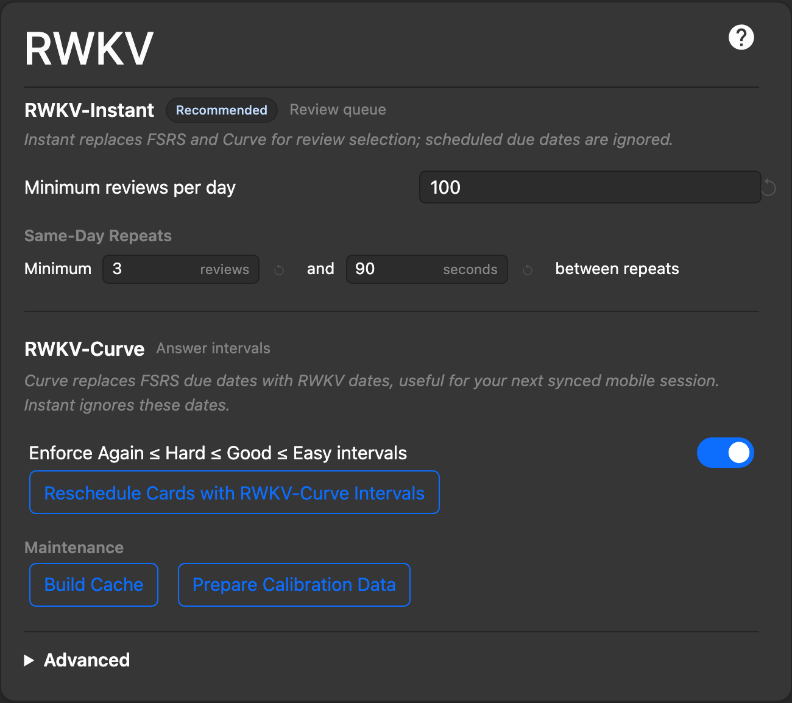
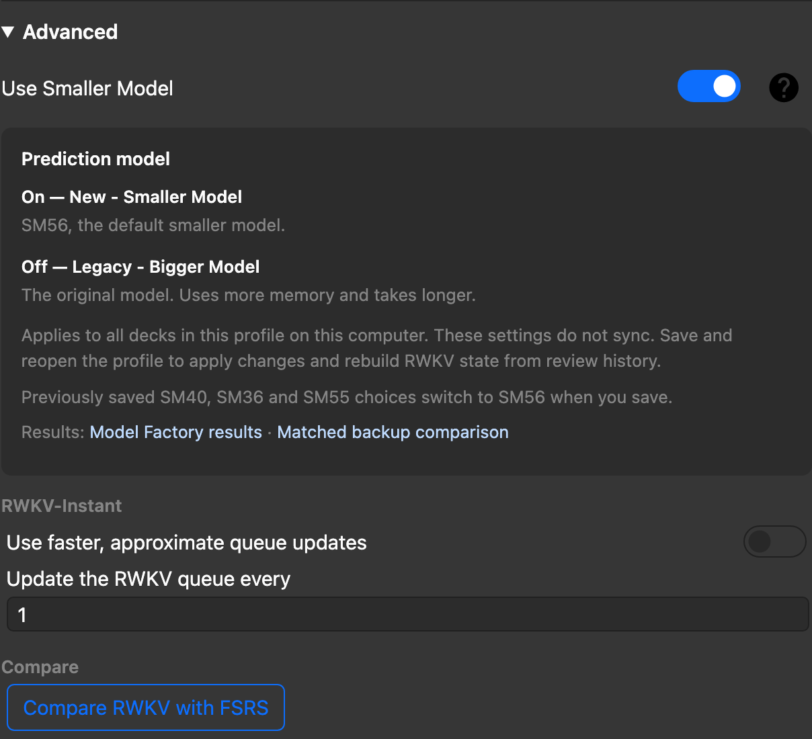
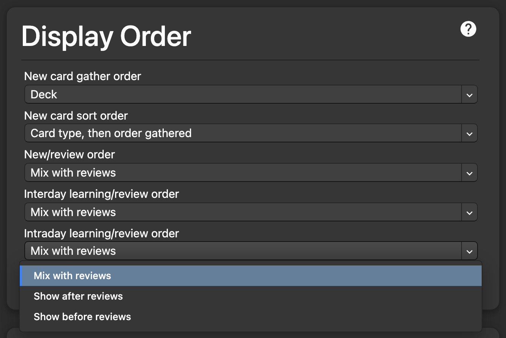

# Build 107 screenshots

These screenshots show the actual built Anki UI corresponding to release commit `95396c9ca1ae570601e977e851f2ab82e5d2fc98`. Later changes in the capture checkout affect documentation only.

## Simplified RWKV settings

Instant, Curve and maintenance actions remain visible, with Advanced collapsed.

## SM56 and advanced controls

Use Smaller Model is enabled for SM56. The open help explains the Legacy alternative, profile scope, reopening and model-result links. Queue controls and Compare are grouped below it.

## Intraday learning order

The open menu shows all three choices: mix with reviews, show after reviews and show before reviews.

## Capture and verification

Captured with Chromium through Anki's existing Playwright/mediasrv harness in a newly created temporary profile. Profile setup uses `ProfileManager` APIs; the live profile and collection are not accessed. The Deck Options response uses synthetic example settings: 100 minimum reviews per day, three intervening reviews and 90 seconds between same-day repeats, SM56 and mixed INT4-card/INT8-note state. These example numbers are not advertised as defaults. No personal review content or prediction results are included.

The capture uses the app's webview stylesheet, system font and dark theme, at a 1440 × 1400 CSS-pixel viewport and device scale factor 2. Screens are cropped during browser capture; no screenshot content is retouched. The final locator checks confirm the SM56 help and all three intraday choices are visible. Every image is visually inspected before uploading.

File hashes and pixel dimensions are recorded in [manifest.json](manifest.json). The temporary launcher, capture script, configuration and logs are retained under `/private/tmp/rwkv-sm56-integration-2026-10-24/`. Images embedded in the release use immutable commit URLs so later edits do not change the release gallery.
