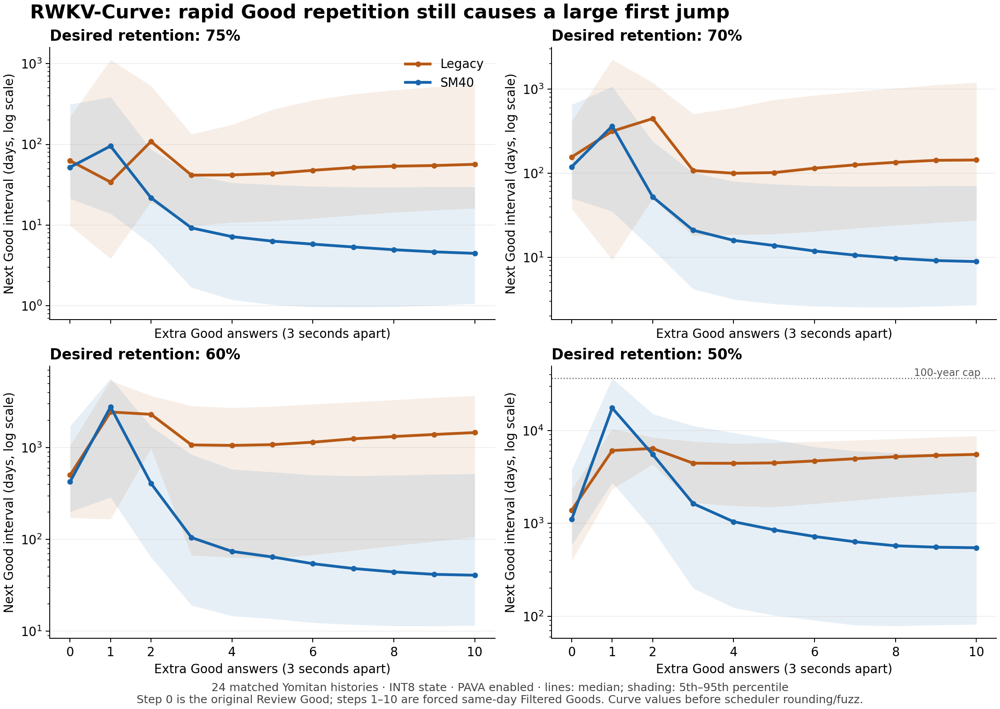

# RWKV-Curve interval stress comparison: Legacy and SM40

Measured on October 20, 2026, with the dual-model integration at `66806e08b`. This is an investigation of interval behavior, not a scheduling change.

**SM40 substantially reduces grade-order conflicts at 75% desired retention and reduces the sustained inflation after many rapid Good answers. It does not fix the first-repeat jump or the very long low-retention tail. The first jump can be larger than Legacy's, including reaching the configured 36,500-day limit.** Both f32 and INT8 state reproduce this result.

The subsequent [independent reference investigation](rwkv-sm40-reference-2026-10-20.MD) reproduces these SM40 trajectories with the released NumPy implementation, identifies the changing power-mixture tail, and isolates the card/note state contribution to the collapse.

## What was retested

The earlier discussion identified two different problems:

- A Good followed by same-day Filtered Goods seconds apart could preserve or multiply a multi-year interval, although Instant retrievability eventually exceeded 99%.
- Independently generated Again/Hard/Good/Easy curves could disagree about grade order. Production PAVA now pools conflicting probabilities before finding their target crossings.

This comparison uses the same retained-history input and four model/state variants as the [SM40 integration benchmark](rwkv-sm40-2026-10-20.MD). All weights are f32. The models use their deployed curves: Legacy's monotonic exponential mixture without the learned ahead correction, and SM40's monotonic power mixture with its published constant residual. This is a matched comparison against today's Legacy implementation, not the original July executable.

The [aggregate JSON](rwkv-curve-sm40-2026-10-20.json) contains the distributions, counts, per-step summaries and provenance. Private histories and card identifiers are excluded from the committed results.

## Rapid Good repetition

The October backup contains **24 retained Yomitan Review Good events from July 6–13, 2026 whose recorded interval was at least 730 days**. They cover 24 different cards. This deliberately selects the problematic long-interval population; it is not a representative sample of ordinary reviews. The old investigation used 15 events from an earlier snapshot, so these are newly matched cases following the old selection principle rather than an exact rerun of that old file.

For each model, the full collection history is replayed chronologically only up to the original event. Step 0 is its hypothetical Good interval. The actual recorded Good is then applied, followed by ten forced Filtered Goods, either three or thirty seconds apart. Each branch holds the card/note/deck/preset identity fixed and restores its recurrent and feature state before the next branch. The production snapshot restoration is verified by reproducing the original complete prediction exactly after every branch. These forced repeats bypass queue repeat guards.

Primary results use the default INT8 state and PAVA enabled. Values below are **medians of unrounded Curve crossings in days**, before configured learning steps, interval minimums, day conversion and fuzz. Each table cell reads **original Good → first extra Good → tenth extra Good**.

| Desired retention | Legacy, three-second spacing | SM40, three-second spacing |
| --- | ---: | ---: |
| 80% | 18.6 → 5.6 → 27.4 | 20.9 → 22.7 → 2.0 |
| 75% | 62.7 → 34.1 → 56.6 | 52.1 → 95.3 → 4.5 |
| 70% | 155.8 → 314.6 → 143.3 | 119.0 → 363.1 → 8.9 |
| 60% | 503.2 → 2,448.9 → 1,462.2 | 426.6 → 2,784.8 → 40.9 |
| 50% | 1,390.2 → 6,087.0 → 5,534.0 | 1,112.0 → 17,502.8 → 545.9 |

[Vector SVG](rwkv-curve-sm40-2026-10-20-progression.svg). Lines show the median at each step; shading shows the 5th–95th percentile. Each step's distribution uses the same 24 histories. A path of medians is not one representative card's path.

At 50% retention and three-second spacing:

- The first extra Good more than doubles the initial interval for **24/24 cards with either model**. The median per-card multiplier is **3.81× for Legacy** and **11.28× for SM40**. These multipliers are computed per card, not by dividing the table's medians.
- **5/24 SM40 cases hit the 36,500-day cap after the first extra Good**, versus none for Legacy. At thirty-second spacing, SM40 hits it in **7/24** cases.
- By the tenth extra Good, **24/24 Legacy cases** still have intervals of at least two years, versus **11/24 SM40 cases**. More than doubling the initial interval remains true for **20/24 Legacy** and **5/24 SM40** cases.
- Before that tenth answer, median Instant R is **99.41% for Legacy** and **99.69% for SM40**. Instant confidence and Curve tail behavior remain different quantities.

SM40's reduction after several additional Goods is a substantial change in the stress trajectory. It does not make the first proposed interval safe or demonstrate that the smaller final intervals are better calibrated: the synthetic answers have no observed future outcomes. A user who stops after the first extra Good would not benefit from the later collapse.

## Controls: precision, PAVA and spacing

The behavior persists with f32 state. At 50% retention and three-second spacing, the first-extra-Good median is **17,419 days with SM40 f32** versus **17,503 with SM40 INT8**; both have five capped cases. Legacy f32 gives **6,074 days**, versus **6,087 with INT8**. Quantization changes individual crossing estimates, but it does not explain this failure pattern.

Disabling PAVA also leaves the large jump. For SM40 at 50% retention and three-second spacing, the first-extra-Good median is **15,915 days raw** versus **17,503 with PAVA**. PAVA can increase some crossings while balancing grade predictions, but the long tail exists before that correction. At 75% and 60%, all 24 SM40 first-repeat Good estimates are identical with PAVA on and off for each tested spacing.

Longer spacing does not remove the first-repeat problem in this selected population:

| Gap before first extra Good | Legacy median, 50% DR | SM40 median, 50% DR | SM40 capped cases |
| --- | ---: | ---: | ---: |
| 3 seconds | 6,087 d | 17,503 d | 5 / 24 |
| 30 seconds | 6,482 d | 20,367 d | 7 / 24 |
| 90 seconds | 6,267 d | 25,614 d | 9 / 24 |
| 10 minutes | 5,826 d | 34,749 d | 12 / 24 |

These controls still force one isolated extra answer without intervening reviews on other cards. They test model response to elapsed time, not the complete real queue guard or a normal session's evolving shared state.

## Grade ordering and the wider snapshot

A separate audit queries **9,003 normal, active Yomitan review cards** from the same copied snapshot. Each card uses its latest retained identity/preset stream, and every query is placed at the same fixed time, 24 hours after the last retained collection answer: October 20, 2026 at 23:22:17 Europe/Brussels. This is a descriptive model comparison; it is not a live-profile scan or a full reproduction of fresh Dynamic Preset Selection routing.

Raw conflicts count any adjacent grade crossing that violates Again ≤ Hard ≤ Good ≤ Easy by more than the native solver tolerance. Grade conflicts within sub-day intervals are included in the raw count; scheduler minimums can hide some of them. The one-day-floor column separately treats every sub-day interval as one day to show how many conflicts extend into day-scale estimates.

| Desired retention | Legacy raw conflicts | SM40 raw conflicts | Legacy / SM40 conflicts after one-day floor |
| --- | ---: | ---: | ---: |
| 90% | 1,524 / 9,003 | 23 / 9,003 | 24 / 0 |
| 75% | 983 / 9,003 (10.92%) | 5 / 9,003 (0.056%) | 909 / 5 |
| 50% | 2,760 / 9,003 | 2,689 / 9,003 | 2,760 / 2,689 |

With production PAVA enabled, neither model has a conflict remaining after the one-day floor at these targets. Legacy has seven residual sub-minute extraction inversions at 90%: a curve already below target returns the first one-minute grid point, while another crossing can be refined below one minute. These are distinct from the previous multi-day grade inversion and are reported rather than silently counted as solver rounding noise. SM40 has no residual conflicts above tolerance in this audit. No extraction behavior is changed by this investigation.

PAVA enforces grade order, not a bound on interval growth or tail length:

| DR, PAVA enabled | Legacy median Good | SM40 median Good | Legacy / SM40 95th-percentile Good | Legacy / SM40 Good at 36,500-day cap |
| --- | ---: | ---: | ---: | ---: |
| 90% | 2.8 d | 8.4 d | 547.6 / 570.1 d | 0 / 0 |
| 75% | 225.9 d | 183.5 d | 2,456.7 / 3,771.8 d | 0 / 1 |
| 50% | 1,977.9 d | 1,697.4 d | 9,571.7 / 36,500.0 d | 0 / 516 |

The exact distributions in the JSON take precedence over rounded figures here. At 50%, **516/9,003 SM40 Good predictions (5.73%) reach the limit**, while Legacy reaches none. A lower median can therefore coexist with a more extreme upper tail. Long durations alone are not proof of prediction error; the rapid-repeat sensitivity is the more direct behavioral concern.

The previously reported three-review Easy/Easy/Hard card was also queried from a causal July 16 prefix. Its old grade inversion does not recur with either current model on this input. At 75% retention, raw Again/Hard/Good/Easy crossings are approximately **8 / 370 / 817 / 1,748 days for Legacy** and **8 / 409 / 1,519 / 3,029 days for SM40**. Both are ordered without PAVA, but SM40 predicts longer Good and Easy intervals. This is further evidence against assuming the new model simply shortens every problematic interval.

## Interpretation and limits

SM40 improves one previously troublesome behavior—raw grade ordering at common retention targets—while retaining a different problem: very long Curve tails at low retention and strong sensitivity to one near-simultaneous successful repeat. Its much shorter intervals after many forced Goods do not repair the first large proposed interval. The f32 and raw-curve controls locate the broad failure in model/Curve behavior; PAVA and INT8 can alter its size but are not prerequisites for it.

This investigation does not establish a new interval cap, repeat discount, calibration correction or better desired-retention setting. Those would change scheduling behavior and need a separately specified policy and evaluation. The existing retrospective log-loss comparison does not validate how a model behaves when its own intervals change the future review schedule.

All measurements use one copied backup and its frozen canonical history. Deleted/restarted histories and dynamic preset definitions reflect that snapshot. Synthetic repeats hold their preset stream fixed and use a one-second answer duration; the original anchor uses its recorded duration. Future target-answer rating/duration are omitted from each query. The experiment does not model queue admission, intervening cards, changing preset routes, learning-step transitions, future recall or actual review workload. No live profile was opened or changed.

## Verification and reproduction

Four native runtime variants complete **1,152 isolated branches**, covering 24 anchors × six targets × two gaps × four model/state variants. Each branch applies ten synthetic answers and verifies exact complete-prediction restoration afterward. The population audit completes 9,003 × three targets × two enforcement settings for each INT8 model. Both models also complete the raw/PAVA first-jump controls at 3, 30, 90 and 600 seconds. All recorded crossings are finite and positive.

The frozen source is the same temporary copy of `backup-2026-10-20-00.42.34.colpkg` used in the integration benchmark. The aggregate JSON records backup/input/weights/native-bridge hashes, source commit and probe hashes. Exact raw results, probes, the imported temporary justfile and logs remain under `/private/tmp/rwkv-curve-sm40-2026-10-20/` and `/private/tmp/rwkv_curve_*.py`; their private card histories are not committed. The PNG and SVG were rendered and visually inspected.

The one-off runtime recipe is `/private/tmp/rwkv-curve-probe.just`. From the integration worktree, run `RELEASE=1 just --justfile /private/tmp/rwkv-curve-probe.just probe MODEL PRECISION` for `legacy`/`sm40` and `int8`/`f32`, then `first-jump MODEL` and `aggregate`. It uses the already-copied input and native checkpoints under `/private/tmp/anki-rwkv-sm40-2026-10-20/`, not the active profile. `just check` verifies the report change against the repository's formatting and full checks.
