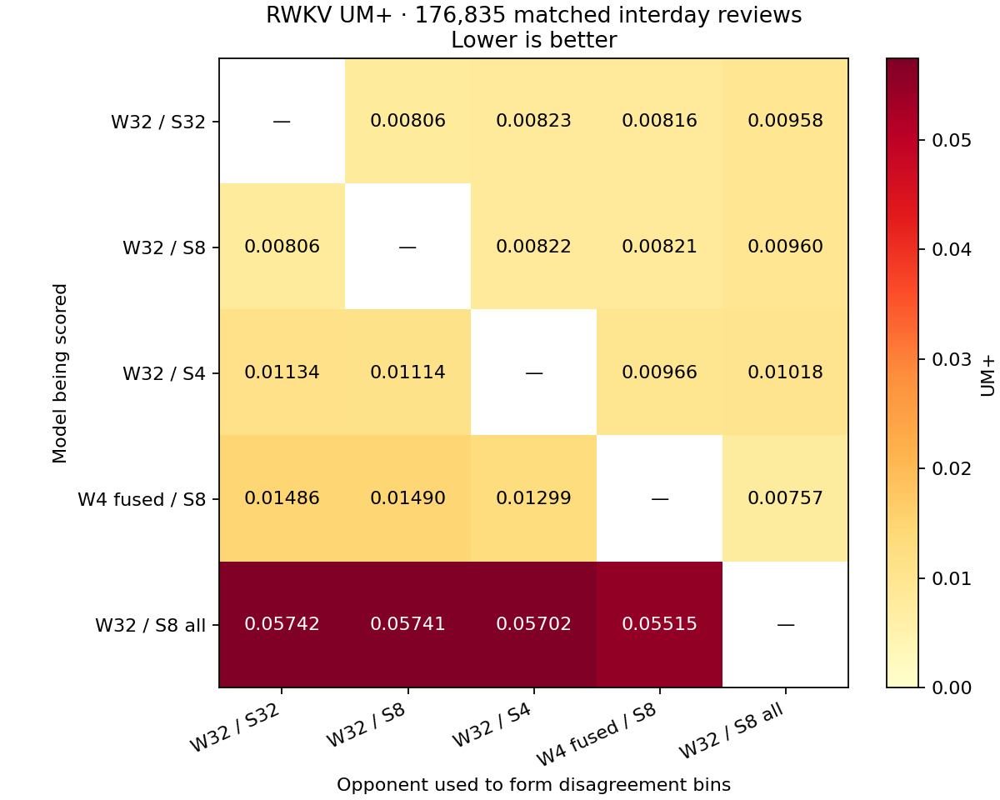

# RWKV runtime precision and UM+ — 2026-10-14

The fused packed int4 prototype removes the repeated f32 projection-buffer allocation. It reduces rebuild time by **32.1%** and CPU work by **41.5%** compared with unpacking each projection into a buffer. It still costs **27.1% more rebuild time** and **38.2% more CPU work** than current f32 weights/int8 state on this machine. Bulk queue scoring is also slower. Current int8 state remains the most attractive tested runtime/quality compromise.

All packed-weight kernels and the shared-state experiment are test-only. The desktop continues to use its existing weights, kernels, precision options and cache format. These are native backend measurements, not complete Anki GUI startup or review timings.

## Recommended default

Keep **f32 weights with int8 card/note recurrent matrices** as the default for the bundled model. Retain the existing f16 card/note shift vectors, f32 deck/preset/global state, and f32 activations and arithmetic. This combination gives the best overall memory, speed and quality balance among the tested variants.

After fresh cache restore, current int8 state uses 506.2 MB versus 1,302.5 MB for f32, a **61.1% RAM reduction**, with almost identical historical quality: UM+ max 0.009604 versus 0.009582. F32 is still faster for rebuild and queue scoring, so int8 does not win every individual metric.

Further quantization does not improve that overall balance here:

- Int4 card/note state saves another 30.2% ready RAM, but worsens UM+ and calibration. Keep it an explicit experimental option for workloads where lower memory matters more than prediction quality.
- Fused int4 weights save 2.9% observed ready RAM versus current weights, while using 38.2% more rebuild CPU work and 3.34× the queue-scoring CPU work. The 82.65% model-file reduction is a storage benefit; the approximately 11 MB weight file is small beside recurrent-state memory.
- Int8 deck/preset/global state saves only 0.46% of serialized state payload, substantially worsens UM+, and demonstrates no ready-RSS improvement in these trials.

This recommendation applies to this trained model, collection and M1 Max measurement. Evaluate a different model or workload using matched outcomes and measured runtime costs; keep storage savings, fresh-restore RSS and rebuild RSS separate when choosing precision.

## Fused packed computation

The trained model has 2,762,884 parameters. Int4 quantizes 2,719,744 dense projection parameters, with symmetric signed codes and one f32 scale per group of up to 32 input weights within an output row. Norms, biases and mixing parameters stay f32. The file shrinks from **11,082,637 to 1,922,693 bytes**, an 82.65% reduction. This is the same quantized model as the earlier [storage POC](rwkv-int4-weights-int8-state-2026-10-14.MD).

The new kernel transforms codes at load into an input-major layout, packs sixteen output lanes into eight bytes, and keeps scales separately. This layout replaces the original packed copy. On AArch64, NEON sign-extends the nibbles, converts and scales them in registers, then multiplies f32 activations. Four rows share each decoded weight vector, and output accumulators remain in registers across input columns. There is no temporary full f32 projection and no integer activation quantization. Other architectures have a scalar reference path; their performance was not measured.

Saved states retain the original ascending-input accumulation and zero skip. Every trained-model projection is exercised by replay tests. Synthetic tests additionally cover signed codes, 32-element group boundaries, partial output tiles, zero activations, bias and row tails. Full-history int4 replay state hashes match across the buffer and fused paths. All **223,954 historical prediction f32 values are byte-identical** to the decoded int4 reference. Historical UM+ therefore does not change. Bulk queries replace Apple's f32 GEMM with the fused kernel; small arithmetic differences are permitted for queries and bounded in the targeted query test.

## Rebuild comparison

Three fresh processes per variant, alternating the order, replay 223,954 retained answers in chunks of 16,384 without producing historical predictions. Medians below exclude JSON preparation, model loading, RSS handshakes, allocator purging and subsequent quality replay. CPU seconds are process user plus system time, including worker threads, so they can exceed elapsed time.

| Implementation | Rebuild seconds | CPU seconds | RSS after rebuild, MB |
| --- | ---: | ---: | ---: |
| Current f32 weights / int8 state | 12.414 | 67.470 | 1,603.9 |
| Resident int4 weights, buffer decode / int8 state | 23.243 | 159.333 | 1,610.3 |
| Resident int4 weights, fused / int8 state | 15.782 | 93.224 | 1,627.3 |

The earlier six-variant measurement explains the original doubling: decoding int4 once at load is close to current rebuild speed; repeatedly decoding each projection is expensive. These figures come from an earlier measurement set and should not be substituted for the contemporaneous controls above.

| Earlier implementation | Rebuild seconds | CPU seconds | RSS after rebuild, MB |
| --- | ---: | ---: | ---: |
| f32 weights / f32 state | 10.079 | 57.103 | 1,694.8 |
| f32 weights / int8 state | 12.750 | 67.550 | 1,620.1 |
| f32 weights / int4 state | 12.665 | 67.406 | 1,362.0 |
| int4 weights decoded once at load / int8 state | 12.851 | 67.787 | 1,679.7 |
| Resident int4 weights, buffer decode / int8 state | 26.734 | 160.042 | 1,611.5 |
| f32 weights / int8 state including shared scopes | 23.662 | 84.396 | 1,610.1 |

Rebuild RSS remains high even after the allocator purge. These measurements do not establish why that memory stays resident. Serialized state bytes cannot be treated as process RAM savings, and fresh cache restore must be measured separately.

## Fresh cache restore, queue scoring and answers

Each run starts a new native process with only the latest 4,096 unique cards' input rows, loads the model, and restores a single final scratch checkpoint through the normal RWKV checkpoint API. All seven modes run three times. Int4 weight implementations share an identical state cache. Every restored state hash matches its cache builder, and every queue result checksum matches the corresponding full-replay run. Fresh process does not imply a cleared filesystem cache.

RSS is measured at the exact post-restore handshake, after allocator purging. The queue consists of 4,096 hypothetical next-day queries, with one untimed primer and three timed passes per run. Answer timing covers twenty individual updates per run; rollback is outside each timed update. All sizes use decimal MB.

| Weights / state | Restore seconds | Ready RSS, MB | Queue ms | Queue CPU seconds | Answer ms |
| --- | ---: | ---: | ---: | ---: | ---: |
| f32 / f32 | 1.365 | 1,302.5 | 28.37 | 0.230 | 0.497 |
| f32 / int8, current | 0.436 | 506.2 | 45.80 | 0.372 | 0.672 |
| f32 / int4 | 0.508 | 353.4 | 54.90 | 0.396 | 0.755 |
| int4 decoded at load / int8 | 0.443 | 498.9 | 57.16 | 0.363 | 0.736 |
| int4 resident, buffer decode / int8 | 0.407 | 491.9 | 59.06 | 0.437 | 3.027 |
| int4 resident, fused / int8 | 0.420 | 491.4 | 167.96 | 1.243 | 0.641 |
| f32 / int8 including shared scopes | 0.420 | 511.1 | 92.97 | 0.743 | 0.831 |

Fused weights reduce observed ready RSS by **14.8 MB (2.9%)** versus current int8 state, or **7.5 MB (1.5%)** versus decoding the same int4 model at load. The decoded-at-load control still stores f32 projections; its lower RSS illustrates that loader allocations and allocator retention also affect this measurement. The packed file's exact 9.16 MB saving is a storage measurement, not an exact RSS prediction. Fused and buffer-resident RAM are effectively similar across these small trials.

The already-shipped int8 state saves 796.3 MB (61.1%) versus f32 after this fresh restore. That existing saving must be separated from the new packed-weight gain. Int4 state saves another 152.8 MB (30.2%) over int8. Shared-scope int8 reduces the checkpoint file from 371,523,584 to 369,819,648 bytes, but does not demonstrate lower process RSS here. It compresses only 22 decks, 13 presets and one global state, while card/note state comprises 27,171 identities.

Fused bulk scoring uses **3.34× the current CPU work** and **3.67× the elapsed time** in this restore set. The kernel avoids unpacking buffers but does not match the optimized GEMM library for a large query batch. The second warm/rebuild measurement set gives 171.9 versus 65.4 ms (2.63×), with a similar CPU-work penalty. Single-answer measurements are below one millisecond for current and fused modes; their small difference is not a meaningful user-perceived speed gain.

## Matched UM+ comparison

This uses the same trained weights, review IDs and outcomes for every precision variant: **176,835 interday reviews**, each with a previous retained answer, elapsed days at least one and the selected history flag. No FSRS, Expertium or updated small training-speed checkpoints are included. This is one collection's historical replay, not multi-user validation or a new training evaluation.

UM+ forms 41 buckets from signed prediction disagreement between two models, then computes count-weighted RMSE of each model's mean outcome error within those buckets. This matches Search Stats Extended's `umPlusData.ts`, including JavaScript rounding of negative half ties. All populated bins contribute; its 200-review display threshold does not remove bins from the score. It follows the [UM+ cross-comparison definition](https://github.com/open-spaced-repetition/fsrs-vs-sm17/blob/main/README.md). Probability-based RMSE bins are reported separately and are not UM+.

Each row is scored against every other precision variant. Maximum and average exclude the diagonal; smaller is better. These summaries depend on the opponent set. The three int4 weight implementations have identical historical predictions, so only fused int4 is included in the matrix.

| Precision variant | UM+ max | UM+ average | Log loss | Probability RMSE bins |
| --- | ---: | ---: | ---: | ---: |
| f32 weights / f32 state | 0.009582 | 0.008510 | 0.455833 | 0.018809 |
| f32 weights / int8 state | 0.009604 | 0.008525 | 0.455832 | 0.018811 |
| f32 weights / int4 state | 0.011337 | 0.010580 | 0.456149 | 0.019826 |
| int4 weights / int8 state | 0.014901 | 0.012581 | 0.456478 | 0.019610 |
| f32 weights / all scopes int8 | 0.057417 | 0.056749 | 0.466223 | 0.048997 |



Current int8 state remains close to f32. Int4 weights trade some historical calibration for modest runtime memory savings and substantially smaller model storage. The fused kernel does not recover that quantization loss. Int8 shared state is a poor tradeoff on this collection: tiny additional storage savings, substantially worse UM+, and increased query/rebuild cost.

## Environment, artifacts and reproduction

Apple M1 Max, 10 logical CPUs, 64 GiB RAM, macOS 26.7.1 arm64, release-mode native library tests, ten Rayon threads, existing Accelerate GEMM. No new dependency or external training run was added. Background CPU activity was substantial and variable: the fresh-restore runs sampled 0–80.6% immediately before each child. Wall times are observations on this host, not stable hardware guarantees. The large CPU-work differences support the buffer-decoding and fused-query cost conclusions. RSS includes native libraries, model, state, feature context and harness input; it excludes the GUI. Peaks are sampled at 20 ms and may miss shorter spikes.

The input was prepared from a copied October 14 backup, never the live profile. Input, original model, packed model, executable, archived experiment sources and review counts are recorded in the [machine-readable results](rwkv-runtime-precision-2026-10-14.json). That file retains both original and fused measurement sets, fresh-restore results, paired UM+ bins, state hashes and metadata. Private JSON history, binary models and prediction arrays remain under `/private/tmp`; they are not committed. Experiment archives are dirty source snapshots based on `ff5b3cb`, not falsely labeled as a completed implementation commit.

Raw results are `/private/tmp/rwkv-runtime-precision-2026-10-14/results.json`, `/private/tmp/rwkv-runtime-fused-2026-10-14/results.json`, and `/private/tmp/rwkv-runtime-cold-cache-2026-10-14/results.json`. Each directory retains its source archive, build logs and case logs. Scripts reject input/model/source changes during measurement and validate restored state and query parity.

```sh
just rwkv-weight-precision-tests --release
just test-py-target qt/tests/test_rwkv_um_plus.py
just rwkv-runtime-precision-bench PREPARED_INPUT OUTPUT 3
just rwkv-runtime-fused-bench PREPARED_INPUT FUSED_OUTPUT OUTPUT 3
just rwkv-runtime-cold-cache-bench PREPARED_INPUT FRESH_OUTPUT FUSED_OUTPUT/results.json 3
just rwkv-runtime-precision-plot FUSED_OUTPUT/results.json PLOT_OUTPUT
just check
```

The general precision recipe now includes fused weights. The retained original six-variant result predates that addition. The fused recipe reuses the original precision predictions to avoid recomputing identical historical results. Use a fresh cache output directory. Plotting requires the local Python environment with NumPy/Matplotlib; the measurement driver uses the repository Python and its existing psutil installation. In a filesystem sandbox, set `MPLBACKEND=Agg`, `MPLCONFIGDIR` and `XDG_CACHE_HOME` to writable temporary locations.

Verification: eight targeted Rust codec/resident/fused tests passed (the independent quality benchmark is ignored by that unit-test recipe); three UM+ Python tests passed; all three full-history fused/control rounds and all 21 fresh-restore runs completed with their parity assertions; `just check` passed. These tests exercise the backend POC, without enabling it in the desktop or synchronizing any live runtime.
