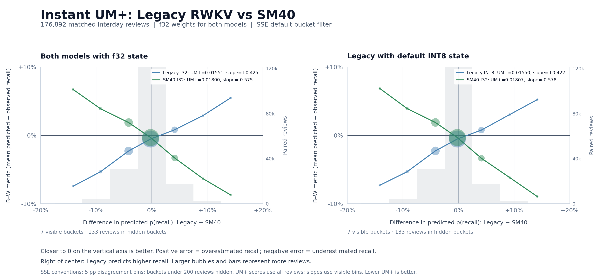

# RWKV SM40 integration and matched comparison — 2026-10-20

With **f32 state for both models**, SM40 reconstructs this collection's complete native state and final cache in **3.64 s versus 10.86 s** for the legacy model: **2.98× faster, or 66.5% less elapsed time**. Its cache is **84.2% smaller**, and fresh-process ready RAM is **72.3% lower**. The legacy model with its default INT8 state takes **11.92 s**. SM40 INT8 saves another **124.6 MB of cache** and **121.0 MB of ready RAM**, but reconstructs in **3.91 s**, with almost unchanged aggregate accuracy relative to SM40 f32.

The quality result is a tradeoff. On matched interday reviews against legacy f32, SM40 f32's Instant log loss increases by **0.00027540 (+0.0604%)**; Curve log loss decreases by **0.00006111 (-0.0133%)**. Instant calibration improves, while the legacy model wins the direct paired UM+ comparisons for both heads and both legacy state precisions. SM40 is not uniformly better at prediction. INT8 remains the branch's default, as requested pending review of these results; explicit profile precision choices are preserved.

## Shareable summary

Apple M1 Max, 64 GB RAM. All variants use **f32 weights**; INT8 refers to card/note recurrent matrices and f16 shift vectors. Shared deck/preset/user state remains f32. Timing and replay-peak RAM are medians of three fresh-process runs per variant, from one four-variant benchmark. Ready RAM comes from one separate fresh-process cache restore per variant. MB means 1,000,000 bytes.

| Metric | Legacy, f32 state | Legacy, INT8 state | SM40, f32 state | SM40, INT8 state |
| --- | ---: | ---: | ---: | ---: |
| Weight file (MB) | 11.08 | 11.08 | 1.35 | 1.35 |
| Full native reconstruction + final cache write (s) | 10.86 | 11.92 | 3.64 | 3.91 |
| State cache file (MB) | 1211.6 | 371.6 | 192.0 | 67.4 |
| Process RAM after fresh cache restore (MB) | 1487.3 | 689.8 | 412.0 | 291.0 |
| Peak process RAM during native replay (MB) | 1731.6 | 1545.9 | 583.8 | 783.2 |
| Curve log loss | 0.46087690 | 0.46087419 | 0.46081579 | 0.46081428 |
| Instant log loss | 0.45581569 | 0.45581453 | 0.45609109 | 0.45609109 |
| Curve calibration RMSE, 20 bins (pp) | 1.206 | 1.208 | 1.250 | 1.245 |
| Instant calibration RMSE, 20 bins (pp) | 1.134 | 1.129 | 0.712 | 0.713 |

Quality uses **176,892 identical interday reviews**, with a previous retained answer for each card. Lower log loss and calibration error are better; pp means percentage points. The resource measurements replay **all 224,022 retained answers**.

UM+ is pairwise: each row builds its own disagreement buckets. The first and second scores correspond to the first and second named models; lower is better.

| Pair | Curve UM+ (first / second) | Instant UM+ (first / second) |
| --- | ---: | ---: |
| Legacy, f32 state vs Legacy, INT8 state | 0.00427826 / 0.00427134 | 0.00805777 / 0.00805716 |
| Legacy, f32 state vs SM40, f32 state | 0.01721519 / 0.02076484 | 0.01550510 / 0.01799880 |
| Legacy, f32 state vs SM40, INT8 state | 0.01721457 / 0.02075931 | 0.01542212 / 0.01812006 |
| Legacy, INT8 state vs SM40, f32 state | 0.01720634 / 0.02074662 | 0.01550408 / 0.01807266 |
| Legacy, INT8 state vs SM40, INT8 state | 0.01713797 / 0.02087249 | 0.01539840 / 0.01812637 |
| SM40, f32 state vs SM40, INT8 state | 0.00237654 / 0.00237122 | 0.00206912 / 0.00207546 |

Both same-model f32/INT8 pairs occupy only the central disagreement bucket, so their UM+ scores reduce to absolute mean calibration bias and should not be read as independent demonstrations that either precision is more predictive.

## Instant UM+ plots



[Download the vector SVG](rwkv-sm40-2026-10-20-instant-um-plus.svg). The plot follows Search Stats Extended's default display: 5 pp disagreement bins, buckets with fewer than 200 reviews hidden, review-weighted bubble sizes and volume bars. Scores include all 176,892 matched interday reviews; slopes use visible bins. Each panel hides 133 reviews. Positive disagreement means legacy predicts higher recall; positive prediction error means overestimated recall. Closer to zero error, lower UM+ and a slope closer to zero are better.

## Reconstruction, storage and memory

| Metric | Legacy, f32 state | Legacy, INT8 state | SM40, f32 state | SM40, INT8 state |
| --- | ---: | ---: | ---: | ---: |
| Weight file (MB) | 11.08 | 11.08 | 1.35 | 1.35 |
| Full native reconstruction + final cache write (s) | 10.86 | 11.92 | 3.64 | 3.91 |
| Recurrent-state payload (MB) | 1193.2 | 353.5 | 187.6 | 63.0 |
| State cache file (MB) | 1211.6 | 371.6 | 192.0 | 67.4 |
| Process RAM after fresh cache restore (MB) | 1487.3 | 689.8 | 412.0 | 291.0 |
| Peak process RAM during native replay (MB) | 1731.6 | 1545.9 | 583.8 | 783.2 |

The three total-reconstruction samples (seconds), in chronological order for each variant, are:

- Legacy, f32 state: 10.8589, 10.9262, 10.6938.
- Legacy, INT8 state: 12.4535, 11.9205, 11.7468.
- SM40, f32 state: 3.7464, 3.6384, 3.4195.
- SM40, INT8 state: 3.9126, 3.6889, 3.9953.

The total is the sum of native input parsing, weight loading, complete retained-history replay and writing/closing the final SQLite state store. The replay-only medians, in table order, are **9.291 s**, **11.298 s**, **3.223 s**, **3.683 s**. This is a complete state rebuild, with matching final-state hashes across all three runs and the restored cache. It excludes backup extraction, Python canonical-history preparation, UI progress rendering and the desktop's intermediate recovery checkpoint. It is not a timing of the whole GUI startup dialog.

The native test executable uses the same state replay and writer as production; its cache-read test buffer is 4 KiB instead of production's 16 MiB. Fresh-process restore time/RAM therefore describes this harness, not exact production startup. The benchmark retains its parsed history to exercise queue/answer operations after restoration, so these RSS values are not total Anki GUI memory or state payload size. Reconstruction can retain allocator scratch; fresh-process restore is the appropriate comparison of ready memory. In particular, SM40 INT8's reconstruction peak exceeds f32 despite its smaller stored state.

No CPU affinity or exclusive-machine isolation was imposed. Recorded pre-run background CPU was 0.0–40.8%; alternating order and the individual samples are retained in the aggregate JSON. Replay CPU-time medians, in table order, were **58.27 s**, **65.90 s**, **15.58 s**, **16.73 s** across the worker pool. These figures support a substantial speed difference on this machine, not a phone or universal performance claim.

These gains benefit the **Building RWKV state cache** operation after a model change, invalidation or explicit rebuild. A new-model integration necessarily discards the old model's cache; it does not change the user's collection data. Routine review behavior also changes through the new predictions, but this experiment does not claim a measured daily-review latency improvement.

## Prediction quality and calibration

| Metric | Legacy, f32 state | Legacy, INT8 state | SM40, f32 state | SM40, INT8 state |
| --- | ---: | ---: | ---: | ---: |
| Curve log loss | 0.46087690 | 0.46087419 | 0.46081579 | 0.46081428 |
| Instant log loss | 0.45581569 | 0.45581453 | 0.45609109 | 0.45609109 |
| Curve calibration RMSE, 20 bins (pp) | 1.206 | 1.208 | 1.250 | 1.245 |
| Instant calibration RMSE, 20 bins (pp) | 1.134 | 1.129 | 0.712 | 0.713 |
| Curve ECE, 20 bins (pp) | 0.911 | 0.922 | 0.856 | 0.847 |
| Instant ECE, 20 bins (pp) | 0.924 | 0.924 | 0.489 | 0.488 |

The observed interday recall rate is **77.2070%**. Mean forecast minus observed recall is:

| Head | Legacy, f32 state | Legacy, INT8 state | SM40, f32 state | SM40, INT8 state |
| --- | ---: | ---: | ---: | ---: |
| Curve | -0.4278 pp | -0.4271 pp | -0.2377 pp | -0.2371 pp |
| Instant | -0.8058 pp | -0.8057 pp | -0.2069 pp | -0.2075 pp |

Calibration uses 20 equal-width probability bins, retaining every populated bin. ECE is the review-weighted absolute difference between each bin's mean forecast and recall; RMSE is the square root of the similarly weighted squared differences. They summarize reliability by forecast level. UM+ instead partitions each model pair by prediction disagreement, so improved ordinary calibration can coexist with a worse UM+ score. Brier scores and all calibration/UM+ bins are retained in the JSON.

INT8 state changes SM40's interday probabilities by **0.0187 pp on average / 0.7164 pp maximum** for Curve, and **0.0232 pp on average / 0.8556 pp maximum** for Instant. The p99 changes are **0.1076 pp** and **0.1264 pp**. Tiny aggregate loss differences do not mean identical individual predictions.

Including same-day answers produces **210,045 matched repeated answers**:

| Metric | Legacy, f32 state | Legacy, INT8 state | SM40, f32 state | SM40, INT8 state |
| --- | ---: | ---: | ---: | ---: |
| Curve log loss | 0.44678939 | 0.44678635 | 0.44661666 | 0.44661514 |
| Instant log loss | 0.44117940 | 0.44117822 | 0.44210081 | 0.44210087 |

On this broader sample, SM40 f32's Instant loss is **0.2089% higher** than legacy f32; the legacy model also wins both paired UM+ comparisons. This is a retrospective comparison of one collection, not a held-out-user study, a refit or a significance test. The pretrained models and forecast calibration are not optimized on this evaluation.

## Proposed INT8 row rounding: measured, not retained

A fused per-row encoder was evaluated using the suggested `1.5 * 2^23` nearest-even arithmetic and low-byte extraction, including serialization through the same encoder. The final candidate uses a direct loop and explicit inlining, preserves NaN-to-zero conversion, and removes per-row helper calls. Both architectures pass exact-byte differential tests across half-integer ties and neighboring floats, all finite exponents, subnormal/extreme scales, zeros and non-finite inputs; the candidate passes 96 legacy and 98 SM40 native tests (16 offline benchmarks ignored in each).

Every Curve/Instant prediction file is byte-identical to the baseline for all four configurations, and the final recurrent-state hashes and state-cache sizes are unchanged. The Instant UM+ plots and quality tables above therefore apply equally to the candidate.

An additional A/B test alternates the frozen baseline and candidate executables for three fresh-process full reconstructions per model, reversing order in the second round. Both use the same prepared 224,022-answer input, f32 weights, INT8 card/note state and final-cache writer. Total time uses the same four phases as the primary table. This A/B test is separate from the original four-variant benchmark; its baseline times differ because the machine is not isolated.

| Model, INT8 state | Baseline total (s) | Candidate total (s) | Change | Replay CPU: baseline / candidate (s) |
| --- | ---: | ---: | ---: | ---: |
| Legacy | 11.104 | 11.175 | +0.64% | 66.089 / 66.219 |
| SM40 | 3.639 | 3.648 | +0.22% | 16.746 / 16.636 |

There is no material full-rebuild improvement on this M1 Max. The existing ARM encoder already uses vector `frintx.4s` rounding and `fcvtzs.4s` conversion instructions; it does not have the reported Windows scalar-library-call bottleneck. The candidate is **not applied** to this integration branch. These measurements do not test Windows performance.

The [tested candidate patch](rwkv-sm40-2026-10-20-int8-rounding-candidate.patch), [candidate four-variant results](rwkv-sm40-2026-10-20-int8-rounding-candidate.json) and [alternating A/B results](rwkv-sm40-2026-10-20-int8-rounding-ab.json) preserve the implementation and evidence for Windows evaluation. Private source archives, exact executables, raw logs and the A/B recipe remain under `/private/tmp/anki-rwkv-sm40-2026-10-20/`. The primary comparison table continues to describe the retained implementation.

## Data and causal scoring

- Source: a temporary copy of Main Profile's existing `backup-2026-10-20-00.42.34.colpkg`. No live collection database was opened, copied or queried.
- Replay: **224,022 canonical retained answers**, **13,977 cards**, **13,202 notes**, **22 reviewed decks**, **13 resolved presets**. All decks participate; the same prepared rows are supplied to every model and precision.
- First answers and same-day answers advance state. Primary scoring requires a previous retained answer, at least one scheduler day elapsed, and membership in the same selected population for every model.
- Instant predictions use query features with no rating or duration from the target answer. Curve predictions evaluate the curve saved after the preceding answer of that card, at the target answer's elapsed seconds. Only afterward does the target answer update the model.
- The legacy curve uses its deployed monotonic exponential-mixture base without the learned ahead residual. SM40 uses its published three-component power mixture and constant 1e-5 logit residual. This compares the deployed scheduling curves rather than silently changing the legacy baseline.
- Binary recall means any answer other than Again. Natural-log loss clips to `[1e-6, 1 - 1e-6]`. UM+ uses the existing 41 disagreement buckets, JavaScript-compatible rounding, and every populated bucket.

## Integration and verification

The upstream source is [small-model-sm40-2026-10-19](https://github.com/JSchoreels/anki-rwkv/releases/tag/small-model-sm40-2026-10-19). The downloaded package SHA-256 is `9bc1e3e4040ce9693f230e905abb5c925b1102f787424b9059543ae900f1e2a2`. The f32 weights, int8 weights and architecture metadata match their manifest hashes. Imported JSON is excluded from automatic formatting and Git line-ending normalization so those byte identities survive checkout.

The desktop bundle now contains SM40 f32 weights, architecture metadata and the source manifest. `rwkv-sm40` is the default native architecture. Offline `--no-default-features` preserves the legacy architecture and weight file for an exact matched comparison. The old PyTorch inference source remains a legacy development path. The main worktree and running app are not switched by this worktree's build.

The port covers scalar/parallel prediction, macOS batched queries, interleaved bulk replay, stripped channel mixers, per-stream value residuals, one-layer note state, both exported weight containers, curve persistence, undo, simulations and cache continuation. Runtime marker `ARWKVPROCSTATE3` and native state-store schema 5 prevent reading the old curve payload. Model-content identity separately triggers reconstruction after the weight change.

Validation:

- Both published users, **14,403 rows**, match the full set of Instant, four rating probabilities, labelled-time Curve and six curve sweep outputs within 1e-5 for f32 and int8 weights. Maximum error: **3.49e-6** and **2.98e-6**. A deterministic 500-row prefix per user is committed as a fast fixture.
- The exact benchmark executables pass their native RWKV regressions: **95 tests** for legacy, **97 tests** for SM40, with 16 offline benchmarks ignored in each.
- The Python/native bridge state, undo and workload roundtrip test passes. Calibration/selection/UM+ tests pass. Four unchanged Torch-only process tests skip because Torch is absent; native SM40 reference parity does not require Torch.
- `just check` passes, including the repository's Rust, Python, TypeScript/Svelte, formatting and lint checks.
- Each variant produces identical recurrent-state hashes across all three reconstructions and fresh-process cache restore. No prediction files contain missing or non-finite values.

The [aggregate JSON](rwkv-sm40-2026-10-20.json) retains source/input/model/executable hashes, per-run phases, sampled RSS, serialized scope sizes, calibration bins, UM+ bins and prediction hashes. Private histories, copied/extracted collection data, prediction arrays, native executables and the source archive remain under `/private/tmp/anki-rwkv-sm40-2026-10-20/`; they are not committed.

## Reproduction

```sh
just rwkv-history-ablation-prepare --backup-copy /private/tmp/rwkv-sm40/backup.colpkg --output /private/tmp/rwkv-sm40/input.json --deck-match=
just rwkv-model-bench --input /private/tmp/rwkv-sm40/input.json --output /private/tmp/rwkv-sm40/comparison --rounds 3
just check
```

Use a fresh output directory. `--resume` accepts only the same frozen sources, input and model identities. The comparison measures legacy f32, legacy INT8, SM40 f32 and SM40 INT8 state. It builds both optimized architectures, runs their native regressions, alternates variant order, reconstructs from empty state, writes final caches, restores in fresh processes and scores matched histories separately from timing. It rejects source/input/model changes, invalid predictions and inconsistent reconstruction/restoration state hashes.

To verify the complete upstream public vectors, extract a verified release package and use a Python interpreter with NumPy for conversion:

```sh
just rwkv-sm40-vectors /private/tmp/sm40v2 /private/tmp/sm40-vectors.json 0 python3
ANKI_RWKV_SM40_VECTORS=/private/tmp/sm40-vectors.json just rwkv-sm40-tests --release -- --nocapture
```
