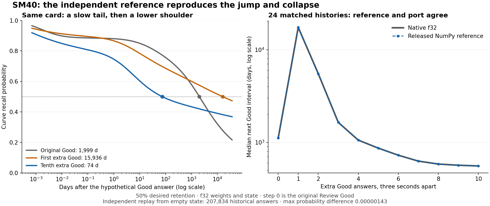

# SM40 first-repeat jump: independent reference verification and mechanism

**The released, unmodified NumPy reference reproduces the jump and collapse.** An independent replay from empty state matches the native implementation across all 24 selected histories and both repeat spacings. The forward mechanism is a large change in the three-component forgetting curve: after the first extra Good, a very slow tail carries roughly half the curve's weight; after more Goods, the card/note recurrent state reduces that weight and makes the middle component decay faster. The 50% crossing can consequently move from decades to months while Instant confidence stays high.

This follows the [Legacy/SM40 interval stress comparison](rwkv-curve-sm40-2026-10-20.MD). It adds diagnostics and reproducible offline tooling; it does not change scheduling behavior. The [training audit and proposed experiments](rwkv-sm40-training-2026-10-20.MD) investigate the objective and data support behind this learned behavior.

## Independent verification

The reference is `reference/small_model_recurrent.py` from the original `sm40v2-package.zip` downloaded for the [SM40 release](https://github.com/JSchoreels/anki-rwkv/releases/tag/small-model-sm40-2026-10-19). All four reference Python files were verified byte for byte against that archive, and the package files match their manifest hashes. The model's forward pass, state updates, curve evaluation and Instant/rating evaluation are unmodified.

Both implementations use **f32 weights and f32 recurrent state** here. This permits a precise comparison without conflating state quantization; the previous stress comparison separately reproduces the same qualitative behavior with INT8 state.

The native trace exports the exact 92 input features and five entity identities for each historical update. A separate feature-state instance builds the export and is checked byte for byte against the production replay's feature cache at every anchor. NumPy starts with an empty store and replays **207,834 historical answers** through its own recurrent equations. It does not load, translate or reuse a native recurrent checkpoint.

At each of the original 24 anchors, both three-second and thirty-second repeat branches are reconstructed independently. NumPy evaluates the current query plus all four hypothetical answers, commits each actual answer, and restores its own five entity states between branches. The same original recorded answer durations and one-second synthetic durations are used as before. Future rating and duration remain absent from query features. An additional audit verifies elapsed-day/second normalization, zero intervening-card counts, rating/query flags and synthetic duration normalization on all **480** extra-answer steps.

| Verification | Result |
| --- | ---: |
| Causal historical prefix rebuilt independently | 207,834 answers |
| Histories / branches / query stages | 24 / 48 / 528 |
| Probability values checked | 29,040 |
| Maximum absolute probability difference | 0.0000014305 |
| Maximum difference in mixture weights or raw log-scales/log-decays | 0.00002480 |
| Maximum relative crossing difference, intervals ≥1 day | 0.002323% |

The probability comparison covers Instant R, all four rating probabilities and Curve recall at one second, three seconds, ten minutes, one day, one year and 100 years, for the query and all four hypothetical answers at every step. Each probability must agree within `1e-5`; the observed maximum is about seven times smaller than that tolerance.

The reference package provides `p_curve(t)`, rather than an Anki answer-button/PAVA implementation. Independent bisection of that unmodified function, optionally pooling the four probabilities with equal-weight PAVA, reproduces the native crossings at 75%, 60% and 50% targets. Thus agreement is checked at the probability level and at independently derived crossings, rather than assuming the native interval extractor is correct.

At 50% desired retention, the median PAVA-adjusted Good intervals are:

| Gap / stage | Native f32 | Released reference |
| --- | ---: | ---: |
| Original Good | 1,116.384 d | 1,116.383 d |
| Three seconds: first extra Good | 17,419.192 d | 17,419.225 d |
| Three seconds: tenth extra Good | 557.995 d | 557.998 d |
| Thirty seconds: first extra Good | 20,240.575 d | 20,240.489 d |
| Thirty seconds: tenth extra Good | 320.715 d | 320.715 d |

Both implementations hit the 36,500-day limit after the first extra Good in **5/24 cases at three seconds** and **7/24 at thirty seconds**. The cap means the curve is still above the target at that horizon; it is not an arithmetic overflow or a missing crossing incorrectly interpreted as a large finite value.



[Vector SVG](rwkv-sm40-reference-2026-10-20-mechanism.svg). The left panel shows one actual matched case's raw Good curves; its displayed crossings also equal its PAVA-adjusted crossings. The right panel shows the 24-history median trajectory with PAVA. The native and reference lines overlap at this scale.

## Why the first extra Good can jump so far

SM40 predicts a weighted sum of three power curves:

`R(t) = sum_i w_i * (1 + t / S_i)^(-d_i)`

The weights sum to one. A smaller positive decay exponent `d` means slower forgetting. The exported implementation also applies its small published probability clamp and constant logit residual; those are included in every measured probability and crossing.

The first extra Good follows a substantial change in both inputs and recurrent state:

1. The original Good updates the card, note and shared recurrent streams.
2. The next query has zero elapsed days, only three or thirty elapsed seconds, and no intervening new cards or other reviews. This replaces the original long-gap timing/context features.
3. The hypothetical Good head evaluates those new features against the updated state and produces a different set of weights, scales and decay exponents.

For an illustrative actual case, **Case 03**, the reference gives the following parameters. The labels “middle” and “slow” describe this case's second and third components; they are not additional model states. This case is one of the two middle-ranked first-extra intervals in the three-second population, rather than a selected maximum.

| Proposed answer | Good interval at 50% | Slow weight | Slow scale | Slow decay `d` | Middle decay `d` |
| --- | ---: | ---: | ---: | ---: | ---: |
| Original Good | 1,999.46 d | 48.84% | 1,364 d | 0.47698 | 0.15429 |
| First extra Good | 15,936.40 d | 49.51% | 701 d | 0.04811 | 0.18797 |
| Tenth extra Good | 74.13 d | 42.03% | 785 d | 0.03850 | 0.47961 |

After the first extra Good, the slow exponent falls by about **9.9×**. That component retains probability for much longer, while carrying almost half the mixture weight. The other components keep the total above 50% for many years. This creates the long shoulder visible in the plot. Across all 24 cases, the median slow-component weight increases from **45.84% to 51.42%**, and its median exponent falls from **0.54324 to 0.09134**.

The individual component's scale also changes, so the exponent alone is not a complete explanation; the measured full mixture establishes the resulting tail. The 50% crossing is particularly sensitive because it sits close to the weight carried by the slow component. A curve can therefore be finite, smooth and strictly decreasing with elapsed time while its 50% interval is extremely long.

The forward pass has no constraint requiring a Good answer to increase or preserve a previous Curve at every future horizon. Time monotonicity within one curve and grade order within one four-answer prediction do not impose consistency across successive review updates.

## Why more Goods collapse the interval

In Case 03, the slow component remains very slow after ten Goods—its exponent falls further to `0.03850`. The collapse therefore does not come from that component suddenly forgetting faster. Instead:

- Its weight falls from **49.51% to 42.03%**.
- The middle component's exponent rises from **0.18797 to 0.47961**, making that component decay faster.
- The total reaches 50% much earlier, while the slow tail remains below that target at practical horizons.

This is a change in curve shape, rather than an update to one scalar “stability.” A few percentage points of redistributed mixture weight can have a very large effect on a low-retention crossing.

Controlled reference interventions isolate where that change comes from. Each intervention holds the tenth step's input features fixed unless specified otherwise, substitutes the saved entity states, and derives the raw Good crossing. These hybrid states are diagnostic counterfactuals, not alternative schedules. The figures below are medians across 24 three-second branches at 50% retention.

| Reference intervention | Median Good interval |
| --- | ---: |
| First extra Good: actual features and state | 15,880 d |
| Tenth-step features, but state frozen just after the original Good | 15,837 d |
| First-extra features, but state advanced through nine extra Goods | 552 d |
| Only card/note state advanced; shared streams frozen | 645 d |
| Only deck/preset/user state advanced; card/note state frozen | 14,468 d |
| Actual tenth extra Good | 558 d |

Most of the collapse follows the changing **card/note recurrent state**, rather than the small changes in the cumulative clock or review-count features. Updating shared state alone does not reproduce it. Shared streams still affect the result, so the experiment does not claim complete card/note independence or separate the card and note contributions individually.

The first jump itself also involves a nonlinear interaction between state and context. In the same population, changing only the original timing/context features gives a median of **2,725 d**; changing only the original recurrent state gives **2,046 d**. Using both changes produces **15,880 d**. These medians are descriptive interventions and cannot be added to assign independent percentages of responsibility.

## Review type, PAVA and Instant R

SM40's architecture specifies `zero_features: [22]`. Input 22 is the direct scaled Review/Filtered/Learning/Relearning type. Both native and reference implementations zero it before the input MLP. Replacing that input with `-2`, `-1`, `0`, `1` or `2` at the tenth step produces **bit-identical reference heads in all 48 branches**. Thus the direct Review-to-Filtered numeric encoding cannot cause this SM40 jump. History retention and the elapsed/context features still matter; this does not make all preprocessing review types interchangeable.

PAVA is also not required for the phenomenon. The parameter example and intervention table use raw Good curves, and the reference reproduces their large jump. PAVA can modify some four-grade crossings, as documented in the previous comparison, but the problematic tail is already present in the independently evaluated Good head.

Instant R comes from a separate rating/Instant head. Rising near-term confidence does not constrain the Curve head to preserve its previous long-term shape. The observed high Instant R and shrinking low-retention Curve interval therefore coexist in the reference without a numerical contradiction in either head.

## Scope and interpretation

The evidence establishes the forward mechanism and locates this behavior in SM40's learned input/state-to-curve mapping on the tested histories. It is not introduced by the Rust recurrent port, INT8 state or the native crossing search in these cases. It does not establish which training examples or training objective choices caused the learned mapping, nor does it prove the resulting long or short intervals reflect real memory.

The NumPy reference consumes the same production feature vectors, so this is an independent model implementation and independent recurrent replay, not an independently rebuilt raw-collection preprocessing pipeline. The explicit raw-feature checks cover the repeated-answer timing, rating, duration and intervening-review inputs; existing native/public-vector tests cover the broader exported architecture. The experiment uses f32 state, one copied history, fixed identity/preset streams, forced extra Goods and no intervening cards, just as described in the original stress report. It does not simulate queue admission, future outcomes or real workload.

## Tooling and reproduction

The test-only `curve_reference_probe` module is compiled only for SM40 native tests. It exports feature vectors, identities, curve components and crossings for explicit anchor indices from an already prepared history. The output directory must be new. It never reads a profile or collection database. The NumPy runner requires the standalone release package and an interpreter with NumPy; NumPy is not added to the application's runtime dependencies.

Prepare a request JSON with these fields:

```json
{
    "input": "/path/to/copied/canonical-input.json",
    "anchors": [206301, 206307],
    "output": "/private/tmp/new-native-trace"
}
```

The example indices are illustrative; use the intended positions in the exact hashed input. Then run:

```sh
just rwkv-sm40-curve-trace /private/tmp/request.json
OPENBLAS_NUM_THREADS=1 VECLIB_MAXIMUM_THREADS=1 just rwkv-sm40-curve-reference /private/tmp/sm40v2 /private/tmp/new-native-trace /private/tmp/reference-results.json python3
just check
```

For this run, exact private inputs, 92-feature history, all raw/reference head outputs, requests, logs and original runner source remain under `/private/tmp/rwkv-sm40-reference-2026-10-20/` and the referenced `/private/tmp/rwkv_curve_reference.py`. The [aggregate JSON](rwkv-sm40-reference-2026-10-20.json) records reference-file, package, weight and trace hashes, error bounds, step summaries, interventions and the anonymized Case 03 components. Source inspection begins from integration commit `42688f52d`; only the added diagnostic tooling and report change in this follow-up.

The final formatted native exporter produces byte-identical feature, identity and curve-trace files. The typed/formatted Python solver matches the measured solver exactly in 864 four-grade crossing comparisons on the captured reference heads. `just check` and an explicit formatting/lint check cover the added tooling.
