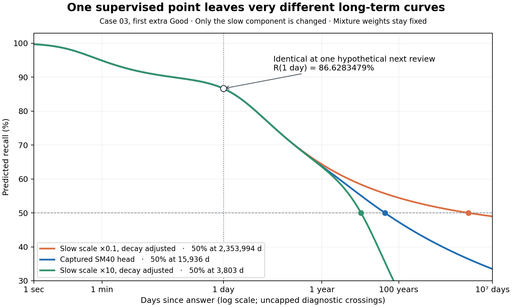

# SM40 training causes and proposed interval stability experiments

**SM40's objective leaves its long-term curve weakly constrained after rapid repeated Goods.** The exact recorded training revision supervises each post-answer curve at the next observed review time, including distillation at that same time. Its three power components can change their weights, scales and decay rates across answers without a consistency loss. The audited data contains little delayed-outcome evidence for the repeated-Good pattern used in the stress test. These findings explain how training permits the reproduced jump and collapse; a matched retraining ablation is still needed to assign their relative contributions or demonstrate a remedy with unchanged prediction quality.

The first proposed experiment is a weak, conditional curve-consistency loss on realistic rapid-repeat rollouts, with the factual prediction loss preserved. A learned separation of transient and durable updates is the next architectural experiment if that fails the quality gate. Neither proposal sets an interval ceiling or projects answer intervals at inference.

## Verified training objective

The release manifest identifies clean training commit [`338249e94b59f11f586135e6f73081e97901cc0d`](https://github.com/JSchoreels/anki-rwkv/tree/338249e94b59f11f586135e6f73081e97901cc0d). The public source at that revision was downloaded for this audit. The release calls the source module `compact`; the Git repository calls it `expertium`. Source file hashes are in the [audit JSON](rwkv-sm40-training-2026-10-20.json). The manifest's separately recorded source snapshot was not available locally, so this audit verifies the public pinned revision rather than claiming byte identity to that separate archive.

The checkpoint starts from **epoch 12**, then receives a **full additional decay epoch**: 369,477,375 review presentations, 321,470,304 Curve labels, 32,768 reviews per chunk and one chunk per batch. The final run uses carried recurrent state, strided lanes and deployment-precision storage at chunk boundaries. With one chunk there is one lane, so the final decay does not repeatedly reset the user's history into sixteen independent lanes. Its carried state is detached at chunk boundaries; this is truncated backpropagation, not full-history gradient propagation. Earlier stages used a context curriculum and different teacher modes; the final manifest should not be read as twelve identical replay-training epochs.

| Source fact | Consequence for this behavior |
| --- | --- |
| [`data_processing.py:284–295`](https://github.com/JSchoreels/anki-rwkv/blob/338249e94b59f11f586135e6f73081e97901cc0d/rwkv/data_processing.py#L284-L295) shifts the next review's elapsed time and outcome onto the preceding answer | One post-answer head gets one factual time/outcome, rather than a whole observed curve |
| [`variant_model.py:434–448`](https://github.com/JSchoreels/anki-rwkv/blob/338249e94b59f11f586135e6f73081e97901cc0d/expertium/model/variant_model.py#L434-L448) evaluates the predicted curve only at `label_elapsed_seconds` | A good fit at seconds or days does not uniquely determine a decades-long tail |
| [`ReplayTargets`](https://github.com/JSchoreels/anki-rwkv/blob/338249e94b59f11f586135e6f73081e97901cc0d/scripts/expertium_options.py#L260-L327) supplies one teacher Curve logit plus four rating probabilities per labelled review | Replay distillation supplies no additional Curve horizons and no repeated-answer counterfactuals |
| The Curve target is `alpha * teacher_probability + (1-alpha) * observed_outcome` | The configured 0.9 teacher weight, falling to 0.5 during decay, changes the target at that same time; it does not identify the tail |
| [`gru_forgetting_curve`](https://github.com/JSchoreels/anki-rwkv/blob/338249e94b59f11f586135e6f73081e97901cc0d/expertium/model/variant_model.py#L215-L247) predicts three mixture weights, three log-scales and three log-decays | Each head has eight independent curve parameters after accounting for normalized weights, with monotonicity in time but no consistency across answers |
| [`loss_avg`](https://github.com/JSchoreels/anki-rwkv/blob/338249e94b59f11f586135e6f73081e97901cc0d/expertium/model/variant_model.py#L489-L530) contains observed-time Curve BCE, rating cross-entropy, a `1e-5` uniform-mixture penalty and ahead-residual penalties | The mixture penalty only constrains weights. The ahead residual is disabled, so its penalties cannot stabilize learned scales or decays. There is no loss on interval changes, multi-Good rollouts or Curve/Instant agreement |

Pointwise likelihood is statistically appropriate for factual outcomes: pooling many histories still teaches a useful model. The weakness is the extrapolation it leaves underdetermined in poorly represented contexts, rather than an error in binary cross-entropy itself. Distilling the same point does not add another independent shape observation.

## Quantitative demonstration of the missing constraint

Use the independently reproduced Case 03 head after the first extra Good at a three-second gap. Keep all mixture weights, the two other components and the rating head unchanged. Change only the slow scale `S` and its decay `d` so its value at a **hypothetical one-day next review** is identical:

`d_new = d_old * log1p(t_observed / (S_old + 1e-7)) / log1p(t_observed / (S_new + 1e-7))`

This produces the following **per-head identifiability construction**, not three trained networks or measured future outcomes:

| Slow component scale | R at one day | BCE for a successful one-day outcome | Uncapped 50% crossing |
| --- | ---: | ---: | ---: |
| 0.1 × captured scale | 86.6283479% | 0.14354308 | 2,353,994 d |
| Captured head | 86.6283479% | 0.14354308 | 15,936 d |
| 10 × captured scale | 86.6283479% | 0.14354308 | 3,803 d |

The ratio between the outer crossings is about **619×**. All parameters remain within the existing power-head bounds. The uniform-mixture penalty is also unchanged, and any mixture of teacher and hard targets at that one time gives the same Curve loss. Equality at that point is checked within `2e-15` in f64. This does not prove a shared neural network could realize every such change without affecting its other predictions; it establishes what the per-output objective cannot distinguish.

[Vector SVG](rwkv-sm40-training-2026-10-20-identifiability.svg). The extreme diagnostic crossings are deliberately uncapped to expose the missing constraint; they are not claims about real memory duration.

For the captured head, the absolute derivative of recall with respect to the slow log-decay is approximately `1.18e-9` at three seconds, `3.40e-5` at one day and `9.79e-3` at one year. A seconds-long observation therefore has almost no direct sensitivity to that tail parameter in this case. This is a probability derivative, not a claim that every full-network loss gradient has the same ratio; BCE weighting and shared network parameters also matter.

The [reference investigation](rwkv-sm40-reference-2026-10-20.MD) already establishes the corresponding forward mechanism: the first extra Good creates a much slower component carrying nearly half the curve's weight; later card/note state updates reduce that weight and speed the middle component. Moving a shoulder around 50% produces a large change in its crossing even when the curve remains smooth and decreasing. Instant is trained through a separate rating head and cannot impose cross-answer tail stability.

## Training data support for these repeat sequences

The audit samples **64 users** from the recorded 5,000 training users by hashing `sm40-tail-audit-20261020:<user_id>` and taking the 64 smallest SHA-256 values. Their local public original-layout Parquet files contain **4,552,017 reviews**, with **4,048,005 next-review Curve labels**. Every user's row count matches the recorded training run. File hashes are retained locally; content identity to the remote training machine's copy was not independently certified. This is a deterministic coverage audit, not a quality benchmark or a complete-dataset census.

“Rapid Good pair” means consecutive reviews **of the same card** both rated Good, with an answer-to-answer gap from zero to 600 seconds. The “globally adjacent” subset additionally has no intervening review of any other card, as in the forced repeat branches. These are broad coverage definitions, not a claim that a ten-minute gap equals a three-second gap. Counts below describe the real **next review after the pair**, which supplies the current training label.

| Label population | Labels | Next review <1 day | Next review ≥30 days | Next review ≥1 year | Next review ≥10 years |
| --- | ---: | ---: | ---: | ---: | ---: |
| All post-answer curves | 4,048,005 | 1,284,106 (31.72%) | 772,779 (19.09%) | 56,065 (1.38%) | 124 |
| After rapid Good pair | 72,594 | 35,587 (49.02%) | 1,806 (2.49%) | 395 (0.54%) | 0 |
| After globally adjacent rapid Good pair | 1,102 | 494 (44.83%) | 21 (1.91%) | 6 (0.54%) | 0 |

Only **29 review positions** reach a run of at least three globally adjacent rapid Goods; 28 have a subsequent label and none has a one-year label. No card reaches eleven rapid consecutive Goods, even allowing intervening other-card reviews. No run of three rapid Goods follows a burst anchor with an elapsed gap of at least 30 days in this sample; only seven globally adjacent pairs do. The tested sequence of an established long-gap card followed by ten forced extra Goods is therefore poorly represented here. Zero counts apply to these 64 users, not to all training data.

The model learns from observational scheduler histories, where rapid repetitions occur in different contexts from a mature card deliberately re-reviewed many times. That supports a distribution-shift explanation for the later recurrent collapse. It does not establish that all rapid reviews should have zero durable learning benefit or that no successful Good can legitimately lower a prediction. In particular, a Good can convey weaker information than an expected Easy.

## Proposed experiments

All proposals below remain **unimplemented and unvalidated**. The primary factual loss, label alignment and causal feature rules remain the reference objective for comparing candidates. Synthetic reviews must never be assigned invented long-term recall labels.

| ID | Proposal and purpose | Main quality risk and decision |
| --- | --- | --- |
| ST01 | **Conditional consistency training**, first experiment: add a small auxiliary loss on multi-horizon Curve changes during 1–10 plausible rapid Good rollouts from real mature-card prefixes. Weight it most for short gaps, high pre-answer recall and an unsurprising grade; compare both adjacent steps and the whole sequence against its original anchor. This addresses the first jump and cumulative collapse together | A retrieval can improve durable memory, and a grade can change inferred difficulty. Use a soft, conditional prior, allow gains and losses, and reject strengths that worsen factual predictions. No universal “Good must increase the interval” rule |
| ST02 | **Learn transient and durable updates separately**, architectural follow-up: preserve the full recurrent history for Instant while a learned evidence gate controls changes to the durable Curve representation. Rapid predictable Goods can mainly refresh the transient part; spaced or surprising answers can substantially update durable memory | Additional capacity and state may overfit or weaken legitimate same-day learning. Train the gate from actual delayed outcomes and compare against a matched-capacity control. This is larger than ST01 and is not the first implementation |
| ST03 | **Coverage and episode audit**, supporting ST01: include naturally occurring rapid-repeat episodes with their real next-review outcomes, preserving chronological shared streams and causal burn-in. Verify the delayed outcome can train the relevant preceding burst updates across chunk boundaries | Resampling does not create missing outcomes. Importance-weight sampling if preserving the original population objective; otherwise report the changed objective explicitly. Do not attach a later outcome to an earlier curve across intervening rehearsals |
| ST04 | **Prospective-duration head**, separate ablation: train/evaluate the button forecast with duration unavailable, or distill a duration-marginalized forecast into a small head while retaining actual durations in committed history | The factual training Curve sees known answer duration; a button forecast uses the normalized missing-duration value. This is a real training/use distinction, but this audit has not isolated its share of the jump. Blanket duration dropout was already recorded as a dead end upstream; it should not be presented as an established fix |
| ST05 | **Shared curve-shape prior**, fallback: compare an anchored scale plus a population-learned shape, or fewer independently changing shape parameters, against the current free `(w,S,d)` head. Learn the prior from delayed factual outcomes and make exceptions data-dependent | A fixed decay floor or forced shape can reduce expressiveness and long-lag accuracy. This must earn its place through the quality gate; no new hard exponent or interval limit |

For ST01, evaluate a distribution over future horizons, including days, months, years and neighborhoods of existing 50%, 60%, 75% and 90% crossings. Compare probabilities at the **same future calendar time**, e.g. `R_after(t)` with `R_before(t + gap)`, rather than treating the passage of time as a learning change. A bounded influence loss on probability logits can discourage excessive drift without setting an interval ceiling. Use both sequence-to-anchor and adjacent comparisons: smoothing each step alone still permits accumulated drift. The loss is a regularizing assumption about low-information repetitions, not an observed counterfactual outcome; its weight and conditioning must be selected on held-out factual data.

Keep the original observed-time distillation while first testing ST01. Adding full-curve teacher distillation is a possible later comparison, but **stronger Legacy imitation is not a clean solution**: Legacy also jumps in the prior stress report, and unobserved teacher tails are not ground truth. Any multi-horizon KD needs an explicit definition of the teacher curve/residual, a teacher repeat audit and reliability weighting. More epochs on the same pointwise objective do not themselves add the missing constraint.

## Quality and adoption gate

The user's requirement is preserved prediction quality. No training proposal can honestly guarantee this before a matched retraining experiment. Use a zero-margin factual-quality gate unless the user explicitly agrees to a tolerance; failure or insufficient evidence means the candidate is not adopted.

1. **Matched control:** start from the same frozen SM40 checkpoint; run the same real review exposure, user ordering, seeds, primary precision, optimizer and learning-rate schedule for control and candidate. Use multiple seeds and report extra auxiliary forwards, total training time and throughput separately. A consistency loss adds compute even if the primary review count is unchanged. A screen can guide selection, but cannot establish final quality preservation.
2. **Independent users:** reserve at least 500 distinct evaluation users excluded from student training, teacher training and previous checkpoint selection, with an independent final cohort. The Legacy teacher's recorded training on users 5000–10000 makes those users unsuitable as clean KD holdouts. Reusing the 464-user selection set is useful for development, not a new independent final test. Freeze cohort, seeds, budgets and acceptance rules before the run.
3. **Factual prediction gate:** compare paired Curve and Instant binary log loss, label-weighted and user-averaged, with uncertainty clustered by user. Require one-sided confidence upper bounds on candidate-minus-control loss at or below zero for the strict no-regression gate; account for multiple candidates/metrics. Report Brier score, fixed-bin calibration and paired UM+ too, with predeclared uncertainty rules, rather than accepting an improvement in the composite training loss. Preserve separate same-day, interday, learning/relearning, long-lag and mature-repeat slices so an aggregate gain cannot hide the affected population getting worse.
4. **Behavioral gate:** rerun the existing raw/reference repeat test plus held-out prefixes at 3, 30, 90 and 600 seconds, realistic duration distributions, all four grades, siblings and intervening cards. Record raw and PAVA crossings over 50–90% retention, out-of-range roots, first-jump ratios and subsequent collapse. Predeclare substantial reductions in the tails of both changes as the stability target. Synthetic stress results establish stability, not improved recall prediction or workload outcomes.
5. **Deployment gate:** after a candidate passes, re-export and verify NumPy/native parity, f32 and INT8 behavior, state/cache compatibility, review latency and reconstruction timing. Measure any added gate/state/head cost rather than assuming the present SM40 speed advantage survives.

The narrow first implementation is ST01 plus ST03 diagnostics. It directly targets the missing training constraint, preserves the existing serving architecture, and produces an interpretable dose-versus-quality comparison. ST02 is the next experiment if a small consistency term cannot remove both behaviors while passing the quality gate.

## Evidence and verification

The [audit JSON](rwkv-sm40-training-2026-10-20.json) retains exact source and reference hashes, sampled user IDs, aggregate counts, derivative diagnostics and all five equal-probability constructions. Inputs are existing public Parquet data and the already prepared private reference result; no collection or live profile database was opened.

The vectorized coverage audit was independently checked by a separate chronological dictionary replay over all **64 users and 4,552,017 reviews**: all **2,880 count fields** agree. All five analytical curve variants independently reproduce their equal one-day probability and uncapped 50% roots. The plotted figure was visually inspected. The research scripts, per-user public-file hashes, verifier and raw logs remain under `/private/tmp/rwkv-sm40-training-2026-10-20/` and `/private/tmp/sm40_training_*.py`; `/private/tmp/rwkv-sm40-training.just` records the local recipes. The scripts and their hashes are identified in the aggregate JSON. `RELEASE=1 NEXTEST_TEST_THREADS=2 just check` passes. The first default-concurrency attempt failed in the unrelated timing-sensitive sync test `fails_when_data_stops_moving`; the isolated test passes, and the complete suite passes with two Rust test threads. Both attempts and the isolated result are retained in the local evidence folder. Application scheduling and weights are not changed by this report.
